<!--
  ARCHIVO: ARQUITECTURA.md
  ROL: Describe la arquitectura en tres niveles con sus diagramas.
  LEE: Nada.
  PRODUCE: La referencia técnica que consultan los cuatro lotes.
  VERIFICACION: Cada archivo citado existe en el repositorio; cada archivo del repositorio aparece en el apartado 7.
-->

# Arquitectura de HUELLA X

HUELLA X es una web pública que muestra qué se mueve entre dos observaciones de SPHEREx e identifica la naturaleza de cada objeto por su espectro infrarrojo. Este documento describe su arquitectura en tres niveles: proyecto, módulo, archivo.

> **Estado.** El repositorio contiene la arquitectura completa **sin código**: cada archivo existe con un comentario que describe su rol, lo que lee, lo que produce, cómo se verifica. Implementar cada archivo es el trabajo de las 48 horas.

## Índice

1. [Principios](#1-principios)
2. [Nivel 1: proyecto global](#2-nivel-1-proyecto-global)
3. [Contratos de datos](#3-contratos-de-datos)
4. [Nivel 2: módulos](#4-nivel-2-módulos)
5. [Nivel 3: archivos](#5-nivel-3-archivos)
6. [Archivos fuera de los módulos](#6-archivos-fuera-de-los-módulos)
7. [Árbol completo](#7-árbol-completo)
8. [Orden de ejecución](#8-orden-de-ejecución)
9. [Prototipo eliminado](#9-prototipo-eliminado)
10. [Fuera de alcance](#10-fuera-de-alcance)

## 1. Principios

1. **Calcular antes, mostrar después.** Todo el cálculo pesado ocurre en un pipeline de Python que se ejecuta antes de la demo. La web solo lee archivos JSON con imágenes PNG ya generados. No hay backend.
2. **Los módulos no se importan entre sí.** Un módulo deja archivos en `datos/<su_modulo>/`; el siguiente los lee. La forma de cada archivo compartido está fijada en `contratos/`.
3. **Cada módulo se verifica solo.** Su comando de verificación usa datos sintéticos o los ejemplos de `contratos/ejemplos/`. No ejecuta ningún otro módulo ni abre conexiones de red.
4. **Un archivo, una responsabilidad.** El rol de cada archivo cabe en una frase sin la conjunción «y». No existen archivos comodín.
5. **El grafo es acíclico.** Un módulo solo lee datos de módulos con número menor.

## 2. Nivel 1: proyecto global

Ocho módulos. Cada flecha lleva el nombre del dato que circula.

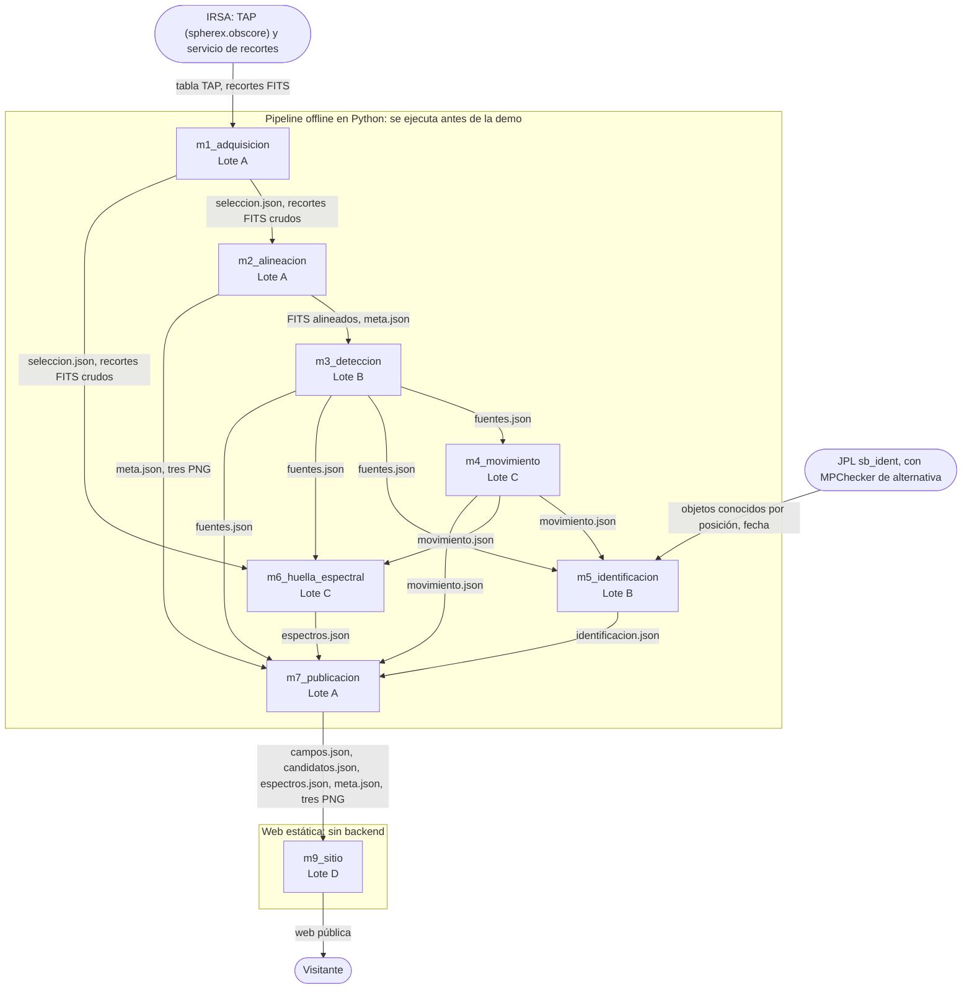

### Módulos

| Módulo | Lote | Propósito | Produce |
|---|---|---|---|
| `m1_adquisicion` | A | Obtener del archivo IRSA los recortes FITS de cada campo objetivo. | datos/m1_adquisicion/&lt;campo&gt;/seleccion.json (contrato seleccion)<br>datos/m1_adquisicion/&lt;campo&gt;/recortes/*.fits (contrato recortes_fits) |
| `m2_alineacion` | A | Poner las tres imágenes de un campo en la misma rejilla de píxeles. | datos/m2_alineacion/&lt;campo&gt;/epoca_a.fits, epoca_b.fits, plantilla.fits (contrato alineados_fits)<br>datos/m2_alineacion/&lt;campo&gt;/meta.json (contrato meta)<br>datos/m2_alineacion/&lt;campo&gt;/epoca_a.png, epoca_b.png, diferencia.png (contrato imagenes_png) |
| `m3_deteccion` | B | Encontrar las fuentes que cambian de posición entre la época A y la época B. | datos/m3_deteccion/&lt;campo&gt;/fuentes.json (contrato fuentes) |
| `m4_movimiento` | C | Medir cuánto se mueve cada pareja propuesta, con su incertidumbre. | datos/m4_movimiento/&lt;campo&gt;/movimiento.json (contrato movimiento) |
| `m5_identificacion` | B | Decir si cada pareja en movimiento corresponde a un objeto ya catalogado. | datos/m5_identificacion/&lt;campo&gt;/identificacion.json (contrato identificacion)<br>datos/m5_identificacion/cache/ (respuestas guardadas; van a git) |
| `m6_huella_espectral` | C | Construir el espectro infrarrojo de cada objeto en movimiento para estimar su naturaleza. | datos/m6_huella_espectral/&lt;campo&gt;/espectros.json (contrato espectros) |
| `m7_publicacion` | A | Dejar en un único directorio los datos que la web lee. | datos/m7_publicacion/campos.json (contrato campos)<br>datos/m7_publicacion/&lt;campo&gt;/candidatos.json (contrato candidatos)<br>datos/m7_publicacion/&lt;campo&gt;/meta.json, espectros.json, epoca_a.png, epoca_b.png, diferencia.png (copias) |
| `m9_sitio` | D | Mostrar al público qué se mueve en cada campo, con la naturaleza de cada objeto. | La web pública servida desde modulos/m9_sitio/index.html |

### Verificación de cada módulo en aislamiento

| Módulo | Comando de verificación | Criterio de aceptación |
|---|---|---|
| `m1_adquisicion` | `python -m pytest modulos/m1_adquisicion/pruebas -q` | 1. El seleccion.json generado desde un listado sintético valida contra contratos/seleccion.schema.json.<br>2. Las exposiciones con papel epoca_a, epoca_b, plantilla comparten el mismo detector.<br>3. La época A dista de la época B entre 0,5 y 72 horas.<br>4. La plantilla dista más de 120 días de la época A.<br>5. La prueba termina sin abrir ninguna conexión de red. |
| `m2_alineacion` | `python -m pytest modulos/m2_alineacion/pruebas -q` | 1. Con dos imágenes sintéticas de cinco estrellas cuyo WCS difiere en un desplazamiento conocido, los centroides coinciden tras alinear con un error máximo de 0,2 píxeles.<br>2. La extensión FLAGS alineada solo contiene valores enteros presentes en la original.<br>3. Los tres PNG miden 600 x 600 píxeles.<br>4. El meta.json generado valida contra contratos/meta.schema.json. |
| `m3_deteccion` | `python -m pytest modulos/m3_deteccion/pruebas -q` | 1. Una fuente falsa inyectada en una imagen de ruido se recupera con un error de posición máximo de 0,5 píxeles.<br>2. Las estrellas presentes en el mismo sitio de las tres imágenes salen con situacion igual a estacionaria.<br>3. Una única fuente desplazada entre A y B produce exactamente una pareja.<br>4. El fuentes.json generado valida contra contratos/fuentes.schema.json. |
| `m4_movimiento` | `python -m pytest modulos/m4_movimiento/pruebas -q` | 1. Con contratos/ejemplos/campo_ejemplo/fuentes.json, la velocidad de cada pareja difiere menos de un 1 % de la del ejemplo movimiento.json.<br>2. Una pareja con posiciones idénticas recibe la clase estacionaria.<br>3. La clase de cada pareja del ejemplo coincide con la del ejemplo movimiento.json.<br>4. El movimiento.json generado valida contra contratos/movimiento.schema.json. |
| `m5_identificacion` | `python -m pytest modulos/m5_identificacion/pruebas -q` | 1. Con una caché sintética, un objeto predicho a 5 segundos de arco da estado conocido.<br>2. Un objeto predicho a 30 segundos de arco da estado sin_identificar.<br>3. Una pareja no_concluyente sin coincidencia da estado artefacto_descartado.<br>4. La prueba termina sin abrir ninguna conexión de red.<br>5. El identificacion.json generado valida contra contratos/identificacion.schema.json. |
| `m6_huella_espectral` | `python -m pytest modulos/m6_huella_espectral/pruebas -q` | 1. Un cuerpo negro sintético de 300 K se recupera con una temperatura entre 270 y 330 K.<br>2. Un espectro sintético con un pico de emisión en 4,26 micras recibe el tipo cometa.<br>3. Un espectro de ruido puro recibe el tipo indeterminado.<br>4. El espectros.json generado valida contra contratos/espectros.schema.json. |
| `m7_publicacion` | `python -m pytest modulos/m7_publicacion/pruebas -q` | 1. El candidatos.json generado desde los ejemplos coincide valor a valor con contratos/ejemplos/campo_ejemplo/candidatos.json.<br>2. El campos.json generado desde los ejemplos coincide con contratos/ejemplos/campos.json.<br>3. Un JSON de entrada que incumple su esquema hace que control_publicacion termine con código distinto de cero.<br>4. Un archivo de 2 MB en el directorio publicado hace que control_publicacion termine con código distinto de cero. |
| `m9_sitio` | `node --test modulos/m9_sitio/pruebas/prueba_sitio.js` | 1. La lectura de contratos/ejemplos devuelve un campo con dos candidatos.<br>2. Un archivo con version_contrato distinta de 1 produce un error con el nombre del archivo.<br>3. Seleccionar un candidato avisa a todas las vistas suscritas una sola vez.<br>4. Las comprobaciones de pruebas/lista_visual.md quedan marcadas tras revisarlas en navegador. |

### Prueba de que el grafo es acíclico

**Afirmación.** El grafo de dependencias entre módulos no tiene ciclos.

**Prueba.** Cada módulo lleva un número en su nombre. La tabla lista, para cada módulo, todos los módulos cuyos datos lee:

| Módulo | Número | Lee datos de (número) | Capa |
|---|---|---|---|
| `m1_adquisicion` | 1 | ninguno | 0 |
| `m2_alineacion` | 2 | m1 (1) | 1 |
| `m3_deteccion` | 3 | m2 (2) | 2 |
| `m4_movimiento` | 4 | m3 (3) | 3 |
| `m5_identificacion` | 5 | m3 (3), m4 (4) | 4 |
| `m6_huella_espectral` | 6 | m1 (1), m3 (3), m4 (4) | 4 |
| `m7_publicacion` | 7 | m2 (2), m3 (3), m4 (4), m5 (5), m6 (6) | 5 |
| `m9_sitio` | 9 | m7 (7) | 6 |

En todas las filas, cada número de la tercera columna es estrictamente menor que el de la segunda. Toda arista del grafo va, por tanto, de un número menor a uno mayor. Un ciclo tendría que volver a su punto de partida, lo que exige al menos una arista de un número mayor a uno menor. No existe ninguna. Luego no hay ciclos, y el orden m1, m2, …, m9 es un orden topológico válido. ∎

La numeración salta el 8: `m8_calculadora` se retiró y no se renumeró `m9_sitio` para no romper rutas ni ramas.

**Capas** (un módulo solo depende de capas anteriores): {m1} → {m2} → {m3} → {m4} → {m5, m6} → {m7} → {m9}.

**Dentro de cada módulo** ocurre lo mismo con los archivos: en los diagramas de nivel 2, ninguna cadena de flechas entre archivos del mismo módulo vuelve a su origen (comprobado con un orden topológico al generar esta documentación).

**Cómo se mantiene.** Si un módulo necesitara un dato de un módulo con número mayor, la regla se rompería a la vista en esta tabla: el cambio se rechaza en revisión.

### Reparto en 4 lotes

| Lote | Perfil | Módulos | Carga estimada |
|---|---|---|---|
| **Lote A** | Datos: entrada del pipeline, alineación, publicación | `m1_adquisicion` (6 h)<br>`m2_alineacion` (6 h)<br>`m7_publicacion` (4 h) | 16 h |
| **Lote B** | Detección con validación en catálogos | `m3_deteccion` (12 h)<br>`m5_identificacion` (6 h) | 18 h |
| **Lote C** | Física: movimiento y espectro | `m4_movimiento` (4 h)<br>`m6_huella_espectral` (10 h) | 14 h |
| **Lote D** | Web pública | `m9_sitio` (18 h) | 18 h |

Las horas son estimaciones para repartir la carga, no un compromiso. Ningún lote necesita el código de otro: solo sus datos, de los que existe un ejemplo desde la hora 0.

## 3. Contratos de datos

Toda flecha entre dos módulos del nivel 1 está respaldada por un contrato de `contratos/`.

| Contrato | Dato | Lo produce | Lo consumen |
|---|---|---|---|
| `contratos/seleccion.schema.json` | seleccion.json | m1 | m2, m6 |
| `contratos/recortes_fits.md` | recortes FITS crudos | m1 | m2, m6 |
| `contratos/alineados_fits.md` | FITS alineados | m2 | m3 |
| `contratos/meta.schema.json` | meta.json | m2 | m3, m7, m9 |
| `contratos/imagenes_png.md` | tres PNG | m2 | m7, m9 |
| `contratos/fuentes.schema.json` | fuentes.json | m3 | m4, m5, m6, m7 |
| `contratos/movimiento.schema.json` | movimiento.json | m4 | m5, m6, m7 |
| `contratos/identificacion.schema.json` | identificacion.json | m5 | m7 |
| `contratos/espectros.schema.json` | espectros.json | m6 | m7, m9 |
| `contratos/candidatos.schema.json` | candidatos.json | m7 | m9 |
| `contratos/campos.schema.json` | campos.json | m7 | m9 |
| `contratos/plantillas.schema.json` | plantillas.json | m6 | m7, m9 |
| `contratos/catalogo.schema.json` | catalogo.json | m7 | m9 |
| `contratos/guia_visual.md` | variables de estilo | equipo | m9 |

Los contratos JSON son esquemas (JSON Schema 2020-12) que una herramienta estándar comprueba. Los contratos de FITS, de PNG, de estilo son documentos Markdown con su propia regla de verificación. Las convenciones comunes (unidades, identificadores, origen de píxeles) están en `contratos/LEEME.md`.

## 4. Nivel 2: módulos

Un diagrama por módulo: sus archivos con las dependencias internas. Los nodos redondeados son el exterior del módulo (otros módulos, servicios, el visitante).

<details>
<summary><strong>m1_adquisicion</strong> — Lote A — Obtener del archivo IRSA los recortes FITS de cada campo objetivo.</summary>

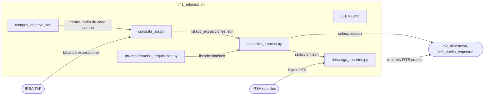

| Archivo | Responsabilidad única |
|---|---|
| `LEEME.md` | Describe el módulo junto a su comando de verificación. |
| `campos_objetivo.json` | Declara los campos del cielo que el pipeline debe procesar. |
| `consulta_sia.py` | Lista las exposiciones de SPHEREx que cubren un campo objetivo. |
| `indice_s3.py` | Lista las exposiciones sin TAP: lee las cabeceras de los FITS en la copia pública de AWS S3 y comprueba la cobertura con su WCS. |
| `seleccion_epocas.py` | Elige qué exposiciones cumplen cada papel del contrato de selección. |
| `descarga_recortes.py` | Descarga el recorte FITS de cada exposición seleccionada. |
| `pruebas/prueba_adquisicion.py` | Comprueba la selección de épocas sobre un listado sintético sin usar la red. |

</details>

<details>
<summary><strong>m2_alineacion</strong> — Lote A — Poner las tres imágenes de un campo en la misma rejilla de píxeles.</summary>

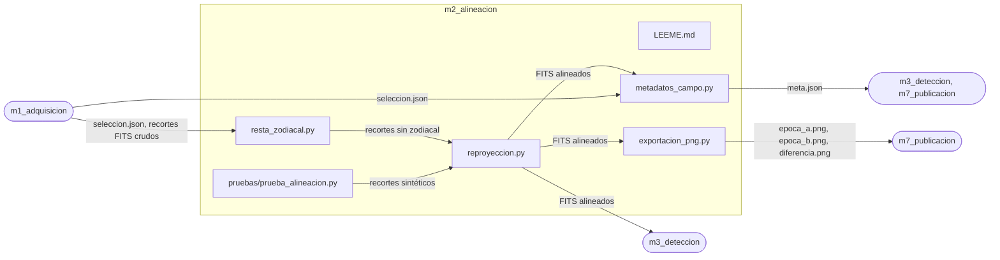

| Archivo | Responsabilidad única |
|---|---|
| `LEEME.md` | Describe el módulo junto a su comando de verificación. |
| `resta_zodiacal.py` | Resta la luz zodiacal de cada recorte crudo. |
| `reproyeccion.py` | Reproyecta cada imagen sobre la rejilla de la época A. |
| `metadatos_campo.py` | Escribe meta.json con los datos del campo alineado. |
| `exportacion_png.py` | Exporta las imágenes PNG que la web muestra. |
| `pruebas/prueba_alineacion.py` | Comprueba la alineación sobre imágenes sintéticas con estrellas desplazadas. |

</details>

<details>
<summary><strong>m3_deteccion</strong> — Lote B — Encontrar las fuentes que cambian de posición entre la época A y la época B.</summary>

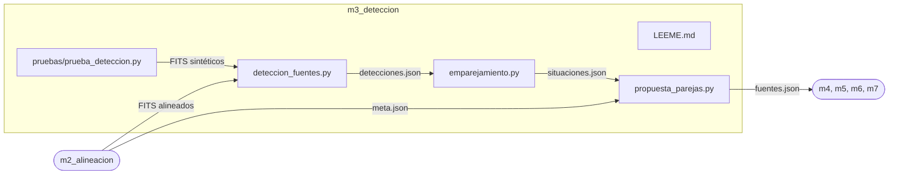

| Archivo | Responsabilidad única |
|---|---|
| `LEEME.md` | Describe el módulo junto a su comando de verificación. |
| `deteccion_fuentes.py` | Detecta las fuentes puntuales de cada imagen alineada. |
| `emparejamiento.py` | Separa las fuentes estacionarias de las fuentes huérfanas. |
| `propuesta_parejas.py` | Propone parejas A-B entre las fuentes huérfanas. |
| `pruebas/prueba_deteccion.py` | Comprueba la detección sobre imágenes de ruido con fuentes inyectadas. |

</details>

<details>
<summary><strong>m4_movimiento</strong> — Lote C — Medir cuánto se mueve cada pareja propuesta, con su incertidumbre.</summary>

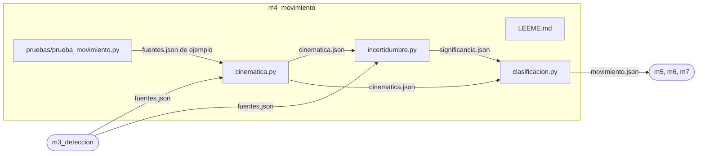

| Archivo | Responsabilidad única |
|---|---|
| `LEEME.md` | Describe el módulo junto a su comando de verificación. |
| `cinematica.py` | Calcula la velocidad angular de cada pareja propuesta. |
| `incertidumbre.py` | Propaga la incertidumbre de posición hasta la velocidad. |
| `clasificacion.py` | Asigna a cada pareja su clase de movimiento. |
| `pruebas/prueba_movimiento.py` | Comprueba las medidas de movimiento sobre el ejemplo del contrato. |

</details>

<details>
<summary><strong>m5_identificacion</strong> — Lote B — Decir si cada pareja en movimiento corresponde a un objeto ya catalogado.</summary>

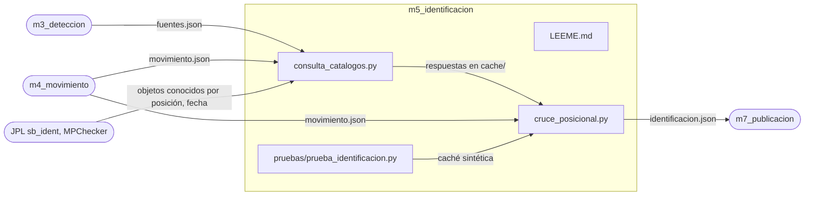

| Archivo | Responsabilidad única |
|---|---|
| `LEEME.md` | Describe el módulo junto a su comando de verificación. |
| `consulta_catalogos.py` | Obtiene la respuesta del catálogo de cuerpos menores para cada pareja en movimiento. |
| `cruce_posicional.py` | Decide el estado de catálogo de cada pareja. |
| `pruebas/prueba_identificacion.py` | Comprueba el cruce con una caché sintética sin usar la red. |

</details>

<details>
<summary><strong>m6_huella_espectral</strong> — Lote C — Construir el espectro infrarrojo de cada objeto en movimiento para estimar su naturaleza.</summary>

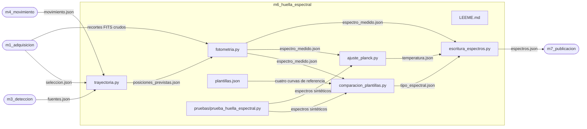

| Archivo | Responsabilidad única |
|---|---|
| `LEEME.md` | Describe el módulo junto a su comando de verificación. |
| `trayectoria.py` | Predice dónde está el objeto en el instante de cada exposición. |
| `fotometria.py` | Mide el flujo del objeto en cada exposición de la serie espectral. |
| `plantillas.json` | Contiene los espectros de referencia de los cuatro tipos de objeto. |
| `comparacion_plantillas.py` | Asigna al espectro medido el tipo de la plantilla más parecida. |
| `ajuste_planck.py` | Estima la temperatura del objeto ajustando la ley de Planck. |
| `identificacion_molecular.py` | Evalúa bandas de H2O, CH4, CO2, CO y NH3 con estados que no fuerzan detecciones. |
| `escritura_espectros.py` | Reúne medida, tipo, temperatura en el archivo del contrato. |
| `pruebas/prueba_huella_espectral.py` | Comprueba el ajuste espectral sobre espectros sintéticos. |

</details>

<details>
<summary><strong>m7_publicacion</strong> — Lote A — Dejar en un único directorio los datos que la web lee.</summary>

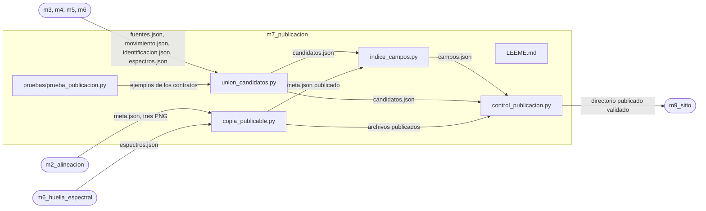

| Archivo | Responsabilidad única |
|---|---|
| `LEEME.md` | Describe el módulo junto a su comando de verificación. |
| `union_candidatos.py` | Une los resultados de cada pareja en candidatos.json. |
| `copia_publicable.py` | Copia al directorio publicado los archivos que la web lee sin cambios. |
| `indice_campos.py` | Escribe campos.json con la lista de campos publicados. |
| `indice_catalogo.py` | Escribe catalogo.json con objetos, datos disponibles y relacionados. |
| `control_publicacion.py` | Rechaza la publicación cuando un archivo incumple su contrato. |
| `pruebas/prueba_publicacion.py` | Comprueba la unión sobre los ejemplos de los contratos. |

</details>


<details>
<summary><strong>m9_sitio</strong> — Lote D — Mostrar al público qué se mueve en cada campo, con la naturaleza de cada objeto.</summary>

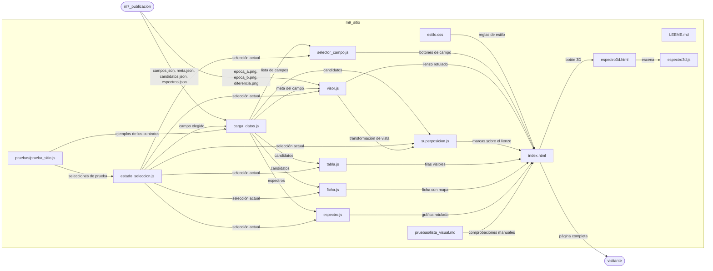

En este módulo las flechas indican quién necesita a quién para funcionar. Los clics del visitante viajan en sentido contrario (de `selector_campo.js`, `visor.js`, `tabla.js` hacia `estado_seleccion.js`) por suscripción: `estado_seleccion.js` no conoce a ninguna vista, así que la dependencia entre archivos sigue siendo acíclica.

| Archivo | Responsabilidad única |
|---|---|
| `LEEME.md` | Describe el módulo junto a su comando de verificación. |
| `index.html` | Define la portada con los contenedores de cada vista. |
| `estilo.css` | Aplica la guía visual con diseño adaptable a móvil. |
| `estado_seleccion.js` | Mantiene la selección actual de campo con su candidato. |
| `carga_datos.js` | Lee los archivos publicados de un campo. |
| `selector_campo.js` | Dibuja la lista de campos disponibles. |
| `visor.js` | Dibuja las dos épocas en el lienzo según el modo elegido. |
| `superposicion.js` | Dibuja sobre el visor la trayectoria de cada candidato. |
| `tabla.js` | Muestra la tabla ordenable de candidatos. |
| `ficha.js` | Muestra la ficha del candidato seleccionado. |
| `espectro.js` | Dibuja la huella espectral del candidato seleccionado. |
| `analisis.js` | Alterna explorador y «Análisis de objetos» y gestiona sus pestañas. |
| `catalogo.js`, `catalogo_logica.js` | Catálogo navegable: búsqueda, ficha, misma clasificación y espectros similares. |
| `comparador.js`, `comparador_logica.js` | Comparador de dos espectros observados y modo objeto frente a plantillas. |
| `composicion.js`, `composicion_logica.js` | Sección «Composición espectral» de las fichas. |
| `identificar.js`, `identificar_logica.js` | Clic en la imagen -> RA/DEC con el WCS, detección marcada y efemérides de SkyBoT. |
| `pruebas/prueba_sitio.js` | Comprueba la lectura de datos sobre los ejemplos de los contratos. |
| `pruebas/lista_visual.md` | Enumera las comprobaciones manuales de la web en navegador. |

</details>

## 5. Nivel 3: archivos

Cada recuadro es un archivo. Dentro, de izquierda a derecha: de dónde recibe, qué pasos da, a quién entrega. Cada flecha lleva el nombre del dato que circula. Los archivos sin lógica (datos, estructura, estilo, fichas) aparecen agrupados al final.

<details>
<summary><strong>m1_adquisicion</strong> — funcionamiento previsto de cada archivo</summary>

```mermaid
flowchart TB
  subgraph g1["consulta_sia.py"]
    direction LR
    g1o(["campos_objetivo.json"])
    g1p1["Consultar TAP en las colecciones de SPHEREx"]
    g1o -->|"centro, radio del campo"| g1p1
    g1p2["Ordenar por t_min"]
    g1p1 -->|"tabla de exposiciones"| g1p2
    g1d(["seleccion_epocas.py"])
    g1p2 -->|"listado_exposiciones.json"| g1d
  end
  subgraph g2["seleccion_epocas.py"]
    direction LR
    g2o(["consulta_sia.py"])
    g2p1["Agrupar por detector"]
    g2o -->|"listado_exposiciones.json"| g2p1
    g2p2["Elegir época A, época B separadas horas o días"]
    g2p1 -->|"grupos por detector"| g2p2
    g2p3["Elegir la plantilla de la otra pasada"]
    g2p2 -->|"pareja A-B"| g2p3
    g2p4["Añadir la serie espectral de todos los detectores"]
    g2p3 -->|"trío del mismo detector"| g2p4
    g2d(["descarga_recortes.py, m2, m6"])
    g2p4 -->|"seleccion.json"| g2d
  end
  subgraph g3["descarga_recortes.py"]
    direction LR
    g3o(["seleccion_epocas.py"])
    g3p1["Añadir center, size a cada url_acceso"]
    g3o -->|"seleccion.json"| g3p1
    g3p2["Pedir el recorte a IRSA"]
    g3p1 -->|"URL de recorte"| g3p2
    g3p3["Guardar con el nombre archivo_recorte"]
    g3p2 -->|"bytes FITS"| g3p3
    g3d(["m2, m6"])
    g3p3 -->|"recortes FITS crudos"| g3d
  end
  subgraph g4["pruebas/prueba_adquisicion.py"]
    direction LR
    g4o(["prueba"])
    g4p1["Ejecutar la selección de épocas"]
    g4o -->|"listado sintético"| g4p1
    g4p2["Validar contra seleccion.schema.json"]
    g4p1 -->|"seleccion.json temporal"| g4p2
    g4d(["pytest"])
    g4p2 -->|"veredicto"| g4d
  end
  subgraph gs["Archivos sin lógica"]
    s0["LEEME.md<br/>ficha del módulo, sin lógica"]
    s1["campos_objetivo.json<br/>datos sin lógica"]
  end
```

| Archivo | Rol | Lee | Produce | Cómo se verifica |
|---|---|---|---|---|
| `LEEME.md` | Describe el módulo junto a su comando de verificación. | Nada. | La ficha del módulo. | Cada archivo citado existe en el directorio. |
| `campos_objetivo.json` | Declara los campos del cielo que el pipeline debe procesar. | Nada: se edita a mano en la hora 0. | La lista de campos (campo, nombre, ra_grados, dec_grados, radio_grados) que lee consulta_sia.py. | Cada entrada tiene los cinco datos; el identificador campo solo usa minúsculas, cifras, guion bajo. |
| `consulta_sia.py` | Lista las exposiciones de SPHEREx que cubren un campo objetivo. | campos_objetivo.json; servicio TAP de IRSA. | datos/m1_adquisicion/&lt;campo&gt;/listado_exposiciones.json (intermedio interno). | El listado sale ordenado por t_min; cada fila tiene identificador, t_min, detector, access_url. |
| `seleccion_epocas.py` | Elige qué exposiciones cumplen cada papel del contrato de selección. | listado_exposiciones.json. | datos/m1_adquisicion/&lt;campo&gt;/seleccion.json. | El archivo valida contra contratos/seleccion.schema.json con un único epoca_a, un único epoca_b, una única plantilla. |
| `descarga_recortes.py` | Descarga el recorte FITS de cada exposición seleccionada. | seleccion.json; servicio de recortes de IRSA. | datos/m1_adquisicion/&lt;campo&gt;/recortes/&lt;id_exposicion&gt;.fits. | Existe un FITS por exposición de seleccion.json; cada uno cumple contratos/recortes_fits.md. |
| `pruebas/prueba_adquisicion.py` | Comprueba la selección de épocas sobre un listado sintético sin usar la red. | Un listado de exposiciones construido en memoria; contratos/seleccion.schema.json. | El veredicto de pytest. | Es el propio verificador: pasa cuando se cumplen los criterios de aceptación del módulo. |

</details>

<details>
<summary><strong>m2_alineacion</strong> — funcionamiento previsto de cada archivo</summary>


| Archivo | Rol | Lee | Produce | Cómo se verifica |
|---|---|---|---|---|
| `LEEME.md` | Describe el módulo junto a su comando de verificación. | Nada. | La ficha del módulo. | Cada archivo citado existe en el directorio. |
| `resta_zodiacal.py` | Resta la luz zodiacal de cada recorte crudo. | seleccion.json; recortes FITS crudos con papel epoca_a, epoca_b, plantilla. | datos/m2_alineacion/&lt;campo&gt;/sin_zodiacal/*.fits (intermedio interno). | La mediana de cada imagen resultante queda más cerca de cero que la mediana de IMAGE. |
| `reproyeccion.py` | Reproyecta cada imagen sobre la rejilla de la época A. | Recortes sin zodiacal. | epoca_a.fits, epoca_b.fits, plantilla.fits en datos/m2_alineacion/&lt;campo&gt;/. | Los tres FITS comparten forma de matriz con WCS idéntico; cumplen contratos/alineados_fits.md. |
| `metadatos_campo.py` | Escribe meta.json con los datos del campo alineado. | Cabeceras de los FITS alineados; seleccion.json. | datos/m2_alineacion/&lt;campo&gt;/meta.json. | El archivo valida contra contratos/meta.schema.json; horas_entre_a_b coincide con la resta de las dos fechas MJD. |
| `exportacion_png.py` | Exporta las imágenes PNG que la web muestra. | FITS alineados. | epoca_a.png, epoca_b.png, diferencia.png en datos/m2_alineacion/&lt;campo&gt;/. | Los tres PNG miden 600 x 600 píxeles; las estrellas fijas no saltan al alternar epoca_a.png con epoca_b.png. |
| `pruebas/prueba_alineacion.py` | Comprueba la alineación sobre imágenes sintéticas con estrellas desplazadas. | Dos imágenes sintéticas creadas en memoria; contratos/meta.schema.json. | El veredicto de pytest. | Es el propio verificador: pasa cuando se cumplen los criterios de aceptación del módulo. |

</details>

<details>
<summary><strong>m3_deteccion</strong> — funcionamiento previsto de cada archivo</summary>

```mermaid
flowchart TB
  subgraph g1["deteccion_fuentes.py"]
    direction LR
    g1o(["m2_alineacion"])
    g1p1["Enmascarar los píxeles marcados en FLAGS"]
    g1o -->|"FITS alineados"| g1p1
    g1p2["Estimar el fondo local"]
    g1p1 -->|"imagen enmascarada"| g1p2
    g1p3["Buscar picos sobre 5 veces el ruido"]
    g1p2 -->|"imagen sin fondo"| g1p3
    g1p4["Calcular señal/ruido con VARIANCE"]
    g1p3 -->|"posiciones x, y"| g1p4
    g1d(["emparejamiento.py"])
    g1p4 -->|"detecciones.json"| g1d
  end
  subgraph g2["emparejamiento.py"]
    direction LR
    g2o(["deteccion_fuentes.py"])
    g2p1["Emparejar por posición en el cielo entre A, B, plantilla"]
    g2o -->|"detecciones.json"| g2p1
    g2p2["Marcar estacionaria toda fuente fija en las tres imágenes"]
    g2p1 -->|"coincidencias"| g2p2
    g2p3["Marcar huérfana toda fuente sin coincidencia"]
    g2p2 -->|"fuentes estacionarias"| g2p3
    g2d(["propuesta_parejas.py"])
    g2p3 -->|"situaciones.json"| g2d
  end
  subgraph g3["propuesta_parejas.py"]
    direction LR
    g3o(["emparejamiento.py"])
    g3p1["Leer las horas entre A, B de meta.json"]
    g3o -->|"situaciones.json"| g3p1
    g3p2["Filtrar por separación, brillo parecido"]
    g3p1 -->|"separación máxima admisible"| g3p2
    g3p3["Escribir fuentes con parejas"]
    g3p2 -->|"parejas compatibles"| g3p3
    g3d(["m4, m5, m6, m7"])
    g3p3 -->|"fuentes.json"| g3d
  end
  subgraph g4["pruebas/prueba_deteccion.py"]
    direction LR
    g4o(["prueba"])
    g4p1["Ejecutar detección, emparejamiento, propuesta"]
    g4o -->|"FITS sintéticos con una fuente desplazada"| g4p1
    g4p2["Comparar con las posiciones inyectadas"]
    g4p1 -->|"fuentes.json temporal"| g4p2
    g4p3["Validar contra fuentes.schema.json"]
    g4p2 -->|"error en píxeles"| g4p3
    g4d(["pytest"])
    g4p3 -->|"veredicto"| g4d
  end
  subgraph gs["Archivos sin lógica"]
    s0["LEEME.md<br/>ficha del módulo, sin lógica"]
  end
```

| Archivo | Rol | Lee | Produce | Cómo se verifica |
|---|---|---|---|---|
| `LEEME.md` | Describe el módulo junto a su comando de verificación. | Nada. | La ficha del módulo. | Cada archivo citado existe en el directorio. |
| `deteccion_fuentes.py` | Detecta las fuentes puntuales de cada imagen alineada. | epoca_a.fits, epoca_b.fits, plantilla.fits. | datos/m3_deteccion/&lt;campo&gt;/detecciones.json (intermedio interno). | Cada detección tiene señal/ruido mayor o igual que 5; su incertidumbre de posición nunca baja de 0,5 segundos de arco. |
| `emparejamiento.py` | Separa las fuentes estacionarias de las fuentes huérfanas. | detecciones.json. | datos/m3_deteccion/&lt;campo&gt;/situaciones.json (intermedio interno). | Toda fuente recibe una situacion; ninguna fuente presente a menos de 1 píxel en las tres imágenes queda como huérfana. |
| `propuesta_parejas.py` | Propone parejas A-B entre las fuentes huérfanas. | situaciones.json; meta.json. | datos/m3_deteccion/&lt;campo&gt;/fuentes.json. | El archivo valida contra contratos/fuentes.schema.json; toda pareja une una fuente de epoca_a con una de epoca_b. |
| `pruebas/prueba_deteccion.py` | Comprueba la detección sobre imágenes de ruido con fuentes inyectadas. | Tres imágenes sintéticas creadas en memoria; contratos/fuentes.schema.json. | El veredicto de pytest. | Es el propio verificador: pasa cuando se cumplen los criterios de aceptación del módulo. |

</details>

<details>
<summary><strong>m4_movimiento</strong> — funcionamiento previsto de cada archivo</summary>

```mermaid
flowchart TB
  subgraph g1["cinematica.py"]
    direction LR
    g1o(["m3_deteccion"])
    g1p1["Leer posiciones, fechas de cada pareja"]
    g1o -->|"fuentes.json"| g1p1
    g1p2["Calcular la separación angular sobre la esfera"]
    g1p1 -->|"coordenadas, MJD"| g1p2
    g1p3["Dividir por las horas transcurridas"]
    g1p2 -->|"separación en segundos de arco"| g1p3
    g1d(["incertidumbre.py, clasificacion.py"])
    g1p3 -->|"cinematica.json"| g1d
  end
  subgraph g2["incertidumbre.py"]
    direction LR
    g2o(["cinematica.py"])
    g2p1["Leer las incertidumbres de posición de fuentes.json"]
    g2o -->|"cinematica.json"| g2p1
    g2p2["Combinar en cuadratura"]
    g2p1 -->|"sigma de A, sigma de B"| g2p2
    g2p3["Dividir la separación entre su sigma"]
    g2p2 -->|"sigma de la separación"| g2p3
    g2d(["clasificacion.py"])
    g2p3 -->|"significancia.json"| g2d
  end
  subgraph g3["clasificacion.py"]
    direction LR
    g3o(["incertidumbre.py"])
    g3p1["Leer la velocidad de cinematica.json"]
    g3o -->|"significancia.json"| g3p1
    g3p2["Aplicar los umbrales de significancia"]
    g3p1 -->|"medidas por pareja"| g3p2
    g3p3["Escribir el resultado"]
    g3p2 -->|"clase por pareja"| g3p3
    g3d(["m5, m6, m7"])
    g3p3 -->|"movimiento.json"| g3d
  end
  subgraph g4["pruebas/prueba_movimiento.py"]
    direction LR
    g4o(["prueba"])
    g4p1["Ejecutar cinemática, incertidumbre, clasificación"]
    g4o -->|"fuentes.json de ejemplo"| g4p1
    g4p2["Comparar con el movimiento.json de ejemplo"]
    g4p1 -->|"movimiento.json temporal"| g4p2
    g4p3["Comparar con el 1 %"]
    g4p2 -->|"diferencia relativa"| g4p3
    g4d(["pytest"])
    g4p3 -->|"veredicto"| g4d
  end
  subgraph gs["Archivos sin lógica"]
    s0["LEEME.md<br/>ficha del módulo, sin lógica"]
  end
```

| Archivo | Rol | Lee | Produce | Cómo se verifica |
|---|---|---|---|---|
| `LEEME.md` | Describe el módulo junto a su comando de verificación. | Nada. | La ficha del módulo. | Cada archivo citado existe en el directorio. |
| `cinematica.py` | Calcula la velocidad angular de cada pareja propuesta. | fuentes.json. | datos/m4_movimiento/&lt;campo&gt;/cinematica.json (intermedio interno). | La separación se mide sobre la esfera; la velocidad es separación entre horas transcurridas. |
| `incertidumbre.py` | Propaga la incertidumbre de posición hasta la velocidad. | fuentes.json; cinematica.json. | datos/m4_movimiento/&lt;campo&gt;/significancia.json (intermedio interno). | La incertidumbre de la separación es la suma en cuadratura de las dos incertidumbres de posición. |
| `clasificacion.py` | Asigna a cada pareja su clase de movimiento. | cinematica.json; significancia.json. | datos/m4_movimiento/&lt;campo&gt;/movimiento.json. | Significancia menor que 2 da estacionaria, entre 2 y 5 da no_concluyente, 5 o más da candidata; el archivo valida contra su esquema. |
| `pruebas/prueba_movimiento.py` | Comprueba las medidas de movimiento sobre el ejemplo del contrato. | contratos/ejemplos/campo_ejemplo/fuentes.json; contratos/ejemplos/campo_ejemplo/movimiento.json. | El veredicto de pytest. | Es el propio verificador: pasa cuando se cumplen los criterios de aceptación del módulo. |

</details>

<details>
<summary><strong>m5_identificacion</strong> — funcionamiento previsto de cada archivo</summary>

```mermaid
flowchart TB
  subgraph g1["consulta_catalogos.py"]
    direction LR
    g1o(["m3_deteccion, m4_movimiento"])
    g1p1["Leer posición, fecha de cada pareja no estacionaria"]
    g1o -->|"fuentes.json, movimiento.json"| g1p1
    g1p2["Buscar cada respuesta en la caché"]
    g1p1 -->|"consultas pendientes"| g1p2
    g1p3["Preguntar a JPL sb_ident, con MPChecker de alternativa"]
    g1p2 -->|"consultas sin respuesta guardada"| g1p3
    g1p4["Guardar la respuesta"]
    g1p3 -->|"respuesta nueva"| g1p4
    g1d(["cruce_posicional.py"])
    g1p4 -->|"respuestas en cache/"| g1d
  end
  subgraph g2["cruce_posicional.py"]
    direction LR
    g2o(["consulta_catalogos.py"])
    g2p1["Leer las posiciones predichas"]
    g2o -->|"respuestas en cache/"| g2p1
    g2p2["Medir la distancia a la posición observada"]
    g2p1 -->|"objetos conocidos cercanos"| g2p2
    g2p3["Comparar con la tolerancia de 15 segundos de arco"]
    g2p2 -->|"distancia en segundos de arco"| g2p3
    g2p4["Marcar artefacto_descartado toda pareja no_concluyente sin coincidencia"]
    g2p3 -->|"estado conocido o sin_identificar"| g2p4
    g2d(["m7"])
    g2p4 -->|"identificacion.json"| g2d
  end
  subgraph g3["pruebas/prueba_identificacion.py"]
    direction LR
    g3o(["prueba"])
    g3p1["Ejecutar el cruce posicional con la red bloqueada"]
    g3o -->|"caché sintética con objetos a 5, 30 segundos de arco"| g3p1
    g3p2["Comparar cada estado con el esperado"]
    g3p1 -->|"identificacion.json temporal"| g3p2
    g3d(["pytest"])
    g3p2 -->|"veredicto"| g3d
  end
  subgraph gs["Archivos sin lógica"]
    s0["LEEME.md<br/>ficha del módulo, sin lógica"]
  end
```

| Archivo | Rol | Lee | Produce | Cómo se verifica |
|---|---|---|---|---|
| `LEEME.md` | Describe el módulo junto a su comando de verificación. | Nada. | La ficha del módulo. | Cada archivo citado existe en el directorio. |
| `consulta_catalogos.py` | Obtiene la respuesta del catálogo de cuerpos menores para cada pareja en movimiento. | fuentes.json; movimiento.json; datos/m5_identificacion/cache/; API sb_ident de JPL. | Un archivo de respuesta por pareja en datos/m5_identificacion/cache/. | Una segunda ejecución sobre el mismo campo no abre ninguna conexión de red. |
| `cruce_posicional.py` | Decide el estado de catálogo de cada pareja. | Respuestas en cache/; fuentes.json; movimiento.json. | datos/m5_identificacion/&lt;campo&gt;/identificacion.json. | El archivo valida contra contratos/identificacion.schema.json; todo estado conocido lleva nombre_objeto con distancia_segarc menor o igual que 15. |
| `pruebas/prueba_identificacion.py` | Comprueba el cruce con una caché sintética sin usar la red. | Una caché creada en un directorio temporal; contratos/ejemplos/campo_ejemplo/fuentes.json; contratos/ejemplos/campo_ejemplo/movimiento.json. | El veredicto de pytest. | Es el propio verificador: pasa cuando se cumplen los criterios de aceptación del módulo. |

</details>

<details>
<summary><strong>m6_huella_espectral</strong> — funcionamiento previsto de cada archivo</summary>

```mermaid
flowchart TB
  subgraph g1["trayectoria.py"]
    direction LR
    g1o(["m1, m3, m4"])
    g1p1["Leer las posiciones A, B de cada pareja candidata"]
    g1o -->|"seleccion.json, fuentes.json, movimiento.json"| g1p1
    g1p2["Interpolar linealmente en el tiempo"]
    g1p1 -->|"dos puntos con fecha"| g1p2
    g1p3["Descartar las exposiciones sin el objeto dentro del recorte"]
    g1p2 -->|"posición por exposición"| g1p3
    g1d(["fotometria.py"])
    g1p3 -->|"posiciones_previstas.json"| g1d
  end
  subgraph g2["fotometria.py"]
    direction LR
    g2o(["trayectoria.py"])
    g2p1["Restar ZODI de IMAGE en cada recorte"]
    g2o -->|"posiciones_previstas.json"| g2p1
    g2p2["Leer la longitud de onda del píxel en WCS-WAVE"]
    g2p1 -->|"imagen sin zodiacal"| g2p2
    g2p3["Ajustar la PSF en la posición prevista"]
    g2p2 -->|"longitud de onda en micras"| g2p3
    g2p4["Promediar por detector cuando la señal/ruido es baja"]
    g2p3 -->|"flujo con error"| g2p4
    g2d(["comparacion_plantillas.py, ajuste_planck.py, escritura_espectros.py"])
    g2p4 -->|"espectro_medido.json"| g2d
  end
  subgraph g3["comparacion_plantillas.py"]
    direction LR
    g3o(["fotometria.py"])
    g3p1["Leer las cuatro curvas de plantillas.json"]
    g3o -->|"espectro_medido.json"| g3p1
    g3p2["Escalar cada plantilla por mínimos cuadrados"]
    g3p1 -->|"plantillas remuestreadas"| g3p2
    g3p3["Elegir el menor"]
    g3p2 -->|"chi cuadrado reducido por tipo"| g3p3
    g3d(["escritura_espectros.py"])
    g3p3 -->|"tipo_espectral.json"| g3d
  end
  subgraph g4["ajuste_planck.py"]
    direction LR
    g4o(["fotometria.py"])
    g4p1["Separar los puntos del continuo"]
    g4o -->|"espectro_medido.json"| g4p1
    g4p2["Ajustar Planck por mínimos cuadrados"]
    g4p1 -->|"puntos fuera de bandas"| g4p2
    g4p3["Aplicar la ley de Wien"]
    g4p2 -->|"temperatura con incertidumbre"| g4p3
    g4d(["escritura_espectros.py"])
    g4p3 -->|"temperatura.json"| g4d
  end
  subgraph g5["escritura_espectros.py"]
    direction LR
    g5o(["comparacion_plantillas.py, ajuste_planck.py"])
    g5p1["Leer espectro_medido.json"]
    g5o -->|"tipo_espectral.json, temperatura.json"| g5p1
    g5p2["Unir por id_pareja"]
    g5p1 -->|"puntos por objeto"| g5p2
    g5p3["Escribir según el contrato"]
    g5p2 -->|"registro por objeto"| g5p3
    g5d(["m7"])
    g5p3 -->|"espectros.json"| g5d
  end
  subgraph g6["pruebas/prueba_huella_espectral.py"]
    direction LR
    g6o(["prueba"])
    g6p1["Ejecutar comparación, ajuste de Planck"]
    g6o -->|"cuerpo negro de 300 K, espectro con pico en 4,26 micras"| g6p1
    g6p2["Comparar con cometa, con el intervalo de 270 a 330 K"]
    g6p1 -->|"tipo, temperatura"| g6p2
    g6d(["pytest"])
    g6p2 -->|"veredicto"| g6d
  end
  subgraph gs["Archivos sin lógica"]
    s0["LEEME.md<br/>ficha del módulo, sin lógica"]
    s1["plantillas.json<br/>datos sin lógica"]
  end
```

| Archivo | Rol | Lee | Produce | Cómo se verifica |
|---|---|---|---|---|
| `LEEME.md` | Describe el módulo junto a su comando de verificación. | Nada. | La ficha del módulo. | Cada archivo citado existe en el directorio. |
| `trayectoria.py` | Predice dónde está el objeto en el instante de cada exposición. | seleccion.json; fuentes.json; movimiento.json. | datos/m6_huella_espectral/&lt;campo&gt;/posiciones_previstas.json (intermedio interno). | La posición prevista en la fecha de la época A coincide con la observada en A, igual que en B. |
| `fotometria.py` | Mide el flujo del objeto en cada exposición de la serie espectral. | posiciones_previstas.json; recortes FITS crudos. | datos/m6_huella_espectral/&lt;campo&gt;/espectro_medido.json (intermedio interno). | Cada punto tiene longitud de onda entre 0,75 y 5,0 micras, flujo, error positivo, fecha MJD. |
| `plantillas.json` | Contiene los espectros de referencia de los cuatro tipos de objeto. | Nada: se rellena a mano desde bibliografía. | Las cuatro curvas (asteroide_rocoso, asteroide_oscuro, cometa, enana_marron) que lee comparacion_plantillas.py. | Hay cuatro plantillas; cada una cubre de 0,75 a 5,0 micras con flujo normalizado. |
| `comparacion_plantillas.py` | Asigna al espectro medido el tipo de la plantilla más parecida. | espectro_medido.json; plantillas.json. | datos/m6_huella_espectral/&lt;campo&gt;/tipo_espectral.json (intermedio interno). | Cada objeto recibe un chi cuadrado reducido por plantilla; el tipo es el del menor, o indeterminado si ninguno baja del umbral. |
| `ajuste_planck.py` | Estima la temperatura del objeto ajustando la ley de Planck. | espectro_medido.json. | datos/m6_huella_espectral/&lt;campo&gt;/temperatura.json (intermedio interno). | El producto del pico de Wien por la temperatura vale 2898 micras kelvin con un error menor que 1. |
| `identificacion_molecular.py` | Evalúa, banda por banda, rasgos de H2O, CH4, CO2, CO y NH3. | espectro_medido.json; tipo_espectral.json. | datos/m6_huella_espectral/&lt;campo&gt;/composicion.json (intermedio interno). | Una banda de CO2 sintética de 8 sigmas sale detectada; el ruido puro y los continuos curvos no dan detecciones; un espectro por detector sale datos_insuficientes. |
| `escritura_espectros.py` | Reúne medida, tipo, temperatura en el archivo del contrato. | espectro_medido.json; tipo_espectral.json; temperatura.json. | datos/m6_huella_espectral/&lt;campo&gt;/espectros.json. | El archivo valida contra contratos/espectros.schema.json; hay un espectro por pareja candidata medida. |
| `pruebas/prueba_huella_espectral.py` | Comprueba el ajuste espectral sobre espectros sintéticos. | Espectros sintéticos creados en memoria; contratos/espectros.schema.json. | El veredicto de pytest. | Es el propio verificador: pasa cuando se cumplen los criterios de aceptación del módulo. |

</details>

<details>
<summary><strong>m7_publicacion</strong> — funcionamiento previsto de cada archivo</summary>


| Archivo | Rol | Lee | Produce | Cómo se verifica |
|---|---|---|---|---|
| `LEEME.md` | Describe el módulo junto a su comando de verificación. | Nada. | La ficha del módulo. | Cada archivo citado existe en el directorio. |
| `union_candidatos.py` | Une los resultados de cada pareja en candidatos.json. | fuentes.json; movimiento.json; identificacion.json; espectros.json. | datos/m7_publicacion/&lt;campo&gt;/candidatos.json. | El archivo valida contra contratos/candidatos.schema.json; no contiene ninguna pareja de clase estacionaria. |
| `copia_publicable.py` | Copia al directorio publicado los archivos que la web lee sin cambios. | meta.json, epoca_a.png, epoca_b.png, diferencia.png de m2; espectros.json de m6. | Los mismos cinco archivos en datos/m7_publicacion/&lt;campo&gt;/. | Cada copia es idéntica byte a byte a su original. |
| `indice_campos.py` | Escribe campos.json con la lista de campos publicados. | Los directorios de datos/m7_publicacion/ con su meta.json, su candidatos.json. | datos/m7_publicacion/campos.json. | El archivo valida contra contratos/campos.schema.json; numero_candidatos coincide con el recuento real. |
| `indice_catalogo.py` | Escribe el catálogo navegable. | campos.json y, de cada campo, meta, candidatos y espectros publicados. | datos/m7_publicacion/catalogo.json. | Valida contra contratos/catalogo.schema.json; no lista artefactos ni anuncia espectros que no existen. |
| `control_publicacion.py` | Rechaza la publicación cuando un archivo incumple su contrato. | Todo el contenido de datos/m7_publicacion/; los esquemas de contratos/. | Un informe por pantalla con código de salida 0 si todo cumple. | Con los ejemplos sale con código 0; con un JSON inválido o un archivo de más de 1 MB sale con código distinto de cero. |
| `pruebas/prueba_publicacion.py` | Comprueba la unión sobre los ejemplos de los contratos. | Los siete JSON de contratos/ejemplos/campo_ejemplo/; contratos/ejemplos/campos.json. | El veredicto de pytest. | Es el propio verificador: pasa cuando se cumplen los criterios de aceptación del módulo. |

</details>


<details>
<summary><strong>m9_sitio</strong> — funcionamiento previsto de cada archivo</summary>

```mermaid
flowchart TB
  subgraph g1["estado_seleccion.js"]
    direction LR
    g1o(["vistas"])
    g1p1["Guardar la selección"]
    g1o -->|"campo elegido, id de candidato"| g1p1
    g1p2["Avisar a las vistas suscritas"]
    g1p1 -->|"selección actual"| g1p2
    g1d(["carga_datos.js, vistas"])
    g1p2 -->|"aviso de cambio"| g1d
  end
  subgraph g2["carga_datos.js"]
    direction LR
    g2o(["m7_publicacion"])
    g2p1["Leer campos.json"]
    g2o -->|"campos.json, meta.json, candidatos.json, espectros.json"| g2p1
    g2p2["Leer los tres JSON del campo elegido"]
    g2p1 -->|"lista de campos"| g2p2
    g2p3["Comprobar version_contrato"]
    g2p2 -->|"datos sin comprobar"| g2p3
    g2d(["vistas"])
    g2p3 -->|"datos del campo en memoria"| g2d
  end
  subgraph g3["selector_campo.js"]
    direction LR
    g3o(["carga_datos.js"])
    g3p1["Dibujar un botón por campo"]
    g3o -->|"lista de campos"| g3p1
    g3p2["Comunicar el clic"]
    g3p1 -->|"botones"| g3p2
    g3d(["estado_seleccion.js"])
    g3p2 -->|"campo elegido"| g3d
  end
  subgraph g4["visor.js"]
    direction LR
    g4o(["m7_publicacion"])
    g4p1["Componer el fotograma del modo parpadeo, cortina o diferencia"]
    g4o -->|"epoca_a.png, epoca_b.png, diferencia.png"| g4p1
    g4p2["Aplicar zoom, arrastre"]
    g4p1 -->|"fotograma"| g4p2
    g4p3["Rotular fechas con tiempo transcurrido de meta.json"]
    g4p2 -->|"transformación de vista"| g4p3
    g4d(["superposicion.js, visitante"])
    g4p3 -->|"lienzo rotulado"| g4d
  end
  subgraph g5["superposicion.js"]
    direction LR
    g5o(["carga_datos.js"])
    g5p1["Convertir coordenadas de rejilla a coordenadas de lienzo"]
    g5o -->|"posiciones A, B de cada candidato"| g5p1
    g5p2["Trazar círculo con flecha de A a B"]
    g5p1 -->|"puntos en pantalla"| g5p2
    g5p3["Resaltar el candidato seleccionado"]
    g5p2 -->|"marcas"| g5p3
    g5d(["visitante"])
    g5p3 -->|"marcas sobre el lienzo"| g5d
  end
  subgraph g6["tabla.js"]
    direction LR
    g6o(["carga_datos.js"])
    g6p1["Ordenar por la columna elegida"]
    g6o -->|"candidatos"| g6p1
    g6p2["Filtrar por clase de movimiento"]
    g6p1 -->|"filas ordenadas"| g6p2
    g6p3["Comunicar el clic de fila"]
    g6p2 -->|"filas visibles"| g6p3
    g6d(["estado_seleccion.js"])
    g6p3 -->|"id de candidato"| g6d
  end
  subgraph g7["ficha.js"]
    direction LR
    g7o(["estado_seleccion.js"])
    g7p1["Buscar el registro del candidato"]
    g7o -->|"id de candidato"| g7p1
    g7p2["Redactar el estado de catálogo con la palabra candidato"]
    g7p1 -->|"registro"| g7p2
    g7p3["Centrar el mapa Aladin Lite en su posición"]
    g7p2 -->|"texto de la ficha"| g7p3
    g7d(["visitante"])
    g7p3 -->|"ficha con mapa"| g7d
  end
  subgraph g8["espectro.js"]
    direction LR
    g8o(["estado_seleccion.js"])
    g8p1["Buscar los puntos del espectro"]
    g8o -->|"id de candidato"| g8p1
    g8p2["Ordenar los puntos por fecha"]
    g8p1 -->|"longitud de onda, flujo, error, fecha"| g8p2
    g8p3["Rellenar la gráfica banda a banda"]
    g8p2 -->|"secuencia temporal"| g8p3
    g8p4["Rotular tipo con temperatura"]
    g8p3 -->|"animación"| g8p4
    g8d(["visitante"])
    g8p4 -->|"gráfica rotulada"| g8d
  end
  subgraph g9["pruebas/prueba_sitio.js"]
    direction LR
    g9o(["prueba"])
    g9p1["Ejecutar carga_datos.js, estado_seleccion.js"]
    g9o -->|"ejemplos de los contratos"| g9p1
    g9p2["Comparar con dos candidatos, con un aviso por vista"]
    g9p1 -->|"datos en memoria, avisos"| g9p2
    g9d(["node --test"])
    g9p2 -->|"veredicto"| g9d
  end
  subgraph gs["Archivos sin lógica"]
    s0["LEEME.md<br/>ficha del módulo, sin lógica"]
    s1["index.html<br/>estructura sin lógica"]
    s2["estilo.css<br/>estilo sin lógica"]
    s3["pruebas/lista_visual.md<br/>lista de control sin lógica"]
  end
```

| Archivo | Rol | Lee | Produce | Cómo se verifica |
|---|---|---|---|---|
| `LEEME.md` | Describe el módulo junto a su comando de verificación. | Nada. | La ficha del módulo. | Cada archivo citado existe en el directorio. |
| `index.html` | Define la portada con los contenedores de cada vista. | estilo.css; los ocho archivos .js de trabajo del módulo; Aladin Lite v3 con Chart.js por CDN. | La estructura que el navegador muestra: selector de campo, visor, tabla, ficha y espectro. | La página abre sin errores de consola y muestra el explorador con los datos de un campo. |
| `estilo.css` | Aplica la guía visual con diseño adaptable a móvil. | Los valores de contratos/guia_visual.md, copiados a mano. | Las reglas de estilo que usa index.html. | Las seis variables de color tienen los valores exactos de la guía; por debajo de 700 px de ancho el visor queda encima de la tabla. |
| `estado_seleccion.js` | Mantiene la selección actual de campo con su candidato. | Los clics que le comunican selector_campo.js, visor.js, tabla.js. | Un aviso de cambio para cada vista suscrita. | Cada cambio de selección avisa una sola vez a cada vista suscrita. |
| `carga_datos.js` | Lee los archivos publicados de un campo. | campos.json, meta.json, candidatos.json, espectros.json de datos/m7_publicacion/ (o de contratos/ejemplos/ en modo prueba). | Los datos del campo en memoria para las vistas. | Con contratos/ejemplos devuelve dos candidatos; con otra version_contrato falla nombrando el archivo. |
| `selector_campo.js` | Dibuja la lista de campos disponibles. | La lista de campos de carga_datos.js. | Un botón por campo; el campo elegido pasa a estado_seleccion.js. | Aparece un botón por cada entrada de campos.json. |
| `visor.js` | Dibuja las dos épocas en el lienzo según el modo elegido. | epoca_a.png, epoca_b.png, diferencia.png; meta.json a través de carga_datos.js. | El lienzo con la imagen, las fechas de A, B, el tiempo transcurrido. | Los tres modos (parpadeo, cortina, diferencia) cambian la imagen; la rueda hace zoom; el arrastre desplaza. |
| `superposicion.js` | Dibuja sobre el visor la trayectoria de cada candidato. | candidatos de carga_datos.js; la transformación de vista de visor.js; la selección actual. | Un círculo en cada posición con una flecha de A a B; el candidato seleccionado resaltado. | Con los ejemplos aparecen dos flechas; cada una empieza en posicion_a. |
| `tabla.js` | Muestra la tabla ordenable de candidatos. | candidatos de carga_datos.js; la selección actual. | Las filas visibles; el id de la fila pulsada pasa a estado_seleccion.js. | Pulsar una cabecera reordena las filas; el filtro por clase oculta las demás. |
| `ficha.js` | Muestra la ficha del candidato seleccionado. | candidatos de carga_datos.js; la selección actual; Aladin Lite v3. | El panel con datos, estado de catálogo, mapa del cielo centrado en el objeto. | La ficha siempre contiene la palabra candidato; un estado conocido muestra nombre con distancia al catálogo. |
| `espectro.js` | Dibuja la huella espectral del candidato seleccionado. | espectros de carga_datos.js; la selección actual; Chart.js. | La gráfica de flujo frente a longitud de onda, rotulada con tipo, temperatura. | Los puntos aparecen en orden de fecha de observación; el eje horizontal va de 0,75 a 5,0 micras. |
| `catalogo.js` | Dibuja el catálogo navegable y la ficha del objeto. | catalogo.json; espectros.json del campo. | Lista con búsqueda y filtros; ficha con dos listas de relacionados. | Buscar «slipher» deja una fila; «Comparar» abre el comparador con los dos objetos. |
| `comparador.js` | Compara dos espectros observados o un objeto con las plantillas. | espectros.json de todos los campos; plantillas.json. | Gráfica con incertidumbres, modos flujo, normalizado y plantillas, avisos. | Solo lista objetos con espectro válido; el texto dice «más compatible entre las evaluadas». |
| `composicion.js` | Muestra la composición molecular de m6. | composicion de espectros.json. | Sección «Composición espectral» con franjas teóricas y una tarjeta por molécula. | No aparece sin espectro utilizable; cada estado va escrito. |
| `identificar.js` | Identifica una fuente elegida en la imagen. | meta.json con wcs; candidatos; SkyBoT (IMCCE). | Píxel, RA/DEC, época y coincidencias con su veredicto. | Sin wcs no hay coordenadas; la proyección coincide con astropy a menos de 1 mas. |
| `pruebas/prueba_sitio.js` | Comprueba la lectura de datos sobre los ejemplos de los contratos. | contratos/ejemplos/campos.json; contratos/ejemplos/campo_ejemplo/meta.json, candidatos.json, espectros.json. | El veredicto de node --test. | Es el propio verificador: pasa cuando se cumplen los tres primeros criterios de aceptación del módulo. |
| `pruebas/lista_visual.md` | Enumera las comprobaciones manuales de la web en navegador. | Nada: la rellena quien revisa la web. | Ocho casillas marcadas o sin marcar. | Las ocho casillas quedan marcadas en un ordenador, igual que en un móvil. |
</details>

## 6. Archivos fuera de los módulos

| Archivo | Rol |
|---|---|
| `.gitignore` | Declara qué archivos generados quedan fuera de git. |
| `ARQUITECTURA.md` | Describe la arquitectura en tres niveles con sus diagramas. |
| `README.md` | Presenta el proyecto con su análisis completo. |
| `contratos/LEEME.md` | Describe la capa de contratos con sus reglas de cambio. |
| `contratos/alineados_fits.md` | Fija la rejilla común de las tres imágenes alineadas. |
| `contratos/campos.schema.json` | Fija la forma del índice de campos publicados. |
| `contratos/candidatos.schema.json` | Fija la forma de lo que la web muestra de cada pareja. |
| `contratos/ejemplos/campo_ejemplo/candidatos.json` | Ejemplo escrito a mano del contrato candidatos. |
| `contratos/ejemplos/campo_ejemplo/espectros.json` | Ejemplo escrito a mano del contrato espectros. |
| `contratos/ejemplos/campo_ejemplo/fuentes.json` | Ejemplo escrito a mano del contrato fuentes. |
| `contratos/ejemplos/campo_ejemplo/identificacion.json` | Ejemplo escrito a mano del contrato identificacion. |
| `contratos/ejemplos/campo_ejemplo/meta.json` | Ejemplo escrito a mano del contrato meta. |
| `contratos/ejemplos/campo_ejemplo/movimiento.json` | Ejemplo escrito a mano del contrato movimiento. |
| `contratos/ejemplos/campo_ejemplo/seleccion.json` | Ejemplo escrito a mano del contrato seleccion. |
| `contratos/ejemplos/campos.json` | Ejemplo escrito a mano del contrato campos. |
| `contratos/espectros.schema.json` | Fija la forma de la huella espectral de cada pareja candidata. |
| `contratos/fuentes.schema.json` | Fija la forma de las fuentes detectadas con sus parejas propuestas. |
| `contratos/guia_visual.md` | Fija los colores con las tipografías comunes a las dos páginas. |
| `contratos/identificacion.schema.json` | Fija la forma del estado de catálogo de cada pareja. |
| `contratos/imagenes_png.md` | Fija tamaño, contraste, orientación de las imágenes de la web. |
| `contratos/meta.schema.json` | Fija la forma de los datos del campo alineado. |
| `contratos/movimiento.schema.json` | Fija la forma de la medida de movimiento de cada pareja. |
| `contratos/recortes_fits.md` | Fija las extensiones que debe traer cada recorte crudo. |
| `contratos/seleccion.schema.json` | Fija la forma de la lista de exposiciones elegidas para un campo. |
| `datos/LEEME.md` | Describe el directorio de datos generados. Nada de aquí entra en git. |
| `pytest.ini` | Declara el nombrado en español de las pruebas para pytest. |
| `requirements.txt` | Declara las dependencias de Python del pipeline. |

## 7. Árbol completo

```text
AstroNova/
├── contratos/
│   ├── ejemplos/
│   │   ├── campo_ejemplo/
│   │   │   ├── candidatos.json             Ejemplo escrito a mano del contrato candidatos.
│   │   │   ├── espectros.json              Ejemplo escrito a mano del contrato espectros.
│   │   │   ├── fuentes.json                Ejemplo escrito a mano del contrato fuentes.
│   │   │   ├── identificacion.json         Ejemplo escrito a mano del contrato identificacion.
│   │   │   ├── meta.json                   Ejemplo escrito a mano del contrato meta.
│   │   │   ├── movimiento.json             Ejemplo escrito a mano del contrato movimiento.
│   │   │   └── seleccion.json              Ejemplo escrito a mano del contrato seleccion.
│   │   └── campos.json                     Ejemplo escrito a mano del contrato campos.
│   ├── LEEME.md                            Describe la capa de contratos con sus reglas de cambio.
│   ├── alineados_fits.md                   Fija la rejilla común de las tres imágenes alineadas.
│   ├── campos.schema.json                  Fija la forma del índice de campos publicados.
│   ├── catalogo.schema.json                Fija la forma del catálogo navegable de objetos.
│   ├── plantillas.schema.json              Fija la forma de las curvas de referencia publicadas.
│   ├── candidatos.schema.json              Fija la forma de lo que la web muestra de cada pareja.
│   ├── espectros.schema.json               Fija la forma de la huella espectral de cada pareja candidata.
│   ├── fuentes.schema.json                 Fija la forma de las fuentes detectadas con sus parejas propuestas.
│   ├── guia_visual.md                      Fija los colores con las tipografías comunes a las dos páginas.
│   ├── identificacion.schema.json          Fija la forma del estado de catálogo de cada pareja.
│   ├── imagenes_png.md                     Fija tamaño, contraste, orientación de las imágenes de la web.
│   ├── meta.schema.json                    Fija la forma de los datos del campo alineado.
│   ├── movimiento.schema.json              Fija la forma de la medida de movimiento de cada pareja.
│   ├── recortes_fits.md                    Fija las extensiones que debe traer cada recorte crudo.
│   └── seleccion.schema.json               Fija la forma de la lista de exposiciones elegidas para un campo.
├── datos/
│   └── LEEME.md                            Describe los datos generados. Nada de aquí entra en git.
├── modulos/
│   ├── m1_adquisicion/
│   │   ├── pruebas/
│   │   │   └── prueba_adquisicion.py       Comprueba la selección de épocas sobre un listado sintético sin usar la red.
│   │   ├── LEEME.md                        Describe el módulo junto a su comando de verificación.
│   │   ├── campos_objetivo.json            Declara los campos del cielo que el pipeline debe procesar.
│   │   ├── consulta_sia.py                 Lista las exposiciones de SPHEREx que cubren un campo objetivo.
│   │   ├── indice_s3.py                    Lista exposiciones sin TAP: cabeceras de los FITS en AWS S3 y su WCS.
│   │   ├── descarga_recortes.py            Descarga el recorte FITS de cada exposición seleccionada.
│   │   └── seleccion_epocas.py             Elige qué exposiciones cumplen cada papel del contrato de selección.
│   ├── m2_alineacion/
│   │   ├── pruebas/
│   │   │   └── prueba_alineacion.py        Comprueba la alineación sobre imágenes sintéticas con estrellas desplazadas.
│   │   ├── LEEME.md                        Describe el módulo junto a su comando de verificación.
│   │   ├── exportacion_png.py              Exporta las imágenes PNG que la web muestra.
│   │   ├── metadatos_campo.py              Escribe meta.json con los datos del campo alineado.
│   │   ├── reproyeccion.py                 Reproyecta cada imagen sobre la rejilla de la época A.
│   │   └── resta_zodiacal.py               Resta la luz zodiacal de cada recorte crudo.
│   ├── m3_deteccion/
│   │   ├── pruebas/
│   │   │   └── prueba_deteccion.py         Comprueba la detección sobre imágenes de ruido con fuentes inyectadas.
│   │   ├── LEEME.md                        Describe el módulo junto a su comando de verificación.
│   │   ├── deteccion_fuentes.py            Detecta las fuentes puntuales de cada imagen alineada.
│   │   ├── emparejamiento.py               Separa las fuentes estacionarias de las fuentes huérfanas.
│   │   └── propuesta_parejas.py            Propone parejas A-B entre las fuentes huérfanas.
│   ├── m4_movimiento/
│   │   ├── pruebas/
│   │   │   └── prueba_movimiento.py        Comprueba las medidas de movimiento sobre el ejemplo del contrato.
│   │   ├── LEEME.md                        Describe el módulo junto a su comando de verificación.
│   │   ├── cinematica.py                   Calcula la velocidad angular de cada pareja propuesta.
│   │   ├── clasificacion.py                Asigna a cada pareja su clase de movimiento.
│   │   └── incertidumbre.py                Propaga la incertidumbre de posición hasta la velocidad.
│   ├── m5_identificacion/
│   │   ├── pruebas/
│   │   │   └── prueba_identificacion.py    Comprueba el cruce con una caché sintética sin usar la red.
│   │   ├── LEEME.md                        Describe el módulo junto a su comando de verificación.
│   │   ├── consulta_catalogos.py           Obtiene la respuesta del catálogo de cuerpos menores para cada pareja en movimiento.
│   │   └── cruce_posicional.py             Decide el estado de catálogo de cada pareja.
│   ├── m6_huella_espectral/
│   │   ├── pruebas/
│   │   │   └── prueba_huella_espectral.py  Comprueba el ajuste espectral sobre espectros sintéticos.
│   │   ├── LEEME.md                        Describe el módulo junto a su comando de verificación.
│   │   ├── ajuste_planck.py                Estima la temperatura del objeto ajustando la ley de Planck.
│   │   ├── identificacion_molecular.py     Evalúa bandas de H2O, CH4, CO2, CO, NH3 sin forzar detecciones.
│   │   ├── comparacion_plantillas.py       Asigna al espectro medido el tipo de la plantilla más parecida.
│   │   ├── escritura_espectros.py          Reúne medida, tipo, temperatura en el archivo del contrato.
│   │   ├── fotometria.py                   Mide el flujo del objeto en cada exposición de la serie espectral.
│   │   ├── plantillas.json                 Contiene los espectros de referencia de los cuatro tipos de objeto.
│   │   └── trayectoria.py                  Predice dónde está el objeto en el instante de cada exposición.
│   ├── m7_publicacion/
│   │   ├── pruebas/
│   │   │   └── prueba_publicacion.py       Comprueba la unión sobre los ejemplos de los contratos.
│   │   ├── LEEME.md                        Describe el módulo junto a su comando de verificación.
│   │   ├── control_publicacion.py          Rechaza la publicación cuando un archivo incumple su contrato.
│   │   ├── copia_publicable.py             Copia al directorio publicado los archivos que la web lee sin cambios.
│   │   ├── indice_campos.py                Escribe campos.json con la lista de campos publicados.
│   │   ├── indice_catalogo.py              Escribe catalogo.json: objetos, datos y relacionados.
│   │   └── union_candidatos.py             Une los resultados de cada pareja en candidatos.json.
│   └── m9_sitio/
│       ├── pruebas/
│       │   ├── lista_visual.md             Enumera las comprobaciones manuales de la web en navegador.
│       │   ├── prueba_catalogo.js          Comprueba la búsqueda y los textos del catálogo.
│       │   ├── prueba_comparador.js        Comprueba normalización, compatibilidad y plantillas.
│       │   ├── prueba_composicion.js       Comprueba cuándo y cómo se muestra la composición.
│       │   ├── prueba_identificar.js       Comprueba la proyección TAN contra astropy y SkyBoT.
│       │   ├── prueba_sitio.js             Comprueba la lectura de datos sobre los ejemplos de los contratos.
│       │   └── wcs_referencia.json         Valores de astropy para la prueba del WCS.
│       ├── LEEME.md                        Describe el módulo junto a su comando de verificación.
│       ├── analisis.js                     Alterna explorador y análisis; pestañas.
│       ├── carga_datos.js                  Lee los archivos publicados de un campo.
│       ├── catalogo.js                     Catálogo navegable con ficha y relacionados.
│       ├── catalogo_logica.js              Búsqueda, filtros y textos del catálogo.
│       ├── comparador.js                   Comparador de dos espectros y modo plantillas.
│       ├── comparador_logica.js            Objetos válidos, normalización, compatibilidad.
│       ├── composicion.js                  Sección «Composición espectral» de las fichas.
│       ├── composicion_logica.js           Orden y textos de la composición.
│       ├── espectro.js                     Dibuja la huella espectral del candidato seleccionado.
│       ├── espectro3d.html                 Página aparte con las huellas espectrales del campo en 3D.
│       ├── espectro3d.js                   Escena WebGL con un listón por candidata.
│       ├── estado_seleccion.js             Mantiene la selección actual de campo con su candidato.
│       ├── estilo.css                      Aplica la guía visual con diseño adaptable a móvil.
│       ├── ficha.js                        Muestra la ficha del candidato seleccionado.
│       ├── identificar.js                  Clic -> RA/DEC, detección marcada y SkyBoT.
│       ├── identificar_logica.js           Proyección TAN, lienzo <-> píxel, SkyBoT.
│       ├── index.html                      Define la portada con los contenedores de cada vista.
│       ├── selector_campo.js               Dibuja la lista de campos disponibles.
│       ├── superposicion.js                Dibuja sobre el visor la trayectoria de cada candidato.
│       ├── tabla.js                        Muestra la tabla ordenable de candidatos.
│       └── visor.js                        Dibuja las dos épocas en el lienzo según el modo elegido.
├── .gitignore                              Declara qué archivos generados quedan fuera de git.
├── ARQUITECTURA.md                         Describe la arquitectura en tres niveles con sus diagramas.
├── README.md                               Presenta el proyecto con su análisis completo.
├── pytest.ini                              Declara el nombrado en español de las pruebas para pytest.
└── requirements.txt                        Declara las dependencias de Python del pipeline.
```

## 8. Orden de ejecución

Los módulos se ejecutan en el orden de su número, campo a campo. Dentro de cada módulo, el orden figura en su `LEEME.md`.

```text
m1_adquisicion → m2_alineacion → m3_deteccion → m4_movimiento → m5_identificacion → m6_huella_espectral → m7_publicacion
```

`m5_identificacion` y `m6_huella_espectral` no dependen entre sí: pueden ejecutarse a la vez. `m9_sitio` no se ejecuta en el pipeline: es una página estática.

## 9. Prototipo eliminado

El repositorio contenía un prototipo anterior formado por 15 archivos vacíos. Esta arquitectura no reutiliza su estructura. Se eliminaron:

- `ciencia/movimiento.py`
- `pipeline/alinear.py`
- `pipeline/catalogos.py`
- `pipeline/descarga.py`
- `pipeline/detectar.py`
- `pipeline/emparejar.py`
- `pipeline/ensamblar.py`
- `docs/index.html`
- `docs/estilo.css`
- `docs/ficha.js`
- `docs/tabla.js`
- `docs/visor.js`
- `docs/game/game.html`
- `docs/game/game.js`
- `docs/game/game.css`

También se retiraron de `requirements.txt` las dependencias `fastapi`, `uvicorn` (no hay backend), `pandas`, `Pillow` (ningún módulo las usa).

## 10. Fuera de alcance

- **Minijuego** de encontrar el objeto: figuraba en la propuesta como extra y llegó a implementarse dentro de `m9_sitio`. **Se retiró**: la web queda en dos pantallas (portada y explorador) y el juego no tenía contrato ni salida propios.
- **Modo ciudadano** («¿Es real?»): opcional en la propuesta. Exige guardar votos, es decir, un backend. Incompatible con el sitio estático.
- **Textos en inglés**, **descarga de la tabla en CSV**, **botón de compartir**.
- **Orquestador único** del pipeline: se evita a propósito. Un archivo que lanzara todos los módulos tendría que conocerlos a todos. El orden de ejecución está escrito en `ARQUITECTURA.md`.
