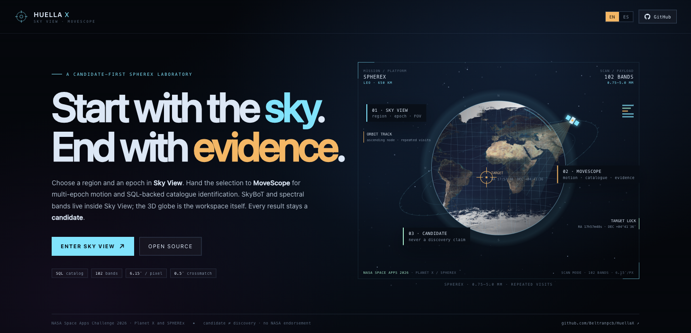
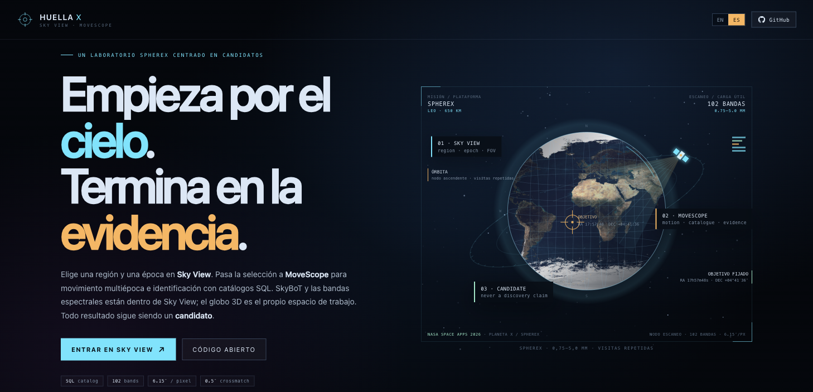
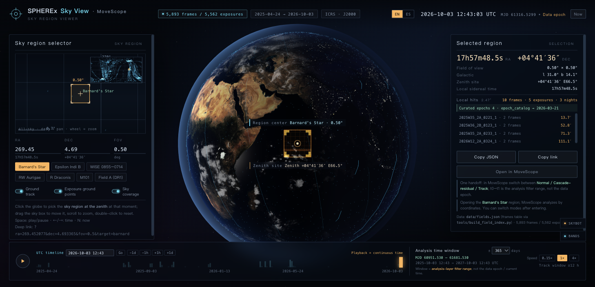
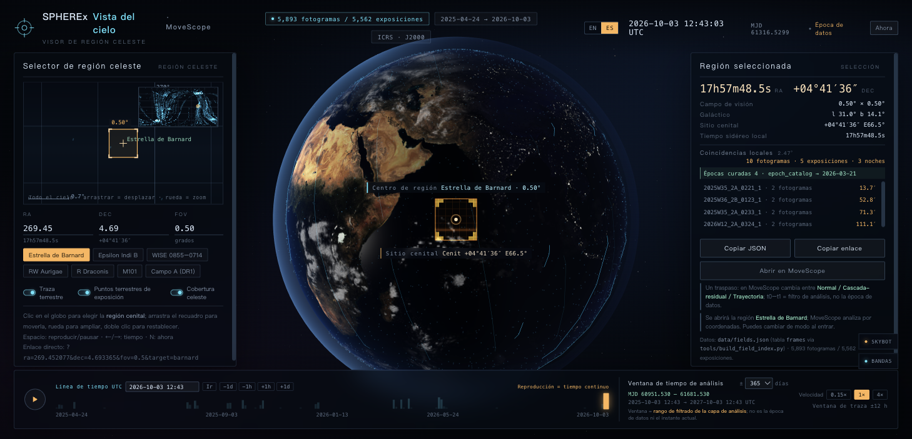
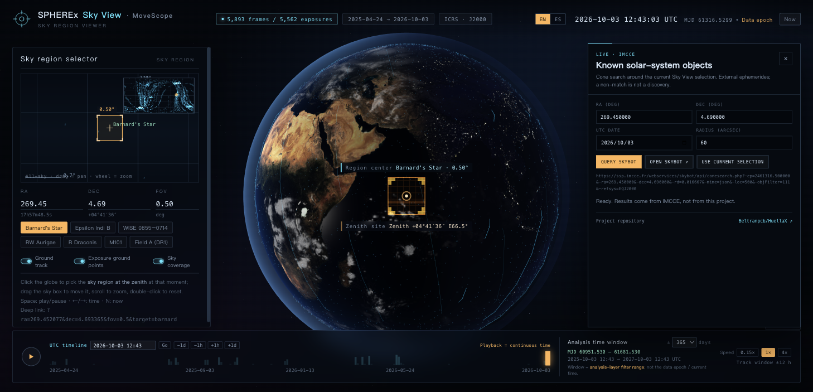
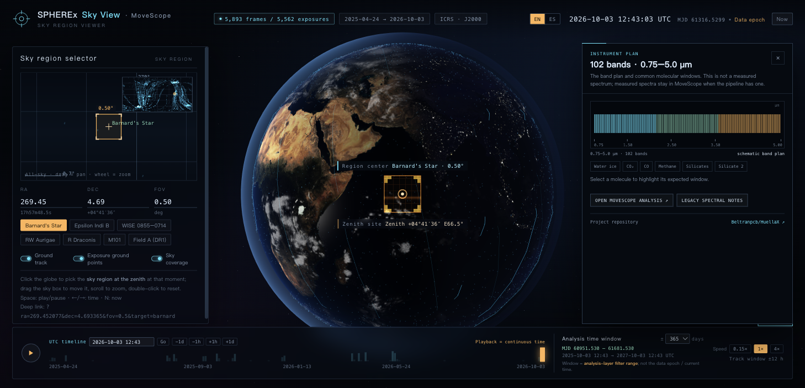
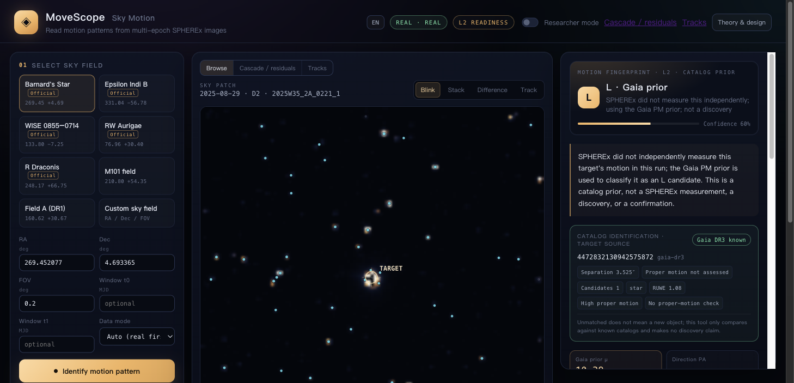
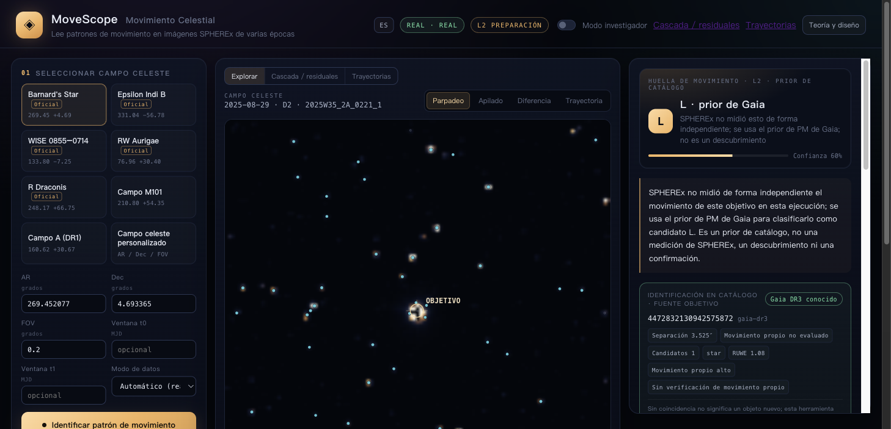

# HuellaX

[English](README.md) | **Español**

> **Empieza por el cielo. Termina en la evidencia.**
> Un laboratorio SPHEREx centrado en candidatos: elige una región en Sky View,
> pásala a MoveScope y revisa el contexto de catálogo y espectral. El globo 3D es el propio espacio de trabajo.

[](LICENSE)
[](#datos-y-procedencia)
[](#límites-científicos)



---

## 1. Qué es HuellaX

HuellaX es un entorno abierto y local para analizar imágenes de **SPHEREx**.
Se construye alrededor de una regla:

> **Un candidato no es un descubrimiento.** Un `no_match` de catálogo no es un
> planeta nuevo. Dos épocas no demuestran un objeto nuevo.

El proyecto combina:

- **MoveScope** — recortes SPHEREx multiépoca, fotometría en WCS común, modelos
  de movimiento y variabilidad, identificación en catálogos, lotes, trayectorias
  y exportaciones auditables.
- **Sky View** — la entrada principal a los datos: globo/cielo 3D, selección de
  región y época, ventana temporal de análisis y un único handoff a MoveScope.
- **Módulos de evidencia dentro de Sky View** — SkyBoT y atlas de bandas del
  instrumento. Cada uno declara su límite de evidencia; el globo 3D es el espacio de trabajo.
- **AstroNova / HUELLA X** — el prototipo de NASA Space Apps Challenge 2026,
  conservado en `astro/` como referencia legacy, nunca como ruta principal.

La envoltura pública de este repositorio está en inglés/español y no contiene
texto en chino. El runtime principal y sus datos SQLite viven en el submódulo
`system/`.

**Repositorio:** <https://github.com/Beltranpcb/HuellaX>

---

## 2. La experiencia

```text
Página de entrada
   │  Entrar en Sky View
   ▼
Sky View ── región + época + ventana de análisis
   │  un handoff: ra, dec, fov, t0, t1, from=view
   ▼
MoveScope ── épocas SQL, movimiento/variabilidad, identidad de catálogo
   │
   ├── modos Normal / Cascade-residual / Track
   ├── identificación por lotes de fuentes A/C
   ├── directorio unificado de candidatos
   └── exportaciones CSV/JSON auditables

Dentro de Sky View:
   ├── SkyBoT    objetos conocidos del sistema solar (efemérides externas)
   ├── Bandas    plan de 102 bandas + ventanas moleculares
```

### Página de entrada

La entrada es deliberadamente ligera: presenta la cadena de evidencia y ofrece
una acción principal, **Entrar en Sky View**. El repositorio GitHub aparece en
la cabecera, junto a la acción principal y en el pie.



### Sky View — el espacio principal



Sky View es donde se eligen:

- RA / Dec / campo de visión;
- época de observación y línea temporal UTC;
- ventana de análisis (`t0`–`t1`);
- objetivos predefinidos o una región personalizada.

El handoff es un clic y una URL. No hay un segundo punto de entrada al análisis.



---

## 3. Módulos de evidencia

Los módulos no son tarjetas decorativas. Están diseñados según lo que el
proyecto puede sostener hoy.

### SkyBoT — objetos conocidos del sistema solar



- Usa la RA/Dec/MJD actuales de Sky View.
- Construye una consulta de cono real a IMCCE SkyBoT.
- Muestra un **sin objeto conocido** externo en lugar de inventar una
  coincidencia.
- Ofrece un enlace externo cuando el navegador no puede leer la respuesta.
- Un no_match no es un descubrimiento.

### Bandas — plan del instrumento, no un espectro medido



- 102 bandas de SPHEREx entre 0,75 y 5,0 µm.
- Ventanas moleculares habituales: hielo de agua, CO₂, CO, metano, silicatos.
- La interacción es esquemática pero se basa en el plan real de bandas.
- El panel dice explícitamente: **no es un espectro medido**.
- Los espectros medidos permanecen en MoveScope cuando el pipeline los tiene.

---

## 4. MoveScope



MoveScope es el destino del análisis. Una ejecución informa:

- modo de datos (`REAL`, `HYBRID`, `SAMPLE`, `SIM` cuando corresponde);
- número de épocas utilizables y línea base;
- huella de movimiento / evidencia de variabilidad;
- clase de movimiento con confianza y falsadores;
- estado de identidad de catálogo: `known`, `ambiguous`, `no_match`,
  `insufficient`, `unavailable` o `conflict`;
- nivel de preparación L0–L3 y límites de los datos.



La interfaz permite cambiar entre **Normal**, **Cascade / residuals** y
**Tracks** sin salir del mismo lienzo de análisis. Las fuentes A/C se pueden
identificar por lotes, unir en un directorio unificado de candidatos y exportar
como CSV o JSON.

---

## 5. Arquitectura

```text
Envoltura HuellaX
├── index.html                  página de entrada bilingüe
├── README.md / README.es.md
├── INTEGRATION.md              límites de integración y mapeo del upstream
├── start.sh / stop.sh          wrappers del lanzador principal
├── scripts/                    servidor de portada y comprobaciones
├── docs/screenshots/           imágenes del README
├── astro/                      AstroNova legacy (UI española, demo sintética)
└── system/                     submódulo git: runtime principal MoveScope
    ├── app/                    API MoveScope + UI + pruebas
    ├── database/               catálogo SQLite y servicio de catálogo B
    ├── anyfield/               servicio de cobertura de campo arbitrario C
    └── viewer/                 Sky View + módulos de evidencia
```

### Servicios

| Servicio | Puerto por defecto | Función |
|---|---:|---|
| API de BD | 8797 | catálogo SQLite, épocas, cobertura, procedencia |
| App MoveScope | 8790 | análisis, lotes, cascada, trayectorias, exportaciones |
| Sky View | 8830 | selección de región/época y un único handoff |
| Catálogo B | 8799 | servicio SQLite Gaia + 2MASS/WISE derivado |
| AnyField C | 8798 | cobertura/descubrimiento de campo arbitrario |
| Página de entrada | 8840 | entrada estática bilingüe |

---

## 6. Datos y procedencia

**SQL es la fuente principal.**

- `system/` contiene el catálogo SQLite y el catálogo separado Gaia/2MASS/WISE
  que usa el servicio B.
- Las tablas 2MASS/WISE son subconjuntos derivados del cruce con Gaia, no
  catálogos completos de todo el cielo.
- La identificación usa una coincidencia posicional con Gaia como primario y
  deduplicación de 0,5 arcsec.
- El JSON local es un respaldo offline explícito para objetivos predefinidos; no
  es una segunda fuente de verdad.
- El JSON/PNG estático de AstroNova en `astro/datos/` es legacy/demo y no está
  conectado a la ruta SQL.

### Vocabulario de candidatos

| Estado | Significado |
|---|---|
| `known` | Asociación de catálogo dentro de la tolerancia probada |
| `ambiguous` | Más de una asociación plausible |
| `no_match` | Ninguna asociación en el conjunto probado; **no** es un objeto nuevo |
| `insufficient` | Los datos no permiten responder |
| `unavailable` | Servicio o catálogo requerido no disponible |
| `conflict` | Las fuentes discrepan; no se fuerza una conclusión |

---

## 7. Inicio rápido

### Requisitos

- Python 3.11+ con las dependencias del submódulo principal
- Git con soporte de submódulos
- Un navegador con WebGL2 para Sky View

### Clonar

```bash
git clone --recurse-submodules https://github.com/Beltranpcb/HuellaX.git
cd HuellaX
```

Si falta el submódulo:

```bash
git submodule update --init --recursive
```

### Arrancar el runtime principal

```bash
./start.sh
```

Arranca el stack SQL básico:

```text
BD 8797 · MoveScope 8790 · Sky View 8830
```

### Arrancar la página de entrada

```bash
./scripts/serve_cover.sh
# http://127.0.0.1:8840/
```

### Servicios de evidencia opcionales

El catálogo B y AnyField C son opcionales en esta envoltura pública. El
submódulo principal contiene sus lanzadores y su runbook:

- B en 8799 es necesario para la identificación en catálogo.
- C en 8798 es necesario para cobertura/descubrimiento de campo arbitrario.

Abrir:

- entrada: <http://127.0.0.1:8840/>
- MoveScope: <http://127.0.0.1:8790/>
- Sky View: <http://127.0.0.1:8830/>

Detener:

```bash
./stop.sh
```

---

## 8. Funciones principales

- Recuperación de recortes SPHEREx multiépoca y fotometría en WCS común.
- Familia de modelos movimiento/variabilidad con BIC, incertidumbre y readiness.
- Gaia DR3 más identificación derivada 2MASS/WISE.
- Identificación por lotes A/C y directorio unificado de candidatos.
- Vistas cascada/residuales y tracklets en el mismo lienzo.
- Cobertura/descubrimiento de campo arbitrario.
- Exportaciones CSV/JSON con procedencia.
- Línea temporal, reproducción, ventana de tiempo y un único handoff en Sky View.
- Módulos SkyBoT y atlas de bandas.
- UI con inglés primario y selector español completo.

---

## 9. Validación

El proyecto se probó localmente con la integración completa:

| Comprobación | Resultado |
|---|---|
| Suite de la app | **298 tests OK** |
| Smoke de Sky View | **65 PASS / 0 FAIL / 0 WARN** |
| Comprobaciones de la envoltura | **48 PASS** |
| Aceptación T1 | **45 PASS / 0 FAIL / 1 WARN** |
| Comprobador de deriva T6 | **0 ERROR** |
| Lanzador integrado | **6/6 servicios sanos** |
| Prueba funcional de candidato | Barnard: `REAL`, 4 épocas, `L`, prior de catálogo |

El informe de evidencia está en [`docs/integration/FUNCTIONAL-TEST.md`](docs/integration/FUNCTIONAL-TEST.md).

---

## 10. Límites científicos

HuellaX evita deliberadamente exagerar:

- no usa “planeta nuevo” ni “descubrimiento” para candidatos;
- no presenta la demo sintética de AstroNova como observación;
- no presenta un `no_match` como objeto nuevo;
- no presenta plantillas espectrales sintéticas como composición medida;
- no fabrica una ingesta TAP exitosa cuando el servicio no está disponible.

La demo sintética de AstroNova sirve como referencia de interfaz y pipeline. Su
validación con datos reales y Gaia estaba pendiente al integrar.

---

## 11. AstroNova legacy

`astro/` conserva el upstream AstroNova / HUELLA X:

- <https://github.com/Beltranpcb/AstroNova>
- commit `1253925ab13419b5d44db323548784c939a93a6e`
- NASA Space Apps Challenge 2026, Planet X and SPHEREx

En el momento de la integración el upstream no tenía LICENSE. El propietario
confirmó que el código puede incluirse como código abierto. Se conserva con
atribución y **no** se relicencia bajo Apache License 2.0, que cubre el trabajo
original MoveScope. Ver [`astro/LEGACY.md`](astro/LEGACY.md),
[`astro/UPSTREAM.md`](astro/UPSTREAM.md) y
[`THIRD_PARTY_NOTICES.md`](THIRD_PARTY_NOTICES.md).

NASA no respalda este proyecto ni ningún producto o servicio comercial.

---

## 12. Licencia y enlaces

- Trabajo original MoveScope/HuellaX: **Apache-2.0**, ver [`LICENSE`](LICENSE).
- Datos/software de terceros: [`THIRD_PARTY_NOTICES.md`](THIRD_PARTY_NOTICES.md).
- Referencias: [`REFERENCES.md`](REFERENCES.md).
- Diseño de integración: [`INTEGRATION.md`](INTEGRATION.md).
- Repositorio: <https://github.com/Beltranpcb/HuellaX>

**Candidato ≠ descubrimiento.**
