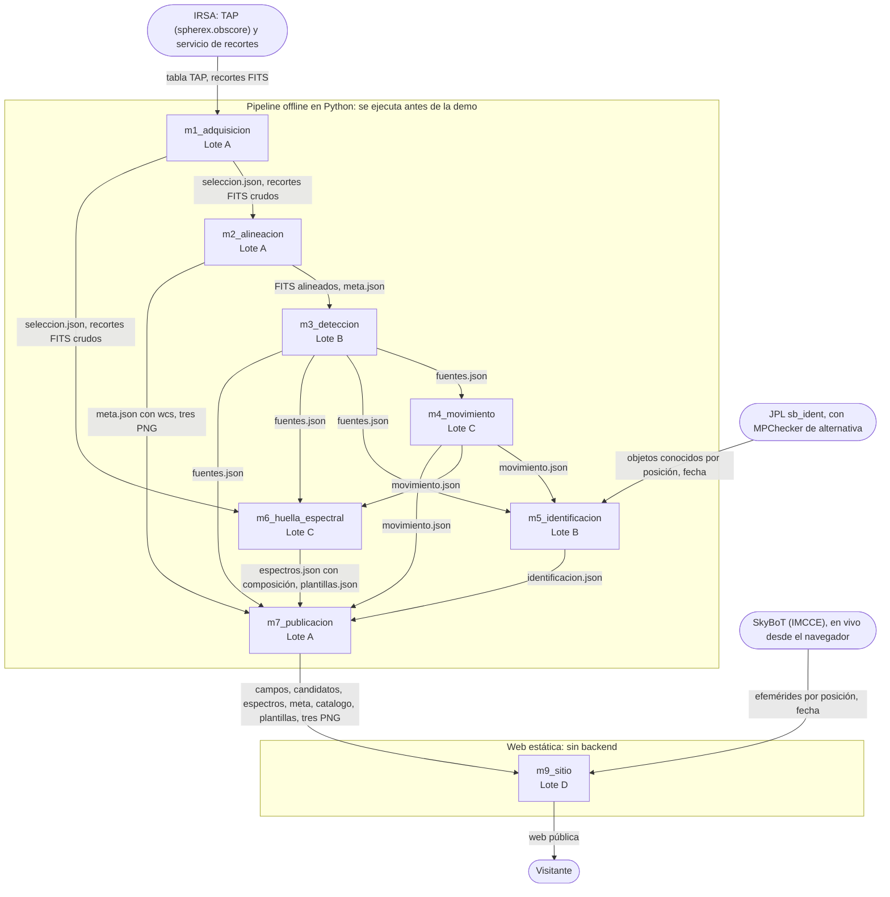

<!--
  ARCHIVO: README.md
  ROL: Presenta el proyecto con sus funcionalidades, el valor de cada una y su arquitectura.
  LEE: Nada.
  PRODUCE: La portada del repositorio en GitHub.
  VERIFICACION: Cada archivo citado existe en el repositorio; cada funcionalidad del apartado 3
                corresponde a un archivo de modulos/m9_sitio/ o a un módulo del pipeline.
-->

# HUELLA X

**No solo vemos qué se mueve en el cielo: sabemos de qué está hecho.**

Proyecto del equipo AstroNova para NASA Space Apps 2026, reto **SPHEREx / Planeta X**.

HUELLA X es una web pública que muestra qué se mueve entre dos observaciones del telescopio SPHEREx, comprueba si ese objeto ya era conocido y lee su espectro infrarrojo para decir, con prudencia, de qué está hecho.

## Índice

1. [El problema](#1-el-problema)
2. [La solución](#2-la-solución)
3. [Funcionalidades y aporte de valor](#3-funcionalidades-y-aporte-de-valor)
4. [Datos utilizados](#4-datos-utilizados)
5. [Arquitectura](#5-arquitectura)
6. [Cómo verificar](#6-cómo-verificar)
7. [Plan de trabajo para 4 desarrolladores](#7-plan-de-trabajo-para-4-desarrolladores)
8. [Publicación de la web](#8-publicación-de-la-web)
9. [Límites y riesgos](#9-límites-y-riesgos)
10. [Qué se eliminó del prototipo anterior](#10-qué-se-eliminó-del-prototipo-anterior)
11. [Fuera de alcance](#11-fuera-de-alcance)

## 1. El problema

SPHEREx observa todo el cielo en 102 bandas infrarrojas (de 0,75 a 5,0 micras) y lo repite cada seis meses. Cada imagen espectral pesa unos 70 MB (2040 × 2040 píxeles). Ese volumen de datos es casi invisible para el público y difícil de usar para estudiantes. Hay tres obstáculos concretos:

- **El tiempo está escondido.** Las herramientas actuales muestran las imágenes una a una. No enseñan qué ha cambiado entre dos visitas.
- **El espectro está escondido.** Por su filtro lineal variable, cada imagen mide una longitud de onda distinta en cada fila. Reconstruir el espectro de una fuente exige combinar muchas exposiciones.
- **Detectar no es identificar.** Un punto que se mueve puede ser un asteroide, un cometa, una estrella cercana o un artefacto. Un comparador de imágenes se queda en la detección: no dice nada sobre la naturaleza física del objeto.

El reto pide hacer visible la dimensión temporal de los mapas de SPHEREx. Nuestra tesis: esa dimensión solo cobra sentido científico cuando se combina con la espectral. **Posición + tiempo + espectro.**

## 2. La solución

Para cada objeto que se mueve entre dos épocas de SPHEREx, HUELLA X responde tres preguntas, en este orden:

| Pregunta | Función | Qué ve el visitante | Módulos |
|---|---|---|---|
| ¿Qué se ha movido? | **Detector temporal** | Dos épocas en modo parpadeo, cortina o diferencia, con la trayectoria dibujada encima. | m1, m2, m3, m4, m9 |
| ¿Ya lo conocíamos? | **Verificador** | Cada pareja etiquetada como conocida (con su nombre), candidata sin identificar o artefacto descartado. | m5, m9 |
| ¿De qué está hecho? | **Huella espectral** | El espectro de 0,75 a 5,0 micras rellenándose banda a banda, el tipo asignado, la temperatura estimada y la composición molecular. | m6, m9 |

Sobre esas tres preguntas, la sección **Análisis de objetos** añade herramientas para ir más lejos: un catálogo navegable, un identificador por clic con efemérides en vivo y un comparador de espectros.

**Regla de lenguaje.** La web dice siempre «candidato», nunca «descubrimiento». Dos detecciones no demuestran un objeto nuevo. Y un objeto sin coincidencia en los catálogos se presenta como «no identificado», nunca como «Planeta X».

## 3. Funcionalidades y aporte de valor

Esta es la lista completa de lo que hace la web. Para cada funcionalidad se indica qué hace y qué aporta a quien la usa.

### 3.1 Explorador: ver el tiempo

| Funcionalidad | Qué hace | Aporte de valor |
|---|---|---|
| **Visor de épocas** (`visor.js`) | Muestra las dos observaciones de un campo en tres modos: **parpadeo** (alterna A y B), **cortina** (franja deslizante A \| B) y **diferencia** (B menos A en dos tonos). Zoom de 1× a 8× y arrastre. Rotula las fechas de cada época y el tiempo transcurrido. | Hace visible lo que ninguna herramienta de imágenes sueltas enseña: **qué ha cambiado**. El ojo humano detecta un punto que salta mejor que cualquier tabla, así que un visitante sin formación ve el movimiento en segundos. |
| **Trayectorias superpuestas** (`superposicion.js`) | Dibuja sobre la imagen un círculo en la posición A y una flecha hacia la posición B de cada candidato. Color por estado: verde conocido, ámbar sin identificar, gris artefacto. El seleccionado lleva doble anillo. | Convierte la imagen en un mapa legible: se ve de un vistazo cuántos objetos se mueven, hacia dónde y cuáles ya estaban catalogados. |
| **Tabla de candidatos** (`tabla.js`) | Lista ordenable por identificador, objeto, separación, velocidad, significancia, clase de movimiento y estado de catálogo. Filtros: todas, conocidas, sin identificar, artefactos. **Descarga en CSV**. | Pasa de «mirar» a «trabajar»: un estudiante o un aficionado puede ordenar por significancia, quedarse con los no identificados y llevarse los datos a su propia hoja de cálculo. |
| **Ficha del candidato** (`ficha.js`) | Posición, velocidad, significancia, clase, estado de catálogo y una nota fija de «candidato». Incluye un **mapa del cielo** (Aladin Lite) centrado en el objeto; si el servidor del mapa no responde en 2,5 s, dibuja uno de respaldo. | Sitúa el objeto en el cielo real y evita el exceso de confianza: la nota de «candidato» está siempre visible. La demo no se rompe si cae un servicio externo. |
| **Selector de campos y portada** (`selector_campo.js`, `index.html`) | Un botón por campo publicado, con su número de candidatos. | Entrada guiada para el público general: se elige un caso y se explora sin configurar nada. |

### 3.2 Huella espectral: saber de qué está hecho

| Funcionalidad | Qué hace | Aporte de valor |
|---|---|---|
| **Espectro que se rellena banda a banda** (`espectro.js`, datos de m6) | Dibuja el espectro de 0,75 a 5,0 µm de un objeto móvil con sus barras de error, ordenado por fecha de observación. El tipo asignado se rotula junto a la temperatura estimada. | **Enseña cómo mide SPHEREx.** Por su filtro variable, cada longitud de onda se mide en un instante distinto; en un objeto que se mueve, el espectro se construye a lo largo de su trayectoria. Verlo rellenarse hace comprensible un instrumento que de otro modo es muy abstracto. |
| **Clasificación por plantillas** (`comparacion_plantillas.py`, `plantillas.json`) | Compara el espectro con cuatro plantillas: asteroide rocoso, asteroide oscuro, cometa y enana marrón. Asigna la más parecida por χ² reducido, o **«indeterminado»** si ninguna encaja (por ejemplo, con ruido puro). | Convierte un gráfico difícil en una respuesta entendible («roca con silicatos», «bola de hielo activa», «objeto frío, casi un planeta»), sin forzar una etiqueta cuando los datos no la sostienen. |
| **Temperatura por ley de Planck** (`ajuste_planck.py`) | Ajusta un cuerpo negro al continuo y da la temperatura con su incertidumbre; el máximo de emisión sale de la ley de Wien (λ<sub>max</sub> · T = 2898 µm·K). Avisa cuando el espectro no parece de cuerpo negro. | Da un dato físico concreto que el público puede interpretar: **cuánto de frío o caliente está el objeto**. Es lo que separa un asteroide cálido de una enana marrón fría. |

Las cuatro plantillas y su rasgo clave:

| Tipo | Rasgo espectral clave | Lo que decimos al visitante |
|---|---|---|
| Asteroide rocoso | Pendiente roja; absorción en torno a 1 y 2 micras | Roca con silicatos |
| Asteroide oscuro | Espectro plano; posible banda de hidratación en torno a 3 micras | Roca primitiva con agua |
| Cometa | Hielo de agua (2,7 a 3 micras); emisión de CO₂ (4,26 micras); CO (4,67 micras) | Bola de hielo activa |
| Enana marrón | Absorción de agua (1,4 micras); metano (3,3 micras) | Objeto frío, casi un planeta |

### 3.3 Composición espectral: moléculas con rigor

Presente en la ficha del explorador y en la del catálogo, solo cuando el espectro es utilizable (`composicion.js`, calculada por `identificacion_molecular.py` en m6; la web no calcula nada).

| Qué hace | Aporte de valor |
|---|---|
| Evalúa **cinco moléculas** en ventanas de referencia: H₂O (2,85–3,15 µm), CH₄ (3,20–3,45), CO₂ (4,20–4,33), CO (4,55–4,75) y NH₃ (2,17–2,27). Usa un continuo local por banda y mide la **significancia S en sigmas**. | Responde a «¿de qué está hecho?» con una medida, no con una impresión visual. |
| Cada molécula recibe un **estado escrito**: `sin_rasgo`, `compatible`, `candidata`, `detectada` o `datos_insuficientes`, con la explicación del criterio, las explicaciones alternativas, las advertencias y la referencia de la banda. | El visitante aprende que **«candidata» no es «detectada»**. Es una lección de método científico integrada en la interfaz. |
| `detectada` exige cinco condiciones a la vez: S ≥ 5 también con un continuo más simple, al menos 3 puntos, banda de al menos 2 elementos de resolución, sentido esperado para el tipo (emisión en cometas, absorción en el resto) y ninguna alternativa física. Nada se declara detectado por una coincidencia aproximada de longitud de onda. | Evita el error más típico de las herramientas divulgativas: **anunciar agua o CO₂ donde solo hay ruido**. |
| Considera la resolución nominal de SPHEREx (R ≈ 41 hasta 2,4 µm, 35 hasta 3,8, 110 hasta 4,4, 130 hasta 5) y no interpola para ganar resolución. Una banda sin resolver no pasa de candidata. | La web nunca promete más resolución de la que el instrumento tiene. |
| Calibrado con espectros sintéticos sin rasgos: S con desviación típica de 0,95 a 1,1 y **ninguna detección falsa en 270 espectros**. | La tasa de falsos positivos está medida, no supuesta. |

### 3.4 Espectro en 3D

Página aparte (`espectro3d.html`, `espectro3d.js`, escena WebGL con three.js) a la que se llega con el botón **3D** de la cabecera.

| Qué hace | Aporte de valor |
|---|---|
| Dibuja **un listón por candidata** con su huella espectral, en ejes de longitud de onda, flujo y objeto. La cámara orbita con el ratón o el dedo. El botón «Unir listones» dibuja una superficie entre ellos y avisa de que es **solo una ayuda visual**. | Permite **comparar todos los objetos de un campo de un vistazo** y ver cómo difieren sus huellas. Es el elemento más atractivo para divulgación y demostraciones, y no inventa continuidad entre objetos que no la tienen. |

### 3.5 Análisis de objetos

Sección con tres pestañas que separan operaciones distintas: **detección, identificación por catálogo, comparación entre objetos, comparación con plantillas y composición molecular**. Cada una se presenta por separado para que nadie confunda una con otra.

| Pestaña | Qué hace | Aporte de valor |
|---|---|---|
| **Catálogo** (`catalogo.js`, `catalogo_logica.js`; datos de `catalogo.json`, m7) | Lista los objetos detectados en los campos publicados, con búsqueda por nombre, designación o id, y filtros por clase, identificación y «solo con espectro». Cada objeto declara **qué datos existen de verdad**: imagen, trayectoria, espectro real, de demostración, de origen no declarado o pendiente. La ficha cita la **fuente de la clase** y ofrece dos listas distintas: **«Misma clasificación»** y **«Espectros más similares»** (χ² reducido entre formas, con métrica, intervalo y normalización). Desde ahí se abre el comparador o el campo en el explorador. | Es la puerta de entrada para **curiosear por objetos** en lugar de por campos. Separar «misma clase» de «espectro parecido» enseña que **catalogar y parecerse son cosas distintas**: dos objetos pueden compartir etiqueta sin parecerse, o parecerse sin compartirla. Y declarar los datos disponibles da confianza. |
| **Identificar** (`identificar.js`, `identificar_logica.js`) | Un **clic en la imagen** se convierte en RA/DEC con el WCS del campo (proyección TAN, coincide con astropy a menos de 1 mas en cinco casos de prueba). Un clic cerca de una detección marcada la selecciona y muestra su identificación de m5. **«Consultar efemérides»** pregunta en vivo a **SkyBoT (IMCCE)** qué asteroides, planetas o cometas conocidos estaban allí en la fecha de la época A. Devuelve separación, error de la efeméride, tolerancia y un veredicto: coincidencia compatible, ambigua o sin coincidencia concluyente. Sin WCS, avisa y no inventa coordenadas. | **Cualquiera puede verificar un punto del cielo por sí mismo**, sin saber qué es una efeméride. Hace tangible la diferencia entre ver una fuente e identificarla, y es la base de la ciencia ciudadana: «¿esto ya lo conocíamos?» se responde con un clic. Un resultado sin coincidencia dice «Objeto no identificado en los catálogos consultados», nunca «Planeta X». |
| **Comparar espectros** (`comparador.js`, `comparador_logica.js`) | Compara dos espectros observados con sus incertidumbres, en **flujo medido (mJy)** o **normalizado** (método y longitud de onda visibles). Solo lista objetos con al menos dos puntos válidos. Zoom, descarga en **CSV** y **PNG**. Avisa si el intervalo común es estrecho, si la resolución difiere o si el origen de los datos no coincide. Las curvas se distinguen por estilo (línea y marcador), no solo por color. **No clasifica nada.** | Permite **comparar dos objetos con honestidad**: se ve la incertidumbre, se declara cómo se normalizó y se avisa de lo que limita la comparación. Útil en el aula para discutir qué significa que dos curvas «se parezcan». Accesible para personas con daltonismo. |
| **Plantillas** (modo del comparador) | Pone un objeto frente a las curvas de `plantillas.json`, escaladas con el ajuste de m6, y muestra la tabla de **χ² reducido con grados de libertad, puntos y origen** de cada plantilla. Redacta «más compatible con la plantilla X entre las evaluadas»; si m6 dejó el tipo indeterminado, la web no elige ninguna. | Muestra **cómo se llega a una clasificación** y cuánto la sostiene. La redacción prudente («entre las evaluadas») evita presentar como verdad lo que es una comparación con cuatro modelos. |

### 3.6 Transparencia y accesibilidad

| Funcionalidad | Qué hace | Aporte de valor |
|---|---|---|
| **Origen de cada dato** | Todo objeto muestra si su espectro y sus imágenes son reales, de demostración (`origen: "sintetico"`) o de origen no declarado. Las plantillas se declaran sintéticas (`origen_plantilla: sintetica`). | El visitante nunca confunde una demostración con una observación. Es lo que hace creíble al resto. |
| **Avisos de interpretación** | Los avisos de m6 (cuerpo negro dudoso, pocos puntos, espectro promediado por detector) llegan hasta la ficha. | La calidad del dato se ve junto al resultado. |
| **Errores explícitos** | Informa de fallos de carga, red caída, falta de WCS, falta de espectro, espectros incompatibles y calidad insuficiente. | La web falla con claridad en lugar de mostrar pantallas vacías. |
| **Estado en texto, no solo en color** | Cada estado (molécula, clase, identificación) se escribe con palabras. | Legible para personas con daltonismo y en pantallas con poco contraste. |
| **Diseño adaptable a móvil** | `estilo.css` aplica la guía visual con diseño responsive; la tabla se desliza en pantallas estrechas. | La demo funciona en el teléfono del jurado, de un estudiante o de un visitante de museo. |
| **Sin backend** | La web solo lee JSON y PNG ya generados. | Gratuita de alojar, rápida y **sin riesgo de caerse** por una API externa durante la demo. |

### 3.7 A quién sirve

| Público | Qué se lleva |
|---|---|
| **Público general y divulgación** | Ver moverse un asteroide entre dos fotos del cielo y entender, con el espectro 3D y las animaciones, que la luz infrarroja cuenta de qué están hechas las cosas. |
| **Estudiantes y profesorado** | Una herramienta para enseñar método científico: detectar, verificar, clasificar y, sobre todo, **dudar con criterio** (candidata frente a detectada, indeterminado frente a forzado). Descarga de CSV y PNG para trabajos de clase. |
| **Astrónomos aficionados y ciencia ciudadana** | Verificar en vivo contra efemérides si un punto es un cuerpo conocido, y filtrar los candidatos sin identificar. |
| **Investigación y equipos del reto** | Un pipeline reproducible con contratos de datos validados, incertidumbres propagadas y todos los umbrales declarados. |

### 3.8 Estado de cada pieza

La web distingue lo real de la demostración. Balance completo en [docs/analisis_de_objetos.md](docs/analisis_de_objetos.md).

| Pieza | Estado |
|---|---|
| Clic → RA/DEC con WCS | **Real.** Coincide con astropy a menos de 1 mas. |
| Efemérides de cuerpos menores (SkyBoT) | **Real, en vivo.** Probado con 2014 RR73: coincidencia compatible a 1,0″. |
| Identificación por JPL sb_ident y MPChecker (m5) | Real cuando lo es el pipeline. |
| Composición molecular | Método real calibrado con datos sintéticos; **validación con observaciones reales pendiente**. |
| Plantillas espectrales | **Sintéticas**; deben sustituirse por curvas de bibliografía. |
| Estrellas y galaxias (Gaia DR3) | **Pendiente.** Los archivos de la ESA y del CDS no admiten CORS; se precalculará en m5. |
| Datos de la web hoy | **Demostración.** Los tres campos (`slipher`, `atlas`, `luhman`) son sintéticos y lo dicen. El pipeline real no pudo ejecutarse el 2026-11-14 porque el TAP de IRSA devolvía error 502. |

## 4. Datos utilizados

**Imágenes de SPHEREx.** Publicaciones DR1 con QR3 del archivo IRSA (Caltech/IPAC). Cada imagen espectral de nivel 2 es un FITS con las extensiones de brillo (`IMAGE`, en MJy/sr), máscara (`FLAGS`), varianza (`VARIANCE`), luz zodiacal (`ZODI`), PSF (`EPSF` en el archivo real) y longitud de onda (`WCS-WAVE`, una tabla `WAVE-TAB` con rejilla de nodos, no una imagen). Escala: 6,15 segundos de arco por píxel.

| Detector | Longitud de onda (µm) | Resolución R | Por qué importa |
|---|---|---|---|
| 1 | 0,75 – 1,09 | 39 | Banda de silicatos en torno a 1 µm |
| 2 | 1,10 – 1,62 | 41 | Agua en enanas marrones (1,4 µm) |
| 3 | 1,63 – 2,41 | 41 | Segunda banda de silicatos en torno a 2 µm |
| 4 | 2,42 – 3,82 | 35 | Hielo de agua, hidratación, metano (3,3 µm) |
| 5 | 3,83 – 4,41 | 112 | CO₂ en cometas (4,26 µm) |
| 6 | 4,42 – 5,00 | 128 | CO en cometas (4,67 µm), emisión térmica |

**Cómo se accede.**

- **TAP de IRSA** (`https://irsa.ipac.caltech.edu/TAP/sync`), tabla `spherex.obscore`: lista las exposiciones de `spherex_qr3`, `spherex_dr1` y `spherex_dr1_deep` que cubren un punto del cielo. Cada fila trae un `access_url` que es un **DataLink**, no un FITS.
- **DataLink** (`/datalink/links/spherex?ID=…`): de su respuesta se toma la ruta relativa del FITS científico.
- **Servicio de recortes** (`ibe/cutout?path=…&center=…&size=…`): se descargan recortes de unos 0,2 grados, nunca la imagen entera de 70 MB.

> El servicio SIA del IRSA (`/SIA`) **no sirve SPHEREx**: solo cubre `wise`, `twomass` y `ptf`. La vía que responde es TAP, como se comprobó el 2026-11-14.

**Qué épocas se comparan.** Un asteroide del cinturón principal se mueve entre 30 y 75 segundos de arco por hora (media docena de píxeles en un par de horas). Con seis meses de separación ya no estaría en el campo. Por eso cada campo usa tres imágenes del mismo detector:

- **Época A** con **época B**: separadas horas o pocos días. Con ellas se mide el movimiento.
- **Plantilla**: de la otra pasada, unos seis meses antes o después. Sirve para reconocer las estrellas fijas.

**Catálogos y servicios de objetos conocidos.**

- **JPL `sb_ident`**, con **MPChecker** del Minor Planet Center como alternativa, para el pipeline. Las respuestas se guardan en `datos/m5_identificacion/cache/` para que la demo no dependa de la red.
- **SkyBoT (IMCCE)**, consultado en vivo desde el navegador por la pestaña Identificar.
- **Aladin Lite** (mapa del cielo) y **Chart.js**, cargados por CDN; **three.js** para el espectro 3D.

**Campos de la demo.** Hoy son tres campos sintéticos generados por `modulos/m9_sitio/ejemplos/generar_datos.py`, con la forma exacta que produce el pipeline:

1. `slipher`: un asteroide conocido en la eclíptica, el caso que demuestra que el detector funciona.
2. `atlas`: un cometa, ejemplo de huella espectral por su emisión de CO₂ (inspirado en 3I/ATLAS, que SPHEREx observó del 8 al 12 de agosto de 2025).
3. `luhman`: una enana marrón, conservada para mostrar la huella espectral y no como ejemplo de detección por movimiento (véase el apartado 9).

Los campos reales se declaran en `modulos/m1_adquisicion/campos_objetivo.json`.

## 5. Arquitectura

La referencia técnica completa, con los diagramas de módulos y de archivos y las tablas de cada archivo, está en [ARQUITECTURA.md](ARQUITECTURA.md). Aquí va el resumen.

### 5.1 Principios

1. **Calcular antes, mostrar después.** Todo el cálculo pesado ocurre en un pipeline de Python que se ejecuta antes de la demo. La web solo lee archivos JSON con imágenes PNG ya generados. No hay backend. Las únicas consultas en vivo son SkyBoT y los mapas, y la web degrada con un aviso si fallan.
2. **Los módulos no se importan entre sí.** Un módulo deja archivos en `datos/<su_modulo>/`; el siguiente los lee. La forma de cada archivo compartido está fijada en `contratos/`.
3. **Cada módulo se verifica solo.** Su comando de verificación usa datos sintéticos o los ejemplos de `contratos/ejemplos/`. No ejecuta ningún otro módulo ni abre conexiones de red.
4. **Un archivo, una responsabilidad.** El rol de cada archivo cabe en una frase sin la conjunción «y».
5. **El grafo es acíclico.** Un módulo solo lee datos de módulos con número menor.
6. **Los contratos solo crecen de forma compatible.** Todo campo nuevo es opcional y `version_contrato` se mantiene en `"1"`.

### 5.2 Proyecto global

Siete módulos de pipeline más la web. Cada flecha lleva el nombre del dato que circula.



| Módulo | Lote | Propósito | Produce |
|---|---|---|---|
| `m1_adquisicion` | A | Obtener del archivo IRSA los recortes FITS de cada campo objetivo. | `seleccion.json`, recortes FITS crudos |
| `m2_alineacion` | A | Poner las tres imágenes de un campo en la misma rejilla de píxeles. | FITS alineados, `meta.json` (con `wcs` y `origen`), tres PNG |
| `m3_deteccion` | B | Encontrar las fuentes que cambian de posición entre la época A y la época B. | `fuentes.json` |
| `m4_movimiento` | C | Medir cuánto se mueve cada pareja propuesta, con su incertidumbre. | `movimiento.json` |
| `m5_identificacion` | B | Decir si cada pareja en movimiento corresponde a un objeto ya catalogado. | `identificacion.json`, caché de respuestas |
| `m6_huella_espectral` | C | Construir el espectro infrarrojo de cada objeto, estimar su tipo, su temperatura y su composición. | `espectros.json` (con `composicion`), `plantillas.json` |
| `m7_publicacion` | A | Dejar en un único directorio los datos que la web lee, incluido el catálogo. | `campos.json`, `catalogo.json`, por campo `candidatos.json` y copias |
| `m9_sitio` | D | Mostrar al público qué se mueve en cada campo, con la naturaleza de cada objeto. | La web pública servida desde `modulos/m9_sitio/index.html` |

#### Prueba de que el grafo es acíclico

**Afirmación.** El grafo de dependencias entre módulos no tiene ciclos.

**Prueba.** Cada módulo lleva un número en su nombre. La tabla lista, para cada módulo, todos los módulos cuyos datos lee:

| Módulo | Número | Lee datos de (número) | Capa |
|---|---|---|---|
| `m1_adquisicion` | 1 | ninguno | 0 |
| `m2_alineacion` | 2 | m1 (1) | 1 |
| `m3_deteccion` | 3 | m2 (2) | 2 |
| `m4_movimiento` | 4 | m3 (3) | 3 |
| `m5_identificacion` | 5 | m3 (3), m4 (4) | 4 |
| `m6_huella_espectral` | 6 | m1 (1), m3 (3), m4 (4) | 4 |
| `m7_publicacion` | 7 | m2 (2), m3 (3), m4 (4), m5 (5), m6 (6) | 5 |
| `m9_sitio` | 9 | m7 (7) | 6 |

En todas las filas, cada número de la tercera columna es estrictamente menor que el de la segunda. Toda arista del grafo va, por tanto, de un número menor a uno mayor. Un ciclo tendría que volver a su punto de partida, lo que exige al menos una arista de un número mayor a uno menor. No existe ninguna. Luego no hay ciclos, y el orden m1, m2, …, m9 es un orden topológico válido. ∎

La numeración salta el 8: ese módulo se retiró del proyecto y `m9_sitio` no se renumeró para no romper rutas ni ramas.

**Capas** (un módulo solo depende de capas anteriores): {m1} → {m2} → {m3} → {m4} → {m5, m6} → {m7} → {m9}.

**Cómo se mantiene.** Si un módulo necesitara un dato de un módulo con número mayor, la regla se rompería a la vista en esta tabla: el cambio se rechaza en revisión.

### 5.3 Contratos de datos

Toda flecha entre dos módulos está respaldada por un contrato del directorio [contratos/](contratos/). Los detalles y las reglas de cambio están en [contratos/LEEME.md](contratos/LEEME.md).

| Contrato | Dato | Lo produce | Lo consumen |
|---|---|---|---|
| `contratos/seleccion.schema.json` | `seleccion.json` | m1 | m2, m6 |
| `contratos/recortes_fits.md` | recortes FITS crudos | m1 | m2, m6 |
| `contratos/alineados_fits.md` | FITS alineados | m2 | m3 |
| `contratos/meta.schema.json` | `meta.json` | m2 | m3, m7, m9 |
| `contratos/imagenes_png.md` | tres PNG | m2 | m7, m9 |
| `contratos/fuentes.schema.json` | `fuentes.json` | m3 | m4, m5, m6, m7 |
| `contratos/movimiento.schema.json` | `movimiento.json` | m4 | m5, m6, m7 |
| `contratos/identificacion.schema.json` | `identificacion.json` | m5 | m7 |
| `contratos/espectros.schema.json` | `espectros.json` | m6 | m7, m9 |
| `contratos/plantillas.schema.json` | `plantillas.json` | m6 | m7, m9 |
| `contratos/candidatos.schema.json` | `candidatos.json` | m7 | m9 |
| `contratos/campos.schema.json` | `campos.json` | m7 | m9 |
| `contratos/catalogo.schema.json` | `catalogo.json` | m7 | m9 |
| `contratos/guia_visual.md` | variables de estilo | equipo | m9 |

Cada contrato JSON tiene un ejemplo escrito a mano en `contratos/ejemplos/`. Los ejemplos de `campo_ejemplo` describen el mismo campo ficticio y son coherentes entre sí; sus valores son inventados.

**Ampliaciones compatibles del análisis de objetos.** Todos los campos nuevos son opcionales, de modo que los datos anteriores siguen validando:

| Contrato | Campos nuevos | Para qué sirven en la web |
|---|---|---|
| `meta` | `origen`, `wcs` | Marcar datos reales o sintéticos; convertir un clic en RA/DEC. |
| `identificacion` | `clase_objeto`, `veredicto`, `mjd_consulta`, `coincidencias`; `catalogo` admite `gaia_dr3` | Varias coincidencias ordenadas, ambigüedad y «sin coincidencia concluyente». |
| `espectros` | `origen`, `advertencias`, `calidad`, `composicion`; en `ajustes_plantilla`: `grados_libertad`, `n_puntos`, `escala`, `origen_plantilla`, `referencia_plantilla` | χ² con grados de libertad, avisos de interpretación y composición molecular. |
| `candidatos` | `clase_objeto`, `veredicto_identificacion`, `origen_espectro`, `advertencias`, `tiene_composicion` | Lo que la web necesita sin releer otros archivos. |
| `plantillas` (nuevo) | `plantillas[]` con curva normalizada, `origen_plantilla` y `referencia` | Dibujar las plantillas y declarar si son sintéticas. |
| `catalogo` (nuevo) | `objetos[]` con clasificación, datos disponibles y `relacionados` | Catálogo navegable con dos listas distintas de objetos relacionados. |

### 5.4 Diagramas de módulos y de archivos

Los diagramas de nivel 2 (archivos de cada módulo con sus dependencias internas) y de nivel 3 (funcionamiento de cada archivo, paso a paso) están en [ARQUITECTURA.md](ARQUITECTURA.md), junto con las tablas de lo que cada archivo lee, produce y cómo se verifica.

En `m9_sitio` las flechas indican quién necesita a quién para funcionar. Los clics del visitante viajan en sentido contrario por suscripción: `estado_seleccion.js` no conoce a ninguna vista, así que la dependencia entre archivos sigue siendo acíclica.

### 5.5 Árbol del repositorio

```text
AstroNova/
├── contratos/
│   ├── ejemplos/
│   │   ├── campo_ejemplo/                  Siete JSON de ejemplo coherentes entre sí (seleccion, meta, fuentes, movimiento, identificacion, espectros, candidatos).
│   │   ├── campos.json                     Ejemplo escrito a mano del contrato campos.
│   │   ├── catalogo.json                   Ejemplo escrito a mano del contrato catalogo.
│   │   └── plantillas.json                 Ejemplo escrito a mano del contrato plantillas.
│   ├── LEEME.md                            Describe la capa de contratos con sus reglas de cambio.
│   ├── alineados_fits.md                   Fija la rejilla común de las tres imágenes alineadas.
│   ├── campos.schema.json                  Fija la forma del índice de campos publicados.
│   ├── candidatos.schema.json              Fija la forma de lo que la web muestra de cada pareja.
│   ├── catalogo.schema.json                Fija la forma del catálogo navegable de objetos.
│   ├── espectros.schema.json               Fija la forma de la huella espectral de cada pareja candidata.
│   ├── fuentes.schema.json                 Fija la forma de las fuentes detectadas con sus parejas propuestas.
│   ├── guia_visual.md                      Fija los colores con las tipografías comunes a las páginas.
│   ├── identificacion.schema.json          Fija la forma del estado de catálogo de cada pareja.
│   ├── imagenes_png.md                     Fija tamaño, contraste, orientación de las imágenes de la web.
│   ├── meta.schema.json                    Fija la forma de los datos del campo alineado.
│   ├── movimiento.schema.json              Fija la forma de la medida de movimiento de cada pareja.
│   ├── plantillas.schema.json              Fija la forma de las curvas de referencia publicadas.
│   ├── recortes_fits.md                    Fija las extensiones que debe traer cada recorte crudo.
│   └── seleccion.schema.json               Fija la forma de la lista de exposiciones elegidas para un campo.
├── datos/                                  Salidas del pipeline. NO se versiona (salvo el LEEME).
│   └── LEEME.md                            Describe los datos generados y cómo regenerarlos.
├── docs/
│   ├── analisis_de_objetos.md              Balance del análisis de objetos: qué es real, demostración o pendiente.
│   └── Planeta X y SPHEREx — Propuesta ganadora.pdf   Propuesta original del equipo.
├── herramientas/
│   ├── actualizar_publicacion.py           Refresca lo caducado y conserva lo anterior si falla.
│   └── pruebas/prueba_extremo_a_extremo.py  De m6 a lo publicado, por contratos.
├── modulos/
│   ├── m1_adquisicion/
│   │   ├── pruebas/prueba_adquisicion.py   Comprueba la selección de épocas sobre un listado sintético sin usar la red.
│   │   ├── LEEME.md                        Describe el módulo junto a su comando de verificación.
│   │   ├── campos_objetivo.json            Declara los campos del cielo que el pipeline debe procesar.
│   │   ├── consulta_sia.py                 Lista las exposiciones de SPHEREx que cubren un campo objetivo.
│   │   ├── indice_s3.py                    Lista exposiciones sin TAP: cabeceras de los FITS en AWS S3 y su WCS.
│   │   ├── descarga_recortes.py            Descarga el recorte FITS de cada exposición seleccionada.
│   │   └── seleccion_epocas.py             Elige qué exposiciones cumplen cada papel del contrato de selección.
│   ├── m2_alineacion/
│   │   ├── pruebas/prueba_alineacion.py    Comprueba la alineación sobre imágenes sintéticas con estrellas desplazadas.
│   │   ├── LEEME.md                        Describe el módulo junto a su comando de verificación.
│   │   ├── exportacion_png.py              Exporta las imágenes PNG que la web muestra.
│   │   ├── metadatos_campo.py              Escribe meta.json con los datos del campo alineado, su WCS y su origen.
│   │   ├── reproyeccion.py                 Reproyecta cada imagen sobre la rejilla de la época A.
│   │   └── resta_zodiacal.py               Resta la luz zodiacal de cada recorte crudo.
│   ├── m3_deteccion/
│   │   ├── pruebas/prueba_deteccion.py     Comprueba la detección sobre imágenes de ruido con fuentes inyectadas.
│   │   ├── LEEME.md                        Describe el módulo junto a su comando de verificación.
│   │   ├── deteccion_fuentes.py            Detecta las fuentes puntuales de cada imagen alineada.
│   │   ├── emparejamiento.py               Separa las fuentes estacionarias de las fuentes huérfanas.
│   │   └── propuesta_parejas.py            Propone parejas A-B entre las fuentes huérfanas.
│   ├── m4_movimiento/
│   │   ├── pruebas/prueba_movimiento.py    Comprueba las medidas de movimiento sobre el ejemplo del contrato.
│   │   ├── LEEME.md                        Describe el módulo junto a su comando de verificación.
│   │   ├── cinematica.py                   Calcula la velocidad angular de cada pareja propuesta.
│   │   ├── clasificacion.py                Asigna a cada pareja su clase de movimiento.
│   │   └── incertidumbre.py                Propaga la incertidumbre de posición hasta la velocidad.
│   ├── m5_identificacion/
│   │   ├── pruebas/prueba_identificacion.py  Comprueba el cruce con una caché sintética sin usar la red.
│   │   ├── LEEME.md                        Describe el módulo junto a su comando de verificación.
│   │   ├── consulta_catalogos.py           Obtiene la respuesta del catálogo de cuerpos menores para cada pareja en movimiento.
│   │   └── cruce_posicional.py             Decide el estado de catálogo de cada pareja.
│   ├── m6_huella_espectral/
│   │   ├── pruebas/prueba_huella_espectral.py  Comprueba el ajuste espectral y la composición sobre espectros sintéticos.
│   │   ├── LEEME.md                        Describe el módulo junto a su comando de verificación.
│   │   ├── ajuste_planck.py                Estima la temperatura del objeto ajustando la ley de Planck.
│   │   ├── comparacion_plantillas.py       Asigna al espectro medido el tipo de la plantilla más parecida.
│   │   ├── escritura_espectros.py          Reúne medida, tipo, temperatura y composición en el archivo del contrato.
│   │   ├── fotometria.py                   Mide el flujo del objeto en cada exposición de la serie espectral.
│   │   ├── identificacion_molecular.py     Evalúa bandas de H2O, CH4, CO2, CO, NH3 sin forzar detecciones.
│   │   ├── plantillas.json                 Contiene los espectros de referencia de los cuatro tipos de objeto.
│   │   └── trayectoria.py                  Predice dónde está el objeto en el instante de cada exposición.
│   ├── m7_publicacion/
│   │   ├── pruebas/prueba_publicacion.py   Comprueba la unión sobre los ejemplos de los contratos.
│   │   ├── LEEME.md                        Describe el módulo junto a su comando de verificación.
│   │   ├── control_publicacion.py          Rechaza la publicación cuando un archivo incumple su contrato.
│   │   ├── copia_publicable.py             Copia al directorio publicado los archivos que la web lee sin cambios.
│   │   ├── indice_campos.py                Escribe campos.json con la lista de campos publicados.
│   │   ├── indice_catalogo.py              Escribe catalogo.json: objetos, datos disponibles y relacionados.
│   │   └── union_candidatos.py             Une los resultados de cada pareja en candidatos.json.
│   └── m9_sitio/
│       ├── ejemplos/generar_datos.py       Genera tres campos de demostración conformes a los contratos.
│       ├── pruebas/
│       │   ├── lista_visual.md             Enumera las comprobaciones manuales de la web en navegador.
│       │   ├── prueba_catalogo.js          Comprueba la búsqueda y los textos del catálogo.
│       │   ├── prueba_comparador.js        Comprueba normalización, compatibilidad y plantillas.
│       │   ├── prueba_composicion.js       Comprueba cuándo y cómo se muestra la composición.
│       │   ├── prueba_identificar.js       Comprueba la proyección TAN contra astropy y SkyBoT.
│       │   ├── prueba_sitio.js             Comprueba la lectura de datos sobre los ejemplos de los contratos.
│       │   └── wcs_referencia.json         Valores de astropy para la prueba del WCS.
│       ├── LEEME.md                        Describe el módulo junto a su comando de verificación.
│       ├── analisis.js                     Alterna explorador y análisis; gestiona las pestañas.
│       ├── carga_datos.js                  Lee los archivos publicados de un campo.
│       ├── catalogo.js                     Catálogo navegable con ficha y relacionados.
│       ├── catalogo_logica.js              Búsqueda, filtros y textos del catálogo.
│       ├── comparador.js                   Comparador de dos espectros y modo plantillas.
│       ├── comparador_logica.js            Objetos válidos, normalización, compatibilidad.
│       ├── composicion.js                  Sección «Composición espectral» de las fichas.
│       ├── composicion_logica.js           Orden y textos de la composición.
│       ├── espectro.js                     Dibuja la huella espectral del candidato seleccionado.
│       ├── espectro3d.html                 Página aparte con las huellas espectrales del campo en 3D.
│       ├── espectro3d.js                   Escena WebGL con un listón por candidata.
│       ├── estado_seleccion.js             Mantiene la selección actual de campo con su candidato.
│       ├── estilo.css                      Aplica la guía visual con diseño adaptable a móvil.
│       ├── ficha.js                        Muestra la ficha del candidato seleccionado con su mapa.
│       ├── identificar.js                  Clic -> RA/DEC, detección marcada y SkyBoT.
│       ├── identificar_logica.js           Proyección TAN, lienzo <-> píxel, lectura de SkyBoT.
│       ├── index.html                      Define la portada con los contenedores de cada vista.
│       ├── selector_campo.js               Dibuja la lista de campos disponibles.
│       ├── superposicion.js                Dibuja sobre el visor la trayectoria de cada candidato.
│       ├── tabla.js                        Muestra la tabla ordenable de candidatos y exporta CSV.
│       └── visor.js                        Dibuja las dos épocas en el lienzo según el modo elegido.
├── .gitignore                              Declara qué archivos generados quedan fuera de git.
├── ARQUITECTURA.md                         Describe la arquitectura en tres niveles con sus diagramas.
├── README.md                               Presenta el proyecto con sus funcionalidades y su arquitectura.
├── pytest.ini                              Declara el nombrado en español de las pruebas para pytest.
└── requirements.txt                        Declara las dependencias de Python del pipeline.
```

Cada módulo de Python lleva además `esquemas/`, `ejemplos/` y `pytest.ini`: copias de los contratos y de sus ejemplos para poder verificar el módulo suelto. Los subdirectorios de `datos/` no existen en git: los crea cada módulo al ejecutarse. Su reparto está en [datos/LEEME.md](datos/LEEME.md).

## 6. Cómo verificar

Requisitos: Python 3.11 o superior; Node.js 20 o superior (solo para las pruebas de la web).

```bash
pip install -r requirements.txt
```

**Contratos.** Un comando por contrato; el índice completo está en [contratos/LEEME.md](contratos/LEEME.md). Ejemplo:

```bash
check-jsonschema --schemafile contratos/fuentes.schema.json contratos/ejemplos/campo_ejemplo/fuentes.json
```

**Cada módulo, en aislamiento:**

| Módulo | Comando de verificación | Criterio de aceptación |
|---|---|---|
| `m1_adquisicion` | `python -m pytest modulos/m1_adquisicion/pruebas -q` | 1. El `seleccion.json` generado desde un listado sintético valida contra su contrato.<br>2. Las exposiciones de época A, época B y plantilla comparten detector.<br>3. La época A dista de la época B entre 0,5 y 72 horas.<br>4. La plantilla dista más de 120 días de la época A.<br>5. No se abre ninguna conexión de red. |
| `m2_alineacion` | `python -m pytest modulos/m2_alineacion/pruebas -q` | 1. Con cinco estrellas sintéticas de WCS desplazado, los centroides coinciden tras alinear con un error máximo de 0,2 píxeles.<br>2. `FLAGS` alineado solo contiene valores enteros presentes en la original.<br>3. Los tres PNG miden 600 × 600 píxeles.<br>4. El `meta.json` (con `wcs` y `origen`) valida contra su contrato. |
| `m3_deteccion` | `python -m pytest modulos/m3_deteccion/pruebas -q` | 1. Una fuente falsa inyectada en ruido se recupera con un error máximo de 0,5 píxeles.<br>2. Las estrellas fijas en las tres imágenes salen como estacionarias.<br>3. Una fuente desplazada entre A y B produce exactamente una pareja.<br>4. El `fuentes.json` valida contra su contrato. |
| `m4_movimiento` | `python -m pytest modulos/m4_movimiento/pruebas -q` | 1. La velocidad de cada pareja difiere menos de un 1 % del ejemplo.<br>2. Posiciones idénticas dan la clase estacionaria.<br>3. La clase de cada pareja coincide con el ejemplo.<br>4. El `movimiento.json` valida contra su contrato. |
| `m5_identificacion` | `python -m pytest modulos/m5_identificacion/pruebas -q` | 1. Un objeto predicho a 5 segundos de arco da estado conocido.<br>2. Uno a 30 segundos de arco da sin_identificar.<br>3. Una pareja no concluyente sin coincidencia da artefacto_descartado.<br>4. No se abre ninguna conexión de red.<br>5. El `identificacion.json` valida contra su contrato. |
| `m6_huella_espectral` | `python -m pytest modulos/m6_huella_espectral/pruebas -q` | 1. Un cuerpo negro de 300 K se recupera entre 270 y 330 K.<br>2. Un pico de emisión en 4,26 µm recibe el tipo cometa.<br>3. El ruido puro recibe el tipo indeterminado.<br>4. Los espectros sin rasgos no producen ninguna molécula `detectada`.<br>5. El `espectros.json` valida contra su contrato. |
| `m7_publicacion` | `python -m pytest modulos/m7_publicacion/pruebas -q` | 1. `candidatos.json` y `campos.json` generados coinciden valor a valor con los ejemplos.<br>2. Un JSON que incumple su esquema, un archivo de 2 MB o un PNG que no mide 600 × 600 hacen fallar el control.<br>3. Publicar dos campos escribe ambas entradas con su recuento correcto.<br>4. Un campo con todas las parejas estacionarias publica una lista vacía y pasa el control.<br>5. El catálogo y las plantillas se validan contra sus contratos. |
| `m9_sitio` | `node --test modulos/m9_sitio/pruebas/prueba_*.js` | 1. La lectura de los ejemplos devuelve un campo con dos candidatos.<br>2. Un `version_contrato` distinto de 1 produce un error con el nombre del archivo.<br>3. Seleccionar un candidato avisa a cada vista suscrita una sola vez.<br>4. La proyección TAN coincide con astropy a menos de 1 mas.<br>5. Comparador, catálogo y composición respetan sus reglas de texto y de estado.<br>6. Las comprobaciones de `pruebas/lista_visual.md` quedan marcadas tras revisarlas en navegador. |

**Todo junto:**

```bash
python -m pytest -q                                   # 162 pruebas: m1 a m7 y la de extremo a extremo
node --test modulos/m9_sitio/pruebas/prueba_*.js      # 51 pruebas de la web (ejecutar desde bash)
```

**Estado de la publicación** (cuando haya datos generados):

```bash
python -m herramientas.actualizar_publicacion --estado
```

Muestra campo, candidatas publicadas, antigüedad, intentos fallidos y último error. Con `--forzar` refresca aunque esté fresco; sin argumentos, solo lo caducado.

**Aislamiento entre módulos** (debe seguir pasando):

```bash
# Ningún archivo nombra el paquete de otro módulo. No debe imprimir nada.
grep -rnoE "modulos[./]m[0-9]_[a-z_]+" modulos --include=*.py --include=*.js \
  | awk -F: '{ split($1, a, "/"); split($3, b, /[.\/]/); if (a[2] != b[2]) print }'

# Ningún JavaScript importa un archivo de otro módulo. No debe imprimir nada.
grep -rnE "(import|require).*\.\./m[0-9]_" modulos --include=*.js
```

## 7. Plan de trabajo para 4 desarrolladores

### Reparto

| Lote | Perfil | Módulos | Carga estimada |
|---|---|---|---|
| **Lote A** | Datos: entrada del pipeline, alineación, publicación | `m1_adquisicion` (6 h)<br>`m2_alineacion` (6 h)<br>`m7_publicacion` (4 h) | 16 h |
| **Lote B** | Detección con validación en catálogos | `m3_deteccion` (12 h)<br>`m5_identificacion` (6 h) | 18 h |
| **Lote C** | Física: movimiento y espectro | `m4_movimiento` (4 h)<br>`m6_huella_espectral` (10 h) | 14 h |
| **Lote D** | Web pública | `m9_sitio` (18 h) | 18 h |

Las horas son estimaciones para equilibrar la carga. Cada lote es dueño de sus directorios: nadie toca los archivos de otro lote.

### Por qué nadie espera a nadie

Cada lote programa contra los ejemplos de `contratos/ejemplos/`, que existen desde la hora 0. El Lote D puede construir la web entera con `campo_ejemplo` o con los campos de demostración antes de que exista un solo dato real. Cuando el pipeline produce datos reales con la misma forma, la web los muestra sin cambios.

### Cronograma de 48 horas

| Horas | Lote A | Lote B | Lote C | Lote D | Punto de control |
|---|---|---|---|---|---|
| 0 – 1 | Rellenar `campos_objetivo.json`; comprobar cobertura con TAP | Revisar contratos `fuentes`, `identificacion` | Revisar contratos `movimiento`, `espectros` | Revisar contratos `candidatos`, `campos`, `guia_visual` | Contratos aceptados por los cuatro |
| 1 – 4 | `m1`: consulta, selección, recortes | `m3`: detección sobre imágenes sintéticas | — | `m9`: carga de datos, visor con ejemplos | Recortes reales en disco |
| 4 – 12 | `m2`: alineación, PNG, `meta.json` | `m3`: emparejamiento, parejas | `m4`: movimiento; `m6`: trayectoria, fotometría | `m9`: superposición, tabla, ficha | Primer asteroide real detectado |
| 12 – 20 | `m7`: publicación del primer campo | `m5`: identificación con caché | `m6`: plantillas, Planck, composición | `m9`: espectro; análisis de objetos | Un campo real de punta a punta |
| 20 – 32 | Segundo campo, tercer campo; catálogo | Ajuste de umbrales de detección | Ajuste de plantillas y de la composición | Espectro 3D, estilo, móvil, publicación | **Hora 32: se congelan las funciones** |
| 32 – 42 | Corrección de errores | Corrección de errores | Corrección de errores | `lista_visual.md` completa | Vídeo, diapositivas, ensayo |
| 42 – 48 | Margen | Margen | Margen | Margen | Proyecto enviado |

### Reglas de trabajo en GitHub

- Una rama corta por tarea, con el nombre del lote: `lote_a/adquisicion`, `lote_b/deteccion`, `lote_c/espectro`, `lote_d/visor`.
- Pull requests pequeños, al menos uno cada 3 o 4 horas, revisados por otro lote.
- Cada lote toca solo sus directorios de `modulos/`.
- `contratos/`, `requirements.txt`, `pytest.ini`, `.gitignore` solo cambian en un pull request propio, avisado a los cuatro.
- Un pull request no se fusiona si el comando de verificación de su módulo falla.
- A git solo suben JSON con PNG de menos de 1 MB. Nunca un FITS.

## 8. Publicación de la web

La web es estática: `m9_sitio` lee `datos/m7_publicacion/` con la ruta relativa `../../datos/m7_publicacion/`.

**Los datos no están en el repositorio.** `datos/` es salida del pipeline, no fuente: `.gitignore` lo excluye entero salvo su `LEEME.md`. Por eso la web no puede publicarse tal cual con GitHub Pages: el repositorio no lleva los JSON ni los PNG que necesita leer.

Formas de servirla, de la más simple a la más automática:

1. **En local, para la demo.** Generar los datos y servir la raíz:
   ```bash
   # Datos de demostración (sin red): tres campos, composición y catálogo
   python modulos/m9_sitio/ejemplos/generar_datos.py
   python -m modulos.m6_huella_espectral.identificacion_molecular --anotar datos/m7_publicacion
   python -m modulos.m7_publicacion.indice_catalogo

   # O el pipeline real, que ya incluye composición y catálogo
   python -m herramientas.actualizar_publicacion --forzar

   python3 -m http.server 8765
   # http://127.0.0.1:8765/modulos/m9_sitio/index.html
   ```
   Nunca abrir el HTML con doble clic: el navegador bloquea `fetch`.

2. **GitHub Pages a partir de un artefacto.** Un flujo de trabajo ejecuta el pipeline, guarda `datos/m7_publicacion/` y lo sube junto con el sitio al artefacto de Pages. El repositorio sigue sin datos; lo que se publica es el resultado de esa ejecución.

3. **Carpeta de publicación generada.** `m7` escribe en una carpeta local que se despliega en otro sitio (Vercel, Netlify) fuera de este repositorio.

La dirección de Pages, si se usa la opción 2, quedaría en `https://beltranpcb.github.io/AstroNova/modulos/m9_sitio/`.

### Caché y refresco en el servidor

Cuando la web viva en un servidor, los datos no se pueden pedir a IRSA en cada visita: el archivo se cae (pasó el 2026-11-14) y una consulta puede tardar minutos. El refresco lo gobierna `herramientas/actualizar_publicacion.py`:

```bash
python -m herramientas.actualizar_publicacion --estado          # qué hay y de cuándo
python -m herramientas.actualizar_publicacion                   # refresca lo caducado
python -m herramientas.actualizar_publicacion --ttl-dias 3      # otro intervalo
python -m herramientas.actualizar_publicacion --forzar          # refresca todo
```

| Regla | Comportamiento |
|---|---|
| Antigüedad | un campo se refresca cuando supera `--ttl-dias` (7 por defecto) |
| Fallo del refresco | **no se borra nada**: se conserva lo publicado y se apunta el error |
| Refresco con menos datos | se conserva el anterior salvo `--aceptar-degradacion` |
| Estado | `datos/m7_publicacion/_estado.json` (no entra en git) |

La idea es la misma que en la demo: **lo último que funcionó se sigue sirviendo**. Si IRSA no responde, el servidor no se queda en blanco; como mucho muestra datos de hace unos días.

Programarlo con cron o un temporizador del sistema:

```cron
# cada noche a las 3:15
15 3 * * * cd /srv/astronova && /usr/bin/python3 -m herramientas.actualizar_publicacion >> /var/log/astronova.log 2>&1
```

## 9. Límites y riesgos

- **SPHEREx no verá un Planeta X lejano, y la web no lo promete.** Por la ley de Wien, un cuerpo de unos 12 K emite su máximo en torno a 240 µm, muy lejos del rango de 0,75 a 5,0 µm del telescopio. Lo que sí puede encontrar son objetos más cercanos y fríos: enanas marrones y cuerpos menores. Cualquier objeto sin coincidencia en los catálogos se muestra como «no identificado», nunca como Planeta X.
- **Hoy la web muestra datos de demostración.** Los tres campos son sintéticos y la interfaz lo declara en cada objeto. El pipeline real no pudo ejecutarse el 2026-11-14 porque el TAP de IRSA devolvía 502. Cuando responda, `python -m herramientas.actualizar_publicacion --forzar` los sustituye sin tocar la web.
- **El campo 3 (`luhman`) no encaja con el detector tal como está definido.** Una estrella o enana marrón de alto movimiento propio se mueve unos pocos segundos de arco *por año* (2,75 ″/año en Luhman 16): entre dos épocas separadas horas no se desplaza, y frente a la plantilla de seis meses se desplaza una fracción de píxel. `m3_deteccion` la marcará como estacionaria, y los catálogos de `m5_identificacion` solo contienen cuerpos menores. El campo se conserva para mostrar la huella espectral, no como detección por movimiento.
- **La cobertura de los campos reales en DR1 o QR3 no está comprobada.** Es la primera tarea del Lote A. Hay que tener un campo de reserva.
- **La composición molecular no está validada con observaciones reales.** Su calibración es sintética. Además, el CO (4,55–4,75 µm) necesita seis puntos libres entre 4,80 y 5,0 µm para su continuo y, con el muestreo nominal, suele quedar en «datos insuficientes». No se relajó el requisito porque con cuatro puntos por flanco aparecían candidatas falsas en el 10 % de los espectros. Con cinco bandas evaluadas a 3 sigmas, entre el 1 y el 3 % de los espectros sin rasgos muestra una `candidata` por azar: por eso `candidata` no es una detección.
- **Las plantillas espectrales son sintéticas.** Reproducen los rasgos esperados de cada tipo, pero no son espectros medidos. El χ² y el tipo solo tendrán valor científico con curvas de bibliografía, y `referencia` debe rellenarse.
- **Estrellas y galaxias (Gaia DR3) están pendientes.** Hay que precalcularlas en m5, porque desde el navegador los archivos de la ESA y del CDS no admiten CORS.
- **SkyBoT es geocéntrico.** Para objetos muy cercanos convendría pasar la posición de SPHEREx. La web lo avisa.
- **El espectro de un objeto móvil puede salir ruidoso.** En ese caso se publica promediado por detector (6 puntos en lugar de 102 bandas), dicho con transparencia, y la composición queda en «datos insuficientes».
- **Los umbrales** (5 sigmas de detección, tolerancia de 15 segundos de arco, significancia de 2 a 5) son valores iniciales por calibrar con datos reales.
- **Objetos de prueba pendientes.** Barnard, Epsilon Indi B, WISE 0855, RW Aur y R Dra no están en el repositorio: faltan sus FITS.
- **El catálogo solo contiene objetos detectados por el proyecto.** No hay Vesta, Ceres ni Halley porque no se tienen sus datos.
- **El mapa del cielo y SkyBoT dependen de servicios externos.** Si fallan, la web muestra un mapa de respaldo o un aviso, no una pantalla en blanco.

## 10. Qué se eliminó del prototipo anterior

El repositorio contenía un prototipo anterior: archivos vacíos repartidos en `pipeline/`, `ciencia/` y `docs/`. Esta arquitectura parte de cero y no reutiliza su estructura. Se eliminaron:

- `ciencia/movimiento.py`
- `pipeline/alinear.py`
- `pipeline/catalogos.py`
- `pipeline/descarga.py`
- `pipeline/detectar.py`
- `pipeline/emparejar.py`
- `pipeline/ensamblar.py`
- `docs/index.html`
- `docs/estilo.css`
- `docs/ficha.js`
- `docs/tabla.js`
- `docs/visor.js`

De `requirements.txt` se retiraron `fastapi`, `uvicorn` (no hay backend), `pandas`, `Pillow` (ningún módulo las usa). Se añadieron `reproject`, `pytest`, `check-jsonschema`. En `.gitignore` se sustituyó la regla `data/` por las reglas de `datos/`.

## 11. Fuera de alcance

- **Modo ciudadano** («¿Es real?»): opcional en la propuesta. Exige guardar votos, es decir, un backend. Incompatible con el sitio estático. La pestaña Identificar cubre la parte de verificación por cuenta del visitante sin necesidad de guardar nada.
- **Textos en inglés** y **botón de compartir**.
- **Orquestador único** del pipeline: se evita a propósito. Un archivo que lanzara todos los módulos tendría que conocerlos a todos. El orden de ejecución está escrito en `ARQUITECTURA.md` y en el `LEEME.md` de cada módulo.