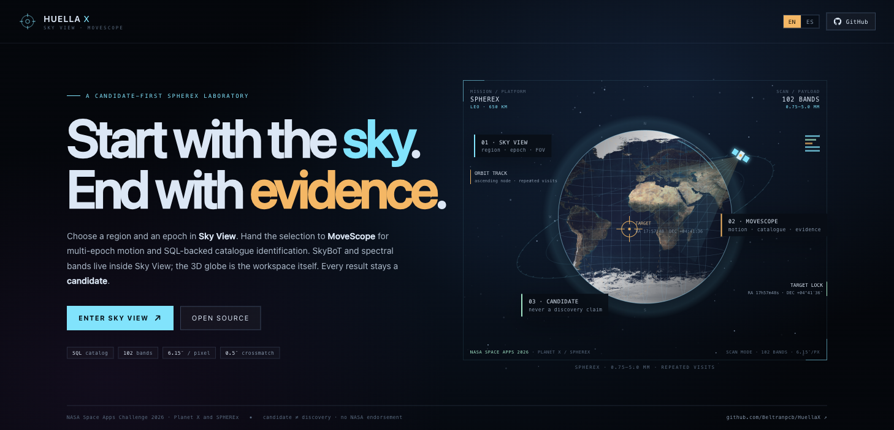
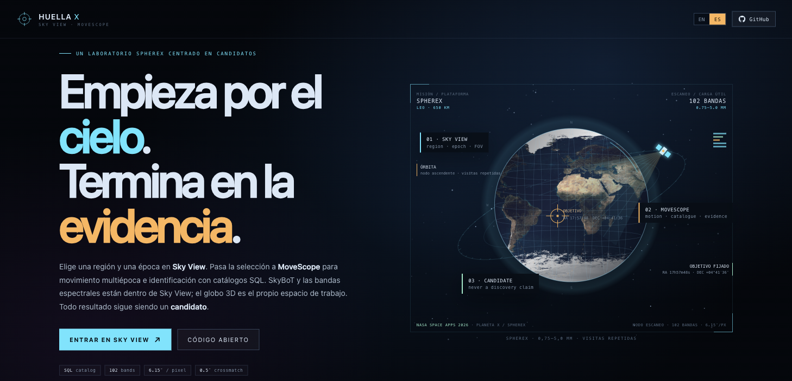
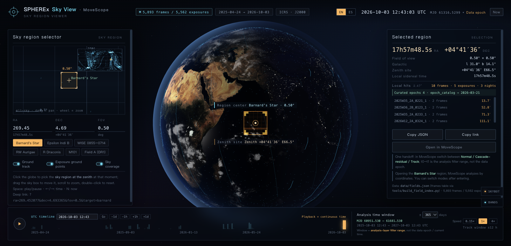
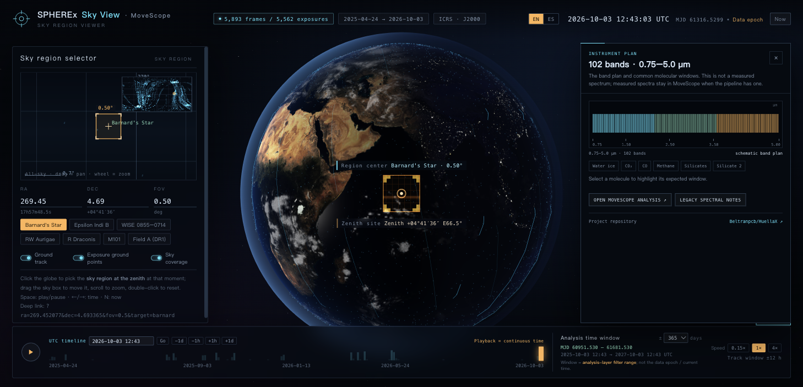
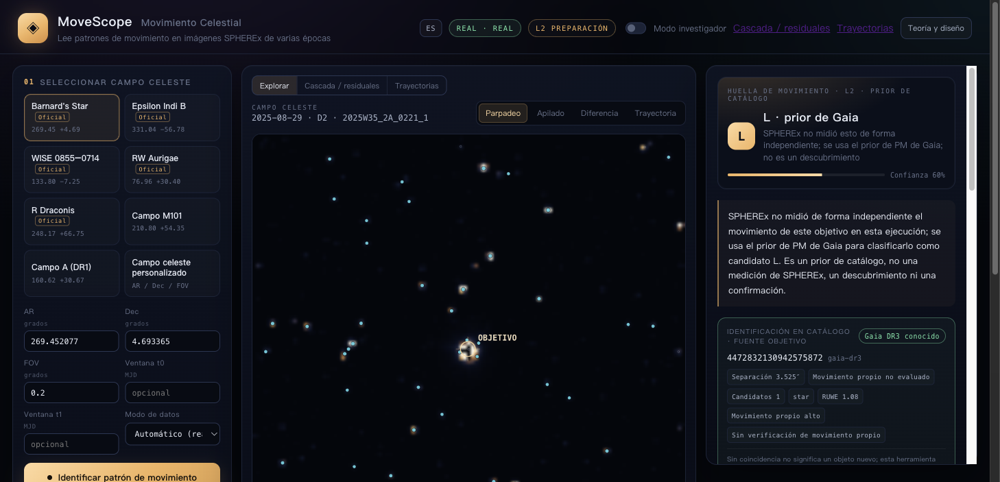

# HuellaX

**English** | [Español](README.es.md)

> **Start with the sky. End with evidence.**
> A candidate-first SPHEREx laboratory: choose a region in Sky View, hand it to
> MoveScope, then inspect catalogue and spectral context. The 3D globe is the workspace itself.

[](LICENSE)
[](#data-and-provenance)
[](#scientific-boundaries)



---

## 1. What HuellaX is

HuellaX is an open, local-first analysis environment for **SPHEREx** images.
It is built around one rule:

> **A candidate is not a discovery.** A catalogue non-match is `no_match`, not a
> new planet. Two epochs do not establish a new object.

The project combines:

- **MoveScope** — multi-epoch SPHEREx cutouts, common-WCS photometry, motion and
  variability modelling, catalogue identification, batch identification, tracks
  and audit exports.
- **Sky View** — the main entry into the data: a 3D sky/globe, region and epoch
  selection, an analysis time window, and one explicit handoff to MoveScope.
- **Evidence modules inside Sky View** — SkyBoT and an instrument band atlas.
  Each has a clearly stated evidential boundary; the 3D globe is the workspace itself.
- **AstroNova / HUELLA X** — the NASA Space Apps Challenge 2026 prototype,
  preserved under `astro/` as a legacy reference, never as the primary data path.

The public envelope of this repository is English/Spanish and contains no
Chinese text. The primary runtime and its SQLite data live in the `system/`
submodule.

**Repository:** <https://github.com/Beltranpcb/HuellaX>

---

## 2. The experience

```text
Entry page
   │  Enter Sky View
   ▼
Sky View ── select region + epoch + analysis window
   │  one handoff: ra, dec, fov, t0, t1, from=view
   ▼
MoveScope ── SQL epochs, motion/variability, catalogue identity
   │
   ├── Normal / Cascade-residual / Track modes
   ├── A/C source batch identification
   ├── unified candidate directory
   └── CSV/JSON audit exports

Inside Sky View:
   ├── SkyBoT    known solar-system objects (external ephemerides)
   ├── Bands     102-band instrument plan + molecular windows
```

### Entry page

The entry page is intentionally light: it introduces the evidence chain and
gives one primary action, **Enter Sky View**. The GitHub repository is linked in
the header, next to the primary action and in the footer.



### Sky View — the main workspace



Sky View is where the user chooses:

- RA / Dec / field of view;
- observation epoch and UTC timeline;
- analysis window (`t0`–`t1`);
- target presets or a custom region.

The handoff is one click and one URL. There is no second analysis entry point.


---

## 3. Evidence modules

The modules are not decorative cards. They are designed around what the project
can actually support today.

### SkyBoT — known solar-system objects


- Uses the current Sky View RA/Dec/MJD.
- Builds a real IMCCE SkyBoT cone-search request.
- Shows an external **no known object** result rather than inventing a match.
- Provides a direct external link when the browser cannot read the response.
- A non-match is not a discovery.

### Bands — instrument plan, not a measured spectrum



- 102 SPHEREx bands across 0.75–5.0 µm.
- Common molecular windows: water ice, CO₂, CO, methane, silicates.
- Hover/select interaction is schematic but based on the real band plan.
- The panel explicitly says: **not a measured spectrum**.
- Measured spectra remain in MoveScope when the pipeline actually has one.

---

## 4. MoveScope


MoveScope is the analysis destination. A run reports:

- data mode (`REAL`, `HYBRID`, `SAMPLE`, `SIM` where applicable);
- number of usable epochs and baseline;
- motion fingerprint / variability evidence;
- a motion class with confidence and falsifiers;
- catalogue identity status: `known`, `ambiguous`, `no_match`, `insufficient`,
  `unavailable` or `conflict`;
- readiness level L0–L3 and the limits of the data.



The UI can switch between **Normal**, **Cascade / residuals** and **Tracks**
without leaving the same analysis canvas. A/C sources can be identified in
batch, merged into a unified candidate directory, and exported as CSV or JSON.

---

## 5. Architecture

```text
HuellaX envelope
├── index.html                  bilingual entry page
├── README.md / README.es.md
├── INTEGRATION.md              integration boundaries and upstream mapping
├── start.sh / stop.sh          wrappers around the primary core launcher
├── scripts/                    cover server and checks
├── docs/screenshots/           README images
├── astro/                      AstroNova legacy (Spanish UI, synthetic demo)
└── system/                     git submodule: primary MoveScope runtime
    ├── app/                    MoveScope API + browser UI + tests
    ├── database/               SQLite catalog and catalogue service B
    ├── anyfield/               arbitrary-field coverage service C
    └── viewer/                 Sky View + evidence modules
```

### Services

| Service | Default port | Role |
|---|---:|---|
| DB API | 8797 | SQLite catalog, epochs, coverage, provenance |
| MoveScope app | 8790 | analysis, batch, cascade, tracks, exports |
| Sky View | 8830 | region/epoch selection and one handoff |
| Catalogue B | 8799 | Gaia + derived 2MASS/WISE SQLite service |
| AnyField C | 8798 | arbitrary-field coverage/discovery |
| Entry page | 8840 | static bilingual entry |

---

## 6. Data and provenance

**SQL is the primary data source.**

- `system/` contains the SQLite catalog and the separate Gaia/2MASS/WISE
  catalogue used by service B.
- The 2MASS/WISE tables are derived Gaia-crossmatch subsets, not complete
  all-sky catalogues.
- Identification uses a positional match with Gaia as primary and 0.5 arcsec
  de-duplication.
- Local JSON is an explicit offline fallback for preset targets; it is not a
  second source of truth.
- AstroNova’s static JSON/PNG under `astro/datos/` is legacy/demo and is not
  connected to the SQL path.

### Candidate vocabulary

| Status | Meaning |
|---|---|
| `known` | Catalogue association within the tested tolerance |
| `ambiguous` | More than one plausible association |
| `no_match` | No association in the tested set; **not** a new object |
| `insufficient` | Data cannot support the question |
| `unavailable` | Required service or catalogue unavailable |
| `conflict` | Sources disagree; do not force a conclusion |

---

## 7. Quick start

### Requirements

- Python 3.11+ with the dependencies used by the primary submodule
- Git with submodule support
- A WebGL2-capable browser for Sky View

### Clone

```bash
git clone --recurse-submodules https://github.com/Beltranpcb/HuellaX.git
cd HuellaX
```

If the submodule is missing:

```bash
git submodule update --init --recursive
```

### Start the core runtime

```bash
./start.sh
```

This starts the core SQL-first stack:

```text
DB 8797 · MoveScope 8790 · Sky View 8830
```

### Start the entry page

```bash
./scripts/serve_cover.sh
# http://127.0.0.1:8840/
```

### Optional evidence services

Catalogue B and AnyField C are optional in this public envelope. The primary
submodule contains their launchers and runbook:

- B on 8799 is needed for catalogue identification.
- C on 8798 is needed for arbitrary-field coverage/discovery.

Open:

- entry: <http://127.0.0.1:8840/>
- MoveScope: <http://127.0.0.1:8790/>
- Sky View: <http://127.0.0.1:8830/>

Stop:

```bash
./stop.sh
```

---

## 8. Main features

- Multi-epoch SPHEREx cutout retrieval and common-WCS photometry.
- Motion vs variability model family with BIC, uncertainty and readiness.
- Gaia DR3 plus derived 2MASS/WISE identification.
- A/C batch identification and unified candidate directory.
- Cascade/residual and tracklet views on the same analysis canvas.
- Arbitrary-field coverage/discovery.
- CSV/JSON audit exports with provenance.
- Sky View timeline, playback, time window and single MoveScope handoff.
- SkyBoT and band atlas modules.
- English-primary UI with a complete Spanish selector.

---

## 9. Validation

The project was exercised locally with the full integration:

| Check | Result |
|---|---|
| App suite | **298 tests OK** |
| Sky View smoke | **65 PASS / 0 FAIL / 0 WARN** |
| Public-envelope checks | **48 PASS** |
| Acceptance T1 | **45 PASS / 0 FAIL / 1 WARN** |
| Drift checker T6 | **0 ERROR** |
| Integrated launcher | **6/6 services healthy** |
| Candidate functional test | Barnard: `REAL`, 4 epochs, `L`, catalogue prior |

The evidence report is in [`docs/integration/FUNCTIONAL-TEST.md`](docs/integration/FUNCTIONAL-TEST.md).

---

## 10. Scientific boundaries

HuellaX deliberately avoids overclaiming:

- no “new planet” or “discovery” wording for candidates;
- no synthetic AstroNova demo presented as observation;
- no catalogue non-match presented as a new object;
- no synthetic spectral template presented as a measured composition;
- no fabricated successful TAP ingest when the upstream service is unavailable.

AstroNova’s synthetic demo is useful for interface and pipeline reference only.
Its real-data and Gaia validation was pending at merge time.

---

## 11. AstroNova legacy

`astro/` preserves the AstroNova / HUELLA X upstream:

- <https://github.com/Beltranpcb/AstroNova>
- commit `1253925ab13419b5d44db323548784c939a93a6e`
- NASA Space Apps Challenge 2026, Planet X and SPHEREx

At merge time the upstream had no LICENSE file. The owner confirmed that the
code may be included as open code. It is preserved with attribution and is **not
relicensed** under the Apache License 2.0 that covers the original MoveScope
work. See [`astro/LEGACY.md`](astro/LEGACY.md), [`astro/UPSTREAM.md`](astro/UPSTREAM.md)
and [`THIRD_PARTY_NOTICES.md`](THIRD_PARTY_NOTICES.md).

NASA does not endorse this project or any commercial product or service.

---

## 12. License and links

- Original MoveScope/HuellaX work: **Apache-2.0**, see [`LICENSE`](LICENSE).
- Third-party data/software: see [`THIRD_PARTY_NOTICES.md`](THIRD_PARTY_NOTICES.md).
- References: [`REFERENCES.md`](REFERENCES.md).
- Integration design: [`INTEGRATION.md`](INTEGRATION.md).
- Repository: <https://github.com/Beltranpcb/HuellaX>

**Candidate ≠ discovery.**
