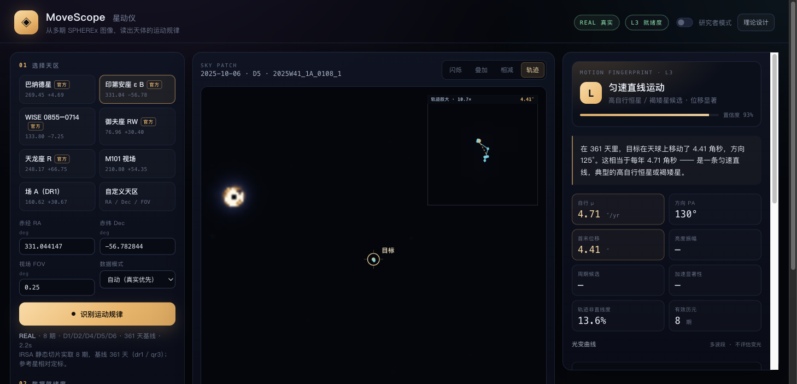

# HuellaX · MoveScope × AstroNova

**A merged, candidate-first SPHEREx motion laboratory.**

HuellaX combines **MoveScope**, our live multi-epoch SPHEREx image-analysis
system, with **AstroNova / HUELLA X**, the NASA Space Apps Challenge 2026
prototype preserved as a legacy static demo and offline pipeline. The live
system is under `系统/`; the upstream reference is under `astro/`.

**English** | [Español](README.es.md)

> Legacy language: [中文](README.zh-CN.md) is the historical MoveScope-only
> Chinese README. It is kept for continuity and is **not** the primary entry
> point for this merged repository.
>
> Bilingual cover page: [`index.html`](index.html) (English default, Spanish
> complete, `?lang=en|es`).

> **Data hierarchy — read this first.**
> **SQL is the primary data source**: the SQLite catalog and blob store on
> port `8797` own targets, epochs, coverage and cutout indexes. AstroNova's
> static JSON under `astro/` is **legacy/demo data**, useful as a UI and
> contract reference but never evidence for a scientific result.
>
> **Every result is a candidate, not a discovery.** This repository does not
> claim a new star, a new planet or a Planet X confirmation. The product
> carries an explicit `discovery_claim: false` boundary.



*Real data: Epsilon Indi B, eight SPHEREx epochs over a 361-day baseline. The
trajectory inset shows the measured 4.41″ displacement.*

---

## 1. What this repository is

| Layer | Path | Role |
|---|---|---|
| **Primary runtime** | `系统/` | MoveScope app, SQL catalog, catalog service B, coverage service C, optional 3D view |
| **Legacy upstream** | `astro/` | AstroNova/HUELLA X static site + offline Python pipeline, preserved at an analyzed upstream commit |
| **Control plane** | `项目主控/` | Launcher, acceptance reports, architecture decisions and reference analysis |
| **Integration docs** | root | `index.html`, this README, [`README.es.md`](README.es.md), [`INTEGRATION.md`](INTEGRATION.md) |

### Entry points

| Destination | URL | Notes |
|---|---|---|
| **MoveScope app** | <http://127.0.0.1:8790/> | Live analysis UI; start via the launcher |
| **Sky View** | <http://127.0.0.1:8830/> | Optional three.js sky/globe context |
| **Legacy AstroNova** | [`astro/modulos/m9_sitio/index.html`](astro/modulos/m9_sitio/index.html) | Static demo; needs generated synthetic demo data and an HTTP server |
| **GitHub — primary** | <https://github.com/tonyelos/huella-x-simu> | MoveScope source repository |
| **GitHub — integration target** | <https://github.com/Beltranpcb/HuellaX> | HuellaX integration repository |
| **Upstream AstroNova** | <https://github.com/Beltranpcb/AstroNova> | Original NASA Space Apps 2026 prototype |

### What this is not

- Not a discovery engine. “No catalog match” means “uncatalogued candidate”,
  never “new object”.
- Not a Planet X confirmation. Two-epoch or four-epoch associations cannot
  establish a new solar-system body.
- Not a claim that AstroNova's demo data is real. Its shipped fields are
  synthetic and are not used as validation evidence.
- Not a copy of AstroNova code. The upstream had no license at analysis time;
  it is included under the owner's permission and is not relicensed under our
  Apache-2.0. See [`astro/UPSTREAM.md`](astro/UPSTREAM.md) and
  [`INTEGRATION.md`](INTEGRATION.md).

---

## 2. What MoveScope does

MoveScope takes a sky position, retrieves several SPHEREx level-2 spectral
images, measures the position and flux of a target (and of the objects around
it), fits a physically motivated model family, and reports a **motion
fingerprint**, a classification, confidence, falsifiable evidence, and the
limits of what the data can support.

For a target it reports one of the following motion classes:

| Class | Meaning | Typical interpretation |
|---|---|---|
| **L** | Linear proper motion | Nearby star / brown dwarf with measurable μ |
| **V** | Variable | Position stable, flux changes (variable star, AGN) |
| **A** | Accelerating / curved | Solar-system object or binary-orbit candidate |
| **S** | Stationary | Background star / galaxy; gives a 3σ motion upper limit |
| **U** | Undetermined | Readiness or data quality is insufficient; no guess |

Each result includes:

- **readiness** L0–L3 (1 / 2 / 3–5 / ≥6 epochs with a ≥6-month baseline);
- **model selection** over M0 stationary, M1 variable, M2 linear proper
  motion, M3 parallax, M4 proper motion + acceleration;
- **evidence chain** and **falsifier**;
- **provenance** REAL / HYBRID / SIM / SAMPLE; simulated data is never
  presented as real;
- an explicit `discovery_claim: false` boundary.

The tool deliberately speaks in terms of candidates and evidence. “No catalog
match” means “uncatalogued candidate”, never “new star” or “new planet”.

> Design comes before code. Read the theory note first:
> [`系统/docs/01_理论设计编排.md`](系统/docs/01_理论设计编排.md).
> Implementation details, measured values, and known discrepancies are in
> [`系统/docs/02_实现与实测记录.md`](系统/docs/02_实现与实测记录.md).

---

## 3. Current status

The app-side test suite currently has **298 tests**:

```bash
PY=/Users/yiao/.dsh/dsh-runtimes/dsh-primary-runtime/dependencies/python/bin/python3
cd 系统/app
$PY -m unittest discover -s tests
# Ran 298 tests ... OK
```

Recent capabilities:

- main-canvas modes: **Browse / Cascade-residual / Tracks**;
- `t0/t1` time-window filtering for analysis and layer products;
- A-source and C-source batch catalog identification;
- CSV/JSON audit export, including candidate-expanded CSV;
- Gaia + 2MASS + WISE multi-catalog batch consumption with 0.5″ position
  deduplication;
- catalog-prior motion annotation (Barnard-like short-baseline case);
- a unified A + C + Tracks audit directory;
- A/C/Track candidate inspection without writing to the catalog database.

The five official benchmark targets in the current cache resolve to:

| Target | Expected | App result | Notes |
|---|---|---|---|
| Barnard's Star | L | **L (catalog prior)** | SPHEREx did not independently measure the motion; Gaia PM prior used |
| Epsilon Indi B | L + O | **L**, identity ambiguous | RUWE high; no forced single-catalog identity |
| WISE 0855 | L | **U** | data-limited; no forced L |
| RW Aurigae | V | **V** | flux variability, position stable |
| R Draconis | V | **V** | flux variability, position stable |

Result: **4 PASS + 1 DATA_LIMITED**. The benchmark is deliberately allowed to
fail or be data-limited; the tool does not tune labels to the expected answer.

---

## 4. Quick start

### Prerequisites

- Python 3.12 with NumPy and Pillow (the bundled runtime works out of the box);
- a browser with Canvas support;
- for the optional WebGL view: WebGL2;
- ports are local-only by default.

### One command (DB + app + view)

```bash
cd /path/to/HuellaX          # repository root
项目主控/启动/start_all.sh
# open http://127.0.0.1:8790/
```

The launcher starts **DB → app → view**, performs health checks, and refuses
to silently replace services that are already running. It does **not** start
the optional catalog service B (`8799`) or coverage service C (`8798`); start
those separately when needed. See
[`项目主控/启动/README.md`](项目主控/启动/README.md).

On a fresh checkout without `系统/数据库工具/var/catalog.sqlite`, initialize
the SQL catalog first; the launcher stops with an explicit error instead of
creating an empty database. See
[`系统/数据库工具/README.md`](系统/数据库工具/README.md) §2.

### Manual start

```bash
PY=/Users/yiao/.dsh/dsh-runtimes/dsh-primary-runtime/dependencies/python/bin/python3

# 1) main app
$PY 系统/app/server.py --port 8790

# 2) SQL catalog + blob data service
cd 系统/数据库工具
$PY cli.py serve --port 8797
```

Optional companion services:

```bash
# B: catalog / identification service (8799)
cd 系统/数据库工具
$PY tools/import_gaia.py --rebuild --offline   # offline fixture/bootstrap
$PY catalog_server.py --port 8799

# C: local coverage / discovery / fetch service (8798)
cd 系统/anyfield
./start.sh 8798

# View: three.js sky/earth picker (8830)
cd 系统/视图工具
./start.sh 8830
```

The main page is <http://127.0.0.1:8790/>. If B or C is not running, the app
degrades explicitly; it does not invent catalog or coverage results.

### Ports

| Service | Port | Started by `start_all.sh` | Data owned |
|---|---:|---|---|
| MoveScope app | **8790** | yes | Analysis results, evidence, readiness |
| SQL catalog API | **8797** | yes | Targets, epochs, coverage, frames, cutouts, blobs |
| Sky View | **8830** | yes | Sky context only |
| Catalog service B | **8799** | optional | Gaia field cache, 2MASS/WISE crossmatches |
| Coverage service C | **8798** | optional | Header footprints, sidecar, fetch jobs |
| Cover / legacy static | any static port | no | Generated demo data |

Production defaults never change silently. For isolated launch-path tests, the
launcher accepts explicit sandbox ports; see its README.

### Landing page and the legacy demo

The bilingual cover is plain HTML/CSS/JS and needs no build. Serve the
repository root over HTTP (the legacy site uses `fetch` and will not work from
`file://`):

```bash
cd /path/to/HuellaX          # repository root
python3 -m http.server 8840
# cover:  http://127.0.0.1:8840/index.html
# legacy: http://127.0.0.1:8840/astro/modulos/m9_sitio/index.html
```

The legacy static site reads `astro/datos/m7_publicacion/`, which is
gitignored. Generate its **synthetic** demonstration fields first:

```bash
cd astro
python3 modulos/m9_sitio/ejemplos/generar_datos.py
```

This writes demo JSON/PNGs for the `slipher`, `atlas` and `luhman` fields. They
are synthetic, clearly labelled, and must not be presented as observations.

### Basic URLs

```text
http://127.0.0.1:8790/                                      # Browse mode
http://127.0.0.1:8790/?target=barnard                      # preset
http://127.0.0.1:8790/?ra=269.452077&dec=4.693365&fov=0.2  # custom coordinates
http://127.0.0.1:8790/?target=barnard&mode=cascade          # main canvas overlay
http://127.0.0.1:8790/?target=barnard&mode=tracks
http://127.0.0.1:8790/?ra=269.452077&dec=4.693365&fov=0.5&t0=60890&t1=60950&from=view
```

`mode` is the canvas mode (`browse`, `cascade`, `tracks`), not the data mode.
The data mode is selected in the left panel (`auto`, `real`, `synthetic`,
`sample`). `/cascade` and `/tracks` remain available as detailed diagnostic
tables; the main page does not redirect to them when switching modes.

---

## 5. Architecture

```text
                         ┌─────────────────────────────┐
                         │ View  (optional, 8830)      │
                         │ sky picker / earth context  │
                         │ ra / dec / fov / t0 / t1    │
                         └──────────────┬──────────────┘
                                        │ one handoff URL
                                        ▼
┌──────────────────────────────────────────────────────────────────┐
│ MoveScope app (8790)                                             │
│                                                                  │
│  Browser UI (no build step)                                      │
│    Browse  ── analysis, source picking, lock, identify           │
│    Cascade ── L1 / masked / residual overlay                     │
│    Tracks  ── tracklet lines/nodes and D0–D4 levels              │
│                                                                  │
│  /api/analyze   → build_dataset → pipeline → result              │
│  /api/cascade   → per-epoch L1 / mask / residual                  │
│  /api/tracks    → tracklets → D0–D4                              │
│  /api/identify  → B catalog match (single source)                │
│  /api/identify/batch → B batch match (A/C sources)               │
│  /api/identify/batch/export → CSV/JSON attachment                 │
└───────────────┬───────────────────────┬──────────────────────────┘
                │                       │
                ▼                       ▼
┌───────────────────────────┐   ┌──────────────────────────────────┐
│ SQL catalog (8797)        │   │ B catalog service (8799)         │
│ SQLite metadata + Blob    │   │ Gaia DR3 + field-level 2MASS/WISE │
│ epoch/coverage index      │   │ single/batch match, optional TAP  │
│ **primary data source**   │   └──────────────────────────────────┘
└───────────────┬───────────┘
                │ optional coverage / discovery
                ▼
┌───────────────────────────┐
│ C coverage service (8798) │
│ header footprints,        │
│ discovery, S3/IRSA fetch  │
└───────────────────────────┘
```

The main app has no build step: static `web/` assets are served directly.
The analysis pipeline is pure Python + NumPy + Pillow; no Astropy/SciPy/FastAPI
is required for the core path.

### 5.1 SQL data flow

```text
IRSA / S3 weekly products
        │
        ▼
系统/数据库工具/  (ingest, harvest, import)
        │  releases · weeks · observations · frames · targets
        │  target_epochs · cutouts · blobs · fields_snapshot · ingest_runs
        ▼
var/catalog.sqlite  +  var/blobs/          ← single epoch/coverage truth
        │
        │  GET /api/v1/epochs?ra&dec&fov
        │  GET /api/v1/coverage?ra&dec
        ▼
MoveScope app (8790)
  build_dataset → fetch slices → photometry → association
  → M0–M4 + BIC → readiness → evidence / falsifier / provenance
        │
        ▼
UI · /api/analyze · audit CSV/JSON
```

Key properties:

- SQL owns **what was observed**: target coordinates, frames, exposure
  metadata, curated target epochs, cutout indexes, coverage and provenance.
- MoveScope owns **what it means**: photometry, relative astrometric
  calibration, association, model selection, readiness and public wording.
- B owns **identity candidates** from Gaia/2MASS/WISE. It does not perform
  science classification and never upgrades a match to a discovery.
- C owns **coverage and discovery of arbitrary fields**, and writes only its
  own sidecar. A failed fetch is reported as unavailable, not as “no coverage”.
- Exports are materialized views, not a second truth. `check_compat.py`
  reconciles the JSON exports with the app/view consumers.

For preset targets, MoveScope can run from local `epoch_catalog.json` to keep
the demo offline-capable. That fallback is explicit. For arbitrary
coordinates, the app resolves real epochs through the DB v1 contract; zero
local epochs produce an explicit SIM/unavailable state, never a fabricated
real measurement. The environment variable is `SPHEREX_DB_URL` (default
`http://127.0.0.1:8797`).

### 5.2 Analysis pipeline

```text
FITS / level-2 image
  → background + FLAGS mask + noise model
  → matched-filter detection
  → PSF / bloom centroid + aperture photometry
  → reference-star relative astrometric calibration
  → associate source positions across epochs
  → fit M0/M1/M2/M3/M4 model family
  → BIC model choice + 3σ / readiness gates
  → result, evidence, falsifier, provenance
```

Key implementation modules:

- `系统/app/core/photometry.py` — mask, matched filter, centroid, photometry;
- `系统/app/core/motion.py` — model family, BIC, motion fingerprint;
- `系统/app/core/pipeline.py` — detection → calibration → association → inference;
- `系统/app/core/epoch_source.py` — DB v1 resolver, coverage and explicit fallback;
- `系统/app/core/catalog.py` — B catalog client, status mapping, multi-catalog
  position deduplication, optional ingest;
- `系统/app/core/catalog_prior.py` — generic Gaia-PM prior for an
  under-significant short-baseline S result;
- `系统/app/core/tracks.py` — cross-epoch tracklets and D0–D4 candidate levels.

### 5.3 Time window

`/api/analyze`, `/api/cascade`, and `/api/tracks` accept `t0` / `t1`
(also `mjd_min` / `mjd_max`). The filter is applied after
`data_layer.build_dataset`:

- 0 epochs → HTTP 200 with an explicit empty-window result, never a fabricated
  measurement;
- 1 epoch → normal single-epoch result; tracks are marked `insufficient`;
- no `t0/t1` → old behavior unchanged.

The response includes `time_filter: {t0,t1,requested,kept,filtered}` and the UI
shows “from view / time window / kept N of M”.

---

## 6. Main interface modes

### Browse

The original behavior: multi-epoch blinking, stack, difference, target
trajectory, A-source table, lock/identify, readiness and model evidence.

### Cascade / residual

For each epoch:

- **L1**: 6σ detection, at most 80 objects per epoch;
- **masked**: the L1 positions, 2 px mask, reason `already_detected`;
- **residual**: 5σ re-detection after local-median masking, at most 80
  candidates per epoch, excluding duplicates within 2 px of L1.

The main canvas overlays L1 as solid cyan dots, masked as grey crosses, and
residuals as hollow amber circles. Layer toggles and per-frame counts are
available. Clicking a residual node locks it and calls `/api/identify`; it does
not re-run the whole analysis. Residual candidates are explicitly **not new
objects**.

Detailed diagnostic page: [`/cascade`](系统/app/web/cascade.html).

### Tracks

L1 + residual nodes are associated across epochs (greedy nearest-neighbor,
3 px gate, one-epoch gap allowed, no node reuse). Track models are
`stationary / linear / curved / variable / transient`, and candidate levels are:

- D0 artifact;
- D1 known catalog;
- D2 not implemented;
- D3 unknown moving;
- D4 unknown stationary;
- D5 out of scope (manual/follow-up).

The main canvas draws track lines and nodes; clicking a node jumps to its epoch
and invokes `/api/identify`. Track candidates are **not new objects**; four
epochs make the association inherently ambiguous and every track carries that
caveat.

Detailed diagnostic page: [`/tracks`](系统/app/web/tracks.html).

### A / C batch identification

- A table: analysis `sources`, paginated/batched at 200 per request;
- C table: `/api/sources` rows, batched at 200 per request;
- each source is sent to `/api/identify/batch`;
- statuses: known / ambiguous / no_match (`uncatalogued_candidate`) /
  insufficient / catalog unavailable / unknown;
- the A and C batch notes show counts and the requested catalogs;
- batch results are audit-exportable without changing the table.

### Unified candidate directory

A + C + Tracks are merged into one read-only audit table:

- A/C rows are deduplicated by `(mjd, round(ra,6), round(dec,6))`;
- same-position A/C rows merge `origins` into `A;C`;
- conflicting identities become `conflict`, never silently resolved;
- one track is one row; track nodes are **not** counted as new sources;
- counts: rows / unique_sources / tracks / known / ambiguous / no_match /
  insufficient / unknown / conflict;
- CSV and JSON export; UI shows the first 80 rows and counts over the full set.

---

## 7. Catalog identification and multi-catalog rules

### Status vocabulary

| Status | Meaning |
|---|---|
| `known_star` | A single catalog candidate with acceptable astrometric quality |
| `ambiguous` | Multiple physical candidates, or a quality/RUWE/PM conflict |
| `uncatalogued_candidate` | Catalog query succeeded with zero candidates; **not** “new object” |
| `insufficient_data` | Not enough information; e.g. a single candidate farther than 6.15″ |
| `catalog_unavailable` | Catalog service/coverage unavailable; **not** “no match” |

A single candidate farther than **6.15″** (one SPHEREx pixel) from the target is
rejected as an accidental alignment and returned as `insufficient_data` with
reason `CATALOG_OFFSET_TOO_LARGE`.

### Catalog-prior motion

For a short-baseline `class="S"` result, the app may apply a generic catalog
prior when:

- there is a single/ambiguous Gaia PM;
- the catalog PM is significant and > 1000 mas/yr;
- the measured and catalog PM agree within 3σ.

Then the class becomes `L` with:

- `catalog_motion.basis = "catalog_prior"`;
- `quality += CATALOG_PRIOR_MOTION, MEASUREMENT_NOT_SIGNIFICANT`;
- confidence ≤ 0.6;
- explicit text: “SPHEREx did not independently measure it; Gaia PM prior
  used; not a discovery”.

The measured μ, its error, `moving=false`, and the original significance are
preserved. The prior is never written as a measured proper motion.

### Multi-catalog batch

A/C batch requests use:

```json
{"catalogs": ["gaia", "2mass", "wise"]}
```

2MASS/WISE have **actual IRSA Gator field caches for the 7 preset fields**
(2MASS 8,674; WISE 23,774), plus legacy derived releases. They are not global
surveys; queries outside the 7 fields remain unavailable. The client:

- groups candidates from different catalogs within **2.0″**;
- prefers Gaia as the primary candidate, then 2MASS, then WISE;
- keeps other-catalog rows under `crossmatches`;
- does not merge two different positions; two physical groups remain
  ambiguous;
- does not treat multiple catalog rows for one physical source as multiple
  sources.

B failure remains `catalog_unavailable`; old B versions can fall back to Gaia
with an explicit `catalog_fallback="gaia"` marker.

---

## 8. API overview

| Method | Path | Purpose |
|---|---|---|
| `POST` | `/api/analyze` | full motion analysis; accepts target/ra/dec/fov/mode/t0/t1 |
| `GET` | `/api/targets` | preset targets |
| `GET` | `/api/health` | app health |
| `GET` | `/api/sources` | C source-list proxy |
| `GET` | `/api/field` | C coverage handshake |
| `GET` | `/api/cascade` | per-epoch L1 / masked / residual |
| `GET` | `/api/tracks` | cross-epoch tracklets and D0–D4 |
| `POST` | `/api/identify` | single-source catalog identification |
| `POST` | `/api/identify/batch` | batch catalog identification (≤200 sources) |
| `POST` | `/api/identify/batch/export` | CSV/JSON audit attachment |

Examples:

```bash
curl -X POST http://127.0.0.1:8790/api/analyze \
  -H 'Content-Type: application/json' \
  -d '{"target_id":"barnard","fov":0.2,"mode":"auto"}'

curl 'http://127.0.0.1:8790/api/cascade?target_id=barnard&fov=0.2'
curl 'http://127.0.0.1:8790/api/tracks?target_id=barnard&fov=0.2'

curl -X POST http://127.0.0.1:8790/api/identify \
  -H 'Content-Type: application/json' \
  -d '{"ra":269.452077,"dec":4.693365,"mjd":60916.656,"sigma_arcsec":0.5}'
```

Batch endpoints are explicitly capped at 200 sources per request. The export
endpoint chunks A-sized inputs (215 → 200 + 15) and returns a CSV/JSON
attachment; JSON contains `sources`, `results`, and `byId`, and CSV expands
physical candidates into candidate rows.

Catalog auto-ingest is **off by default**:

```bash
export CATALOG_AUTO_INGEST=1
export MOVESCOPE_CATALOG_INGEST_TIMEOUT=60
```

When enabled, a partial/no-cached-field match may call B
`POST /api/v1/catalog/ingest` once and retry once. Ingest writes are B-side;
the app does not write the production DB. TAP availability remains an upstream
dependency.

SQL catalog endpoints used by the runtime:

```text
GET http://127.0.0.1:8797/api/v1/health
GET http://127.0.0.1:8797/api/v1/epochs?ra=...&dec=...&fov=...
GET http://127.0.0.1:8797/api/v1/coverage?ra=...&dec=...
GET http://127.0.0.1:8797/api/v1/targets
```

---

## 9. Data modes

| Mode | Source | Purpose | Badge |
|---|---|---|---|
| REAL | Multi-epoch SPHEREx level-2 cutouts from IRSA/static cache | Real observations | green |
| HYBRID | Real single-epoch background/PSF/noise + injected target | When real epochs are insufficient | amber |
| SIM | Synthetic time series from real PSF/background/noise | Algorithm validation / teaching | blue |
| SAMPLE | Two bundled offline cutouts from different fields | Parsing/rendering only | grey |

The data path does not require TAP/SIA/DataLink for the known preset fields:
it uses the S3 weekly pointing index, HTTP Range headers, and static cutouts.
Arbitrary-coordinate coverage still depends on the local DB/C index and is
reported as `NO_LOCAL_COVERAGE` or `DB_UNAVAILABLE` when absent.

---

## 10. Validation and tests

### App tests

```bash
PY=/Users/yiao/.dsh/dsh-runtimes/dsh-primary-runtime/dependencies/python/bin/python3
cd 系统/app
$PY -m unittest discover -s tests -v
# Ran 298 tests ... OK
```

Coverage includes: sample/real modes, FOV validation, caching and LRU,
target-coordinate conflicts, schema contracts, catalog status mapping,
catalog-prior motion, time filters, main-canvas modes, cascade layers,
tracklets, A/C batch identification, candidates/export, and unified-directory
deduplication.

### SQL catalog tests

```bash
cd 系统/数据库工具
$PY -m unittest discover -s tests -v
```

The catalog project keeps its own contract tests and compatibility checks:

```bash
$PY tools/check_compat.py --root ..
```

### Benchmark and validation reports

- [`项目主控/验收/官方案例基准_report.md`](项目主控/验收/官方案例基准_report.md)
- [`项目主控/验收/官方案例基准_fullcache.md`](项目主控/验收/官方案例基准_fullcache.md)
- [`项目主控/验收/星表识别覆盖率.md`](项目主控/验收/星表识别覆盖率.md)
- [`项目主控/验收/GUI链路测试.md`](项目主控/验收/GUI链路测试.md)
- [`系统/docs/validation_report.json`](系统/docs/validation_report.json)
- [`系统/docs/motion_vs_variability.json`](系统/docs/motion_vs_variability.json)

Representative validation results:

- injection-recovery: 5 official targets × 8 random seeds = 40/40 correct;
- counterexamples: RW Aur and R Dra classified V across seeds; position slope
  compatible with zero;
- Epsilon Indi B: 8 real epochs, 361-day baseline, μ ≈ 4.71 ± 0.55″/yr,
  PA ≈ 129.6° (SIMBAD values are close);
- Barnard: short-baseline SPHEREx μ is not significant; reported as L with an
  explicit Gaia-PM prior, not as a measured SPHEREx detection;
- WISE 0855: data-limited U; no forced classification.

A/C batch and directory counts are data-dependent and are printed by the UI;
the E2E log in `系统/docs/02_实现与实测记录.md` is the authoritative record for
the current cache.

### Static integration checks

The cover/docs integration adds a dependency-free checker:

```bash
python3 scripts/check_docs.py
```

It verifies UTF-8 decoding, local HTML/Markdown links, the README language
switch, the i18n key coverage in `index.html`, and basic required statements
(SQL primary, legacy demo, candidate-not-discovery). It does not build or run
the services.

---

## 11. Repository layout

```text
index.html                 bilingual cover (EN default / ES complete)
README.md                  this file (English primary)
README.es.md               complete Spanish README
README.zh-CN.md            legacy Chinese MoveScope README (historical)
INTEGRATION.md             AstroNova → HuellaX mapping, SQL flow, attribution
LICENSE / NOTICE           Apache-2.0 for original work
THIRD_PARTY_NOTICES.md     full third-party inventory
REFERENCES.md              short submission citation list
CITATION.cff               machine-readable citation metadata
scripts/check_docs.py      dependency-free static checks (links, UTF-8, i18n)

系统/
  app/                     main MoveScope app (server + core + web)
    server.py              HTTP API, static UI, image rendering
    core/                  FITS, WCS, photometry, motion, pipeline, catalog,
                           epoch_source, tracks, catalog prior, time utilities
    web/                   no-build browser UI and diagnostic pages
    tests/                 app unit/integration tests
  docs/
    01_理论设计编排.md       theory baseline (read first)
    02_实现与实测记录.md     implementation, measurements, discrepancies
    validation_report.json  injection-recovery
  anyfield/                C coverage/discovery/fetch service
  数据库工具/               SQL catalog + B catalog service
  视图工具/                 optional three.js sky/earth view
  tools/                   week-index/epoch search/validation utilities
  参考 资料/               third-party references and notes

astro/
  README.md                upstream AstroNova/HUELLA X README (Spanish)
  ARQUITECTURA.md          upstream architecture and module contracts
  UPSTREAM.md              upstream SHA, permission and scope boundary
  modulos/m1–m7, m9        offline pipeline + static site
  contratos/               JSON Schema contracts and examples

项目主控/
  架构/                    architecture and evolution notes
  验收/                    benchmark/acceptance reports
  启动/                    start/stop launcher
  参考/AstroNova-DEEP.md   upstream deep analysis (read-only)
  README.md                project-control notes
```

Key documents:

- [Theory design](系统/docs/01_理论设计编排.md)
- [Implementation & measured log](系统/docs/02_实现与实测记录.md)
- [Architecture contract](项目主控/02_架构设计与集成契约.md)
- [Launcher guide](项目主控/启动/README.md)
- [Mode refactor plan](项目主控/架构/14_模式化重构计划.md)
- [Catalog ingest plan](项目主控/架构/17_数据接收接口与自动缓存.md)
- [Batch identification plan](项目主控/架构/18_批量星表识别.md)
- [Audit/export plan](项目主控/架构/20_批量结果审计导出.md)
- [Unified candidate directory plan](项目主控/架构/22_统一候选目录.md)
- [AstroNova deep analysis](项目主控/参考/AstroNova-DEEP.md)
- [Integration map](INTEGRATION.md)

---

## 12. Configuration and environment

| Variable | Default | Purpose |
|---|---|---|
| `SPHEREX_DB_URL` | `http://127.0.0.1:8797` | SQL catalog v1 endpoint override |
| `CATALOG_URL` / `MOVESCOPE_CATALOG_URL` | `http://127.0.0.1:8799` | B catalog base URL |
| `MOVESCOPE_CATALOG_TIMEOUT` | `2.5` s | B match timeout |
| `CATALOG_AUTO_INGEST` | off | Allow one ingest+retry on partial/no-cached-field |
| `MOVESCOPE_CATALOG_INGEST_TIMEOUT` | `60` s | B ingest timeout |
| `ANYFIELD_URL` | `http://127.0.0.1:8798` | C coverage base URL |
| `ANYFIELD_TIMEOUT` | `1.5` s | C coverage timeout |

The app never silently switches to a different port, and the launcher refuses
to replace a live service with a mismatched PID.

---

## 13. Limitations and responsible use

1. **Not a discovery.** Every catalog status and every track is a candidate.
   `discovery_claim` is false; no “new planet/star” claim is made.
2. **Pixel scale.** SPHEREx is about 6.15″/pixel. Motion below ~0.5″/yr cannot
   be measured reliably in a short baseline; background stars and galaxies are
   often `S` with an upper limit.
3. **Saturation.** Barnard's Star is saturated in some SPHEREx data; bloom
   centroid errors are large and explicitly flagged (`SATURATED_SOURCE`).
4. **Catalog coverage.** B has 7 preset fields only; 2MASS/WISE are actual
   IRSA Gator field caches for those fields, not global surveys. Legacy derived
   releases are retained but marked derived. `partial` and
   `catalog_unavailable` are not “not found”.
5. **4-epoch ambiguity.** Cross-epoch association with only four epochs is
   underdetermined; D0–D4 are candidates, not confirmation.
6. **Residuals.** Cascade residuals can contain PSF wings, edge artifacts, and
   noise. A residual is not a new astrophysical source.
7. **TAP.** Real TAP ingest has been blocked by upstream timeouts in this
   environment. Auto-ingest is off by default; simulated TAP success is never
   reported as real.
8. **No full-sky service.** The local catalog cache covers a small set of
   preset fields; arbitrary fields require an explicit DB/C ingest path.
9. **Legacy data is not evidence.** AstroNova's demo fields are synthetic; its
   two-epoch associations and synthetic spectral templates are not validation
   of any HuellaX result.

---

## 14. AstroNova legacy upstream

`astro/` preserves the upstream AstroNova / HUELLA X project as a functional
reference, not as the primary runtime.

| Item | Value |
|---|---|
| Repository | <https://github.com/Beltranpcb/AstroNova> |
| Analyzed commit | `1253925ab13419b5d44db323548784c939a93a6e` |
| Event | NASA Space Apps Challenge 2026 — Planet X and SPHEREx |
| Upstream status at analysis | Static web + offline Python pipeline; three synthetic demo fields; real-data validation pending |
| Original license | None found in the analyzed repository |
| Inclusion | Owner confirmed the code may be included in HuellaX as open code |
| Our license treatment | **Not** relicensed under Apache-2.0; attribution preserved; see `astro/UPSTREAM.md` |

What we keep:

- the upstream source tree under `astro/`, including its Spanish README,
  architecture document, module docs, JSON Schema contracts and examples;
- the original repository path, commit SHA and NASA Space Apps 2026 event note;
- the static site as a working legacy demo;
- a clear statement that its demo data is synthetic.

What we do **not** do:

- copy AstroNova source into the `系统/` runtime;
- use its demo data as scientific evidence;
- present its two-epoch associations or synthetic spectral types as
  confirmation;
- remove the upstream attribution when adapting the legacy UI.

See [`INTEGRATION.md`](INTEGRATION.md) for the module-by-module mapping and the
explicit list of borrowed ideas versus rejected mechanisms.

---

## 15. Citations and acknowledgements

If you use this repository, please cite the repository and the original data
papers. The full source/license inventory is in
[`THIRD_PARTY_NOTICES.md`](THIRD_PARTY_NOTICES.md) and the short submission list
is in [`REFERENCES.md`](REFERENCES.md); machine-readable metadata is in
[`CITATION.cff`](CITATION.cff).

### Mission data

- **SPHEREx level-2 spectral images (QR3/DR1)**, NASA/IPAC Infrared Science
  Archive (IRSA), <https://irsa.ipac.caltech.edu/Missions/spherex.html>.
  SPHEREx is a NASA mission; see NASA mission pages and the IRSA data
  documentation for current release/version details.
- **NASA Space Apps Challenge 2026 — Planet X and SPHEREx**,
  <https://www.spaceappschallenge.org/2026/challenges/planet-x-and-spherex/>.

### Catalogs and name resolution

- **Gaia DR3**: Gaia Collaboration et al. (2023), *A&A* 674, A1,
  <https://doi.org/10.1051/0004-6361/202243940>.
- **2MASS**: Skrutskie et al. (2006), *AJ* 131, 1163,
  <https://doi.org/10.1086/498708>.
- **WISE / AllWISE**: Wright et al. (2010), *AJ* 140, 1868,
  <https://doi.org/10.1088/0004-6256/140/6/1868>; Cutri et al. (2021),
  AllWISE Source Catalog, VizieR II/328.
- **SIMBAD**: Wenger et al. (2000), *A&AS* 143, 9,
  <https://doi.org/10.1051/aas:2000332>.
- 2MASS/WISE derived fields in B use IRSA Gator cross-matches to Gaia IDs;
  coordinates/PM remain Gaia-based and are not a replacement for the original
  survey astrometry.

### Software and assets

- **three.js r160** (MIT), <https://threejs.org/>; license text in
  `系统/视图工具/vendor/three.LICENSE`. The optional 3D view uses three.js
  example patterns (rewritten, not wholesale copied).
- **Earth textures**: NASA Visible Earth / Blue Marble,
  <https://visibleearth.nasa.gov/collection/1484/blue-marble>; distributed via
  the three.js examples with MIT/NASA media terms.
- **Runtime**: Python 3.12 (PSF-2.0), NumPy (BSD-3-Clause), Pillow (HPND).
- **AstroNova / HUELLA X** (upstream, analyzed commit above): included by
  owner permission for the HuellaX integration; original license not present.
- UI/interaction inspiration: WiseView (Backyard Worlds: Planet 9),
  <http://byw.tools/wiseview>; the project does not reuse its code/data.
- Contract/UI inspiration: AstroNova/HUELLA X; ideas only, no code copied.

### License

Original code, documentation, figures, and screenshots are licensed under the
**Apache License 2.0**; see [`LICENSE`](LICENSE) and [`NOTICE`](NOTICE).
Third-party material remains under its own license; see
[`THIRD_PARTY_NOTICES.md`](THIRD_PARTY_NOTICES.md) and
[`REFERENCES.md`](REFERENCES.md). NASA does not endorse this project.

---

## 16. Contributing and reproduction

- Keep changes reviewable and add tests for behavior changes.
- Do not write the production catalog DB from app tests.
- Do not turn partial/unavailable catalog states into “no match”.
- Do not add positive “new planet/new star” language to UI or exports.
- Keep AstroNova attribution and the upstream SHA in place.
- For validation, use the launcher and the current cached fields; record
  provenance and the exact test command.

A minimal reproduction:

```bash
PY=python3
cd 系统/app
$PY -m unittest discover -s tests
$PY server.py --port 8790
# open http://127.0.0.1:8790/
```

Welcome to open issues with reproducible coordinates, data provenance, and
expected/actual status.
